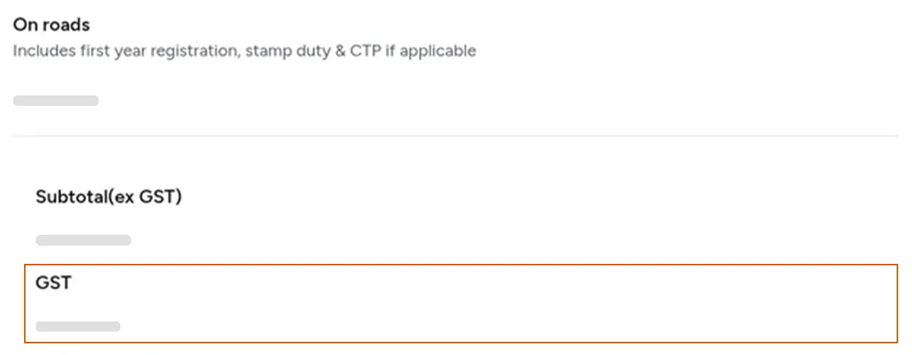

# Provider guidance: second big-picture review and action plans (2026-11-13)

> **What this is:** a follow-up to `PROVIDER_GUIDE_REVIEW_2026-11.md` (on `main`; 18 items). It
> checks the finished work on branch `codex/provider-guide-completion` (worktree
> `/Users/changyang1230/novated-lease-guide-provider-guide`, head `45ea09a0`, 93 commits ahead of
> `main`, not pushed or merged) against the design aims, lists what still falls short, and gives
> plans a smaller model can carry out one at a time.
>
> **How it was reviewed:** read `providerGuide.ts`, the provider parts of `GuidedMode.tsx`,
> `checks.ts`, `guided.css`, the four site sync scripts and all 27 articles (scripted scans plus
> Oly in full); walked Guided as Oly at phone width (500 px, dark) through the first-screen picker,
> Price and Lease steps, and at desktop width (1380 px) on the Price step.
> **Not checked:** light theme, the other 26 providers on screen, the Payment and Running steps on
> screen, Advanced mode, the rendered article pages, and the redactions.

## Working rules for the implementer

- Work only in the worktree above, on its branch. **Do not push, merge, deploy or touch `main`.**
- One item per commit. Append a short note to `PROVIDER_GUIDE_HANDOVER.md` after each. Keep the
  working tree clean.
- In `calculator2`: `npx tsc -b`, `npx vitest run` (350 tests pass at head), `npm run build`,
  and `npx eslint <changed files>`. In `new-site`: `npm run build` (the first build after an
  article edit prints Astro duplicate-id warnings; that is expected). Commit the rebuilt
  `docs/assets/calculator/main.js` and `style.css` with the change.
- Preview: a dev server already runs on port 4340 (`http://localhost:4340/calculator/`). Never use
  or stop ports 4321, 4329 or 5173.
- Copy rules (owner): readers have weak financial literacy. Short main text, nuance in ⓘ
  tooltips, no over-assertive claims. When a quote doesn't print something, ask
  ("Can't find it on your {provider} quote? …") rather than claim.
- **GST rule (owner):** never say a provider's payment is ex or inc GST. It varies by employer.
  Only "If you see '<label that prints GST>' …" is allowed. A test enforces this for pointers.
- No provider logos. No picker on the Price step. No "Not {provider}? Change" link (owner rejected
  both).
- `sync-provider-tables.mjs` leaves quote-specific rows and second tables hand-written on purpose.
  Do not replace them mechanically.
- Only redacted images go in `docs/assets/images/quote-guide/`. Look at every new or changed
  image before committing it.
- If a line number here doesn't match the code, trust the code, say so, and carry on.

## Scorecard against the design aims

| Aim | Verdict | What falls short |
|---|---|---|
| Picker is optional, on the first screen, never blocks | Met | Grammar slip "on a Oly quote" (R1). Readers who explore first and add a quote later never see it (owner accepted). |
| Guidance looks calm, not cluttered | Mostly met | Amber is used for lines that are no longer traps (R7). Each opened picture repeats its caption and the review date (R2). On phones the "typical quote" toggle is jammed under the step title (R3). On desktop the side picture is too small to read and the inline "Show me" duplicates it (R8). |
| Pictures agree with the words | Mostly met | Oly's drive-away crop marks "Recommended retail price" as the answer while the text says to use the dealer's price (R9). The desktop side panel ignores the "× 11" GST-credit picture (R8). |
| Wording suits weak financial literacy | Partly met | Several lines were squeezed to 140 characters and now read like telegrams (R6). |
| No over-assertive claims; GST rule | Partly met | Pointers comply. Three warning messages and three residual lines still assert things from one sample quote (R5). |
| Results stay accurate | Mostly met | Maxxia/Oly insurance fixed. Item 8 (Smart-branded Smartsalary) is parked by the owner. The "GST-reduced price" warning cannot fire for Oly and Lendly, and stacks on top of the generic error for the others (R4). |
| One source of truth | Partly met | About 70 article rows, the trap lists, review months and the index come from `providerGuide.ts`. Article intros, the "× 11" tip and the "not shown" lines do not (R10, R11). Four scripts parse the TypeScript file with regular expressions (R12). |
| Articles are useful pages in their own right | Mostly met | Titles, trap section, phone cards and index are done. Small defects: Oly's intro contradicts its review line; two broken italics; trap lines say "here" with nothing to point at (R10). |
| We can tell whether it helps | Not yet | Events exist, but nothing is live and no one has written down what to read or when (R14). |
| It can be kept up to date | Partly met | 15 of 27 providers rest on one quote. The freshness check is manual. LeasePlan's example is from Aug 2025 (R15). |
| Ready to ship | Not yet | 93 commits, 270 files, never seen by the owner on light theme or for most providers (R13). |

## Priority order

| # | Item | Size | Needs owner |
|---|---|---|---|
| R1 | "a/an" before provider names in Guided | XS | no |
| R2 | One caption and one date per picture | XS | no |
| R3 | Phone: move the "typical quote" toggle below the fields | XS | no |
| R4 | GST-reduced price warning: fire without a base value, don't stack | S | no |
| R5 | Soften claims that rest on one quote | S | wording check |
| R6 | Rewrite the telegram-style pointer lines | S | wording check |
| R7 | Trim the amber "trap" list | XS | yes |
| R8 | Desktop side picture: readable, enlargeable, covers the "× 11" picture | S–M | yes (look) |
| R9 | Oly drive-away crop marks the wrong line as the answer | S | no |
| R10 | Article defects: dates, italics, "here" | S | no |
| R11 | Articles miss the "× 11" tip and the "can't find it" lines | S | no |
| R12 | Scripts read a generated JSON file instead of parsing TypeScript | M | no |
| R13 | Pre-merge walk-through and checklist | M | yes |
| R14 | Analytics reading plan | XS | no |
| R15 | Evidence depth and freshness routine | S (doc) | yes |

Suggested batches: **A (safe fixes, no owner input):** R1, R2, R3, R4, R9, R10, R11.
**B (wording, owner reads the diff):** R5, R6. **C (owner decides first):** R7, R8.
**D (before merge):** R12, R13, R14, R15.

Parked by the owner, do not start: item 8 (Smart-branded Smartsalary escape hatch); a picker on
later steps.

---

## R1. "a/an" before provider names in Guided

**Problem.** Picking Oly shows "We'll show you where each figure is on a Oly quote." The same
happens for SG Fleet, ORIX, Easi, Alliance Leasing and Autopia. The site script already solved
this; the calculator did not.

**Plan.**
1. In `calculator2/src/guided/providerGuide.ts` export `articleFor(label: string): "a" | "an"`
   using the rule from `new-site/scripts/sync-provider-traps.mjs` line 33 (all-capital starts are
   read letter by letter: A E F H I L M N O R S X take "an"; otherwise a vowel takes "an").
2. Use it in `GuidedMode.tsx` at the picker hint (`ProviderSelect`, "on a {providerLabel…} quote")
   and at the button label `Show me on a ${label} quote` in `ProviderPointer`.
3. `FIELD_EXAMPLES[].button` and the `button` key built in `gstCreditLine()` are no longer read
   anywhere (`grep -n "\.button" calculator2/src` returns nothing). Remove the property from the
   `FieldExample` type and all entries.

**Accept.** Hint reads "an Oly", "an SG Fleet", "an ORIX", "a Maxxia", "a Smart Leasing". A unit
test covers those five plus "an Easi (EasiFleet)". No `button:` keys remain.

## R2. One caption and one date per picture

**Problem.** An opened picture shows "A real Oly quote with numbers removed. Checked Nov 2026.
Tap the image to enlarge." and then, for special examples, a second caption that repeats most of
it ("Part of a real Oly quote with values removed. Multiply the outlined figure by 11. Tap the
image to enlarge."). The review date also appears at the foot of the step, so it is shown twice.
Under the picture there can be three links, one of them "Switch to full page view", which wraps on
phones.

**Plan** (`ProviderPointer` in `GuidedMode.tsx`, about line 1696; captions in `providerGuide.ts`).
1. Caption = the example's own caption when there is one, otherwise "A real {label} quote with
   numbers removed." Then always "Tap the image to enlarge." once. Drop "Checked {month}" here;
   the step footer already says it.
2. Edit the five `FIELD_EXAMPLES` captions and the `gstCreditLine` caption so none contains "Tap
   the image to enlarge" or a second "values removed" sentence.
3. Rename the toggle "Switch to full page view" / "Switch to crop view" to "Whole page" /
   "Just this line".

**Accept.** No picture caption contains the same sentence twice or a date. Tests updated. Check at
390 px that the links fit on at most two lines.

## R3. Phone: move the "typical quote" toggle below the fields

**Problem.** Below 820 px the side column is moved above the form (`order: -1`), so "See a typical
quote (not Oly's)" sits tight under the step title and above the intro line, with an odd gap after
it. It is the least useful thing on the screen for someone who chose a provider, yet it comes
first.

**Plan** (`guided.css` lines 50–54; `QuoteStep` in `GuidedMode.tsx` about line 790).
1. When a named provider with a guide is chosen, do not reorder: leave the toggle after the fields
   (remove `order: -1` for that case with a modifier class such as `gd-split--provider`).
2. Keep today's placement when no provider is chosen ("Where is this on my quote?" is the main
   help then), but give it `margin-top: 8px` so it doesn't touch the title.

**Accept.** At 390 px with Oly chosen, the order is title, intro, fields, toggle, date line. With
no provider chosen the toggle stays on top with clear spacing. Screenshot both.

## R4. GST-reduced price warning: fire without a base value, don't stack

**Problem** (`checkProvider` in `calculator2/src/guided/checks.ts`, lines 37–40).
- The warning only fires when drive-away is below the FBT base value. Oly and Lendly quotes print
  no base value, so many of those readers leave it blank or derive it, and the warning never shows
  for two of the six providers it was written for.
- When it does fire, the generic red error "The FBT base value is higher than the drive-away
  price… Check you haven't swapped the two boxes" shows too. Two boxes, two different
  explanations.
- For Oly, SPA and others the "right" text is a description, not a label, but the message puts it
  in quotation marks: Check for "the dealer's full on-road price including GST" instead.

**Plan.**
1. Split `DRIVEAWAY_TRAP_LABELS[].right` into `{ rightLabel?: string; rightText?: string }`.
   Message: `This looks like “{wrong}”, which has the GST saving taken off. Use {“rightLabel”
   | rightText} instead.`
2. Second trigger that needs no base value: when a residual and lease term are entered, compare
   the entered drive-away with the price implied by the residual (the logic already exists in
   `DriveawayHelper.tsx`; reuse its function, do not copy the formula). If the entered price is
   more than 5% below the implied price for one of the six providers, show the same warning. Keep
   it a warning, never change the answer.
3. When the provider warning fires, drop `base_exceeds_driveaway` from the list shown for that
   field so only one message appears. The step must still block or allow "Next" exactly as it does
   today; check how `base_exceeds_driveaway` gates progress before filtering and keep the gate.

**Accept.** Unit tests: Oly with drive-away entered, base blank, residual implying a higher price
→ one warning. Flare with drive-away below base → one message (the provider one). A provider not
in the list → unchanged behaviour. No quotation marks around descriptions.

## R5. Soften claims that rest on one quote

**Problem.** These read as facts about a provider but come from one or two sample quotes:

| Where | Text now |
|---|---|
| `checks.ts` `provider_weekly_payment` | "LeaseLab quotes are usually weekly." (1 quote) |
| `checks.ts` `provider_payment_gst` | "Smartsalary often shows this payment including GST." (1 quote; also brushes the GST rule) |
| `checks.ts` `provider_yearly_payment` | "Remunerator shows the lease payment per year." |
| Maxxia residual pointer | "…with no GST label, it's usually including GST." |
| Oly residual pointer | "…it includes GST: choose Including GST." |
| Lendly residual pointer | "…the quote reviewed says it includes GST." (this one is already honest; keep) |

**Plan.** Reword to what was seen plus what to check. Suggested text (owner to approve the diff):
- LeaseLab: "The LeaseLab quote we checked showed weekly amounts. Check the period beside your
  payment."
- Smartsalary: "If your payment sits under “Motor Vehicle Deductions (inc GST)”, choose Including
  GST."
- Remunerator: "On the Remunerator quote we checked, “Lease Payment” was a yearly total. If yours
  is under “Annual Car Expenses”, choose “Per year”."
- Maxxia residual: "If “Total residual value” has no GST label, check the footnotes or ask Maxxia.
  Not sure? Choose “I'm not sure”." Move "the quotes we checked included GST" to the tooltip.
- Oly residual: "Look for “Your total residual value (after lease term)” near the end." Tooltip:
  "On the quote we checked it included GST. Check the wording on yours."
Then extend the GST test in `provider-picker.test.tsx` so it also runs over every
`checkProvider` message, and add a test that no pointer or check message contains "usually",
"often" or "always".

**Accept.** Tests above pass. Articles re-sync on the next site build (Oly residual is in a
hand-written second table; update that row by hand to match).

## R6. Rewrite the telegram-style pointer lines

**Problem.** The 140-character limit from item 5 was met in places by dropping words. Examples:
- Smartsalary running: "“Motor Vehicle Deductions (inc GST)” plus a “Less” GST credit? Enter costs
  incl GST; say employer claims GST."
- Paywise payment: "…enter “Lease Payment” per fortnight, ex GST—not the package total."
- NLA payment: "…excluding its GST line—not take-home-pay reduction."
- Maxxia/Oly insurance: "Guided accounts for any financed first-year premium separately."
- Maxxia/Oly doc fee: "…use Guided's separate insurance question."

**Plan.** For each pointer whose main text has a dash used as "not", a semicolon, "incl", or the
word "Guided": write one plain sentence saying which figure to use, and move the rest into `more`.
Example for Smartsalary running: text "Enter the running costs as printed, including GST."; more:
"If your quote also shows a “Less” line for a GST credit, answer Yes when asked whether your
employer claims GST." Maxxia/Oly doc fee: "Enter “Financier's Establishment Fee” only. First-year
insurance has its own question just below." (In the article the same text is reused, so avoid
"below": use "has its own question".) Also make apostrophes and quotation marks curly throughout
`providerGuide.ts` (it mixes `'` and `’`).

**Accept.** The existing 140-character test still passes. New test: no main text contains "—",
";", " incl ", or "Guided". Owner reads the before/after list (put it in the commit body).

## R7. Trim the amber "trap" list (owner decides)

**Problem.** Amber is for figures that look right but are wrong. Since the insurance question was
added, these are plain instructions, yet still amber, and they also head the article's "What
catches people out" list:
- Maxxia `insurance` and `docFee`; Oly `insurance` and `docFee`.
- Smart Leasing `docFee` ("Look for “documentation fee” on the terms page…") is a location, not a
  trap.

**Recommendation.** Remove those five from `TRAP_FIELDS`. Maxxia then has no traps and its article
gets the "nothing looked easy to misread" line; reword that line for Maxxia and Oly to mention the
insurance question instead, or keep `docFee` amber for those two only. **Ask the owner which.**

**Plan.** Edit `TRAP_FIELDS` in `providerGuide.ts`; update the count in tests (27 pairs today);
run the site build so the trap sections regenerate; check the two articles read sensibly.

## R8. Desktop side picture (owner to look first)

**Problem.** At 1380 px the side column is 300 px wide and the picture is capped at 260 px high,
so a marked crop is about 170 px wide on screen and can't be read. It can't be clicked to enlarge.
The inline "Show me" is still under every field, so the same picture is offered twice. When the
focused field has no crop (for example Oly's FBT base value, which has a "× 11" picture attached to
the pointer rather than to the field), the panel silently swaps to the generic diagram.

**Plan.**
1. `guided.css` line 43: widen the side column to `minmax(300px, 420px)` from 1200 px up; remove
   `max-height: 260px` and `object-fit: contain` on the image; let it take the full column width.
2. Wrap the image in the same enlarge link the inline picture uses.
3. In `ProviderSidePanel`, look up the picture the way `ProviderPointer` does: pointer's own
   `example` first, then `exampleFor`, then `templateFor`. Extract that lookup into one function
   in `providerGuide.ts` (`pictureFor(id, field)`) and use it in both places.
4. When no picture exists for the focused field, keep the last shown provider picture rather than
   swapping to the diagram; the diagram stays behind "Typical quote".
5. On desktop only, hide the inline "Show me" button when the side panel is showing that field's
   picture (the full-page toggle moves into the side panel). **Owner may prefer to keep both; ask
   with a screenshot of each.**
6. Replace raw field ids in image alt text ("Marked Oly quote for docFee") with the field names
   already listed in `ProviderSidePanel`; move that list to one `FIELD_NAMES` map in
   `providerGuide.ts`.

**Accept.** At 1380 px the marked label text in the side picture is readable without zooming.
Focusing Oly's FBT base value shows the GST-credit picture. Alt text has no camelCase ids.

## R9. Oly drive-away crop marks the wrong line as the answer

**Problem.** `oly/field-driveaway.webp` shows marker ② and an orange box on "Recommended retail
price" and a red ✕ on "Oly driveaway price". The pointer says to use the dealer's full on-road
price, and its tooltip says the retail price only works if it includes on-road charges. A reader
who only looks at the picture will type the retail price.

**Plan.** Private crop pipeline, `/Users/changyang1230/novated-lease-guide/private/quote-review-2026-11/crops/`.
Add `("oly", "driveaway")` handling so marker 2 is not drawn as the answer: simplest is to add
the "2" marker to a new `NEUTRAL` set that paints the marker and box grey. Regenerate only that
crop with `--only oly:driveaway --publish`, compare side by side with the published file, view
it, then copy it in. Update `manifest.json` if the size changed
(`new-site/scripts/prepare_quote_images.py`). If the pipeline is not available to the
implementer, stop and report; do not edit the image by hand.

**Accept.** The crop shows the red ✕ on "Oly driveaway price" and no "this is the answer" mark on
the retail price. The Oly article's row 2 text already explains the retail price; leave it.

## R10. Article defects

1. **Oly intro contradicts its review line.** The generated line says "latest layout reviewed Nov
   2026"; the intro says "reviewed in August 2026". Remove the month from the intro (the generated
   line is the source). Scan all 27 intros for "reviewed in <Month> <Year>" and remove any other
   month the same way; add a test that no article body outside the generated line states a review
   month.
2. **Broken italics** in `how-to-read-alliance-quote.md` line 45 and `how-to-read-oly-quote.md`
   line 43: the closing `*` has a space before it, so the asterisks show as text. Remove the
   space.
3. **"here" with nothing to point at.** Trap lines and synced rows reuse calculator wording:
   FleetPartners "enter $0 here… Enter the PPSR fee here", LeasePlan "may not work here" and
   "fee here", Maxxia and Oly "Enter … here". Fix at the source in `providerGuide.ts` so both
   places read well: say "as the documentation fee" instead of "here". Add a test that no pointer
   main text contains the standalone words "here", "above" or "below" (the existing "residual
   helper below" lines need rewording to "the residual helper" too).
4. **FleetPartners** (carried over from the first review): the doc-fee crop boxes "Brokerage" but
   the pointer names only the PPSR fee. Read the article's hand-written row for what brokerage is,
   then make the pointer mention it or leave a note in the handover if unclear. **NLA**: the
   drive-away pointer lists price, GST, stamp duty, registration and CTP but not luxury car tax;
   add "and luxury car tax if shown".

**Accept.** Site build passes; tests added in 1 and 3 pass; view the Oly, Alliance, FleetPartners
and LeasePlan pages on port 4340.

## R11. Articles miss the "× 11" tip and the "can't find it" lines

**Problem.** Guided tells MillarX, Oly, RemServ and Lendly readers to multiply the GST credit by
11 to get the FBT base value, with a picture. None of the four articles mentions it; they say only
"Not shown on this sample: 1 FBT base value". The other "Can't find it on your {provider}
quote?" lines (from `NOT_SHOWN`) are not in the articles either, so the article is less helpful
than the calculator for exactly the fields people get stuck on.

**Plan.** New prebuild script `new-site/scripts/sync-provider-missing.mjs`, modelled on
`sync-provider-traps.mjs`, writing a marked block `<!-- provider-missing:begin/end -->` just
before the article's closing links line:

```
## Not printed on the {Provider} quotes we checked

- **FBT base value:** Can't find it on your Oly quote? Multiply the “GST” line by 11. (tooltip text as a second sentence)
  
- **Months deferred:** …
```

Because the "not shown" text is built by functions, do R12 first (the JSON export gives the
resolved text and picture for every provider and field). Remove each article's hand-written "Not
shown on this sample: …" sentence once the block replaces it; do that by hand, one article at a
time, checking nothing else in that sentence is lost. Add to the integration test: the block lists
exactly the `kind === "missing"` pointers for that provider.

**Accept.** The four articles show the "× 11" tip with its picture. Providers with nothing missing
get no block. Build is idempotent.

## R12. Scripts read a generated JSON file instead of parsing TypeScript

**Problem.** `sync-provider-index.mjs`, `sync-provider-review-month.mjs`,
`sync-provider-tables.mjs` and `sync-provider-traps.mjs` each slice `providerGuide.ts` with
regular expressions that depend on its exact indentation and key order. Reformatting the file, or
building text with a function (as `gstCreditLine` does), breaks them or makes them miss data.

**Plan.**
1. Add `calculator2/scripts/export-provider-guides.ts`, run with the repo's existing TS runner
   (check `calculator2/package.json` for `tsx` or `vite-node`; if neither is present, write it as
   a vitest "test" that writes the file when `EXPORT=1`, which needs no new dependency). It
   imports the real module and writes `new-site/src/data/provider-guides.json`:
   `{ providers: [{ id, label, popular, seen, sourceCount, pointers: [{ field, kind, text, more,
   image }] }] }`, using `pointersFor` for every field so "missing" lines are included. Do not
   export `sources` ids.
2. Commit the JSON. Add a calculator test that fails when the committed JSON differs from a fresh
   export.
3. Change the four scripts to read the JSON. Their output must be byte-identical: run the site
   build before and after and `git diff --stat` must show no article changes.

**Accept.** No `.mjs` script reads `providerGuide.ts`. Site build output unchanged.

## R13. Pre-merge walk-through and checklist

The branch has never been seen whole. Before the owner is asked to merge:
1. Produce a contact sheet (one HTML page in the scratchpad, not committed) with, for each of the
   27 providers, a 390 px screenshot of the Price, Lease, Payment and Running steps with every
   "Show me" open, in light and dark themes. Script it with Playwright if installed in
   `calculator2`; otherwise list the manual steps. Note anything where picture and text disagree.
2. Run the full checks listed in the working rules, plus `git diff --stat main...HEAD` and
   confirm no file under `private/`, no PDF and no unredacted image is included.
3. Write `PROVIDER_GUIDE_MERGE_CHECKLIST.md`: what changes for visitors (picker on the first
   screen, 27 articles, index page, new insurance question for Maxxia and Oly, new Advanced
   field), what to watch after deploy, and how to roll back (revert the merge commit).
4. Update `CALCULATOR2_NOTES.md` and `FUTURE_WORK.md` pointers if they mention the picker as
   planned work.

**Accept.** The owner has the contact sheet and the checklist. Nothing is merged.

## R14. Analytics reading plan

Events exist (`guided_provider`, `guided_step` and `guided_completed` with provider,
`guided_pointer_open`, `guided_provider_check`, `guided_provider_feedback_click`). Add a section
"Reading the provider-guidance numbers" to the handover with: the ship date (fill in on deploy);
the coffee-nudge A/B test that overlaps until mid-December; the three questions to answer after
four weeks (share of quote-holders who pick a provider; completion from Price to results for
named vs none; which fields get their picture opened most); and the GA4 script to use
(`~/.claude/scripts/ga4_report.py`). Check each event name is registered as it needs to be for GA4
custom dimensions (`provider`, `field`, `code`); list any that must be created in the GA4 admin
screen by the owner.

## R15. Evidence depth and freshness routine (owner decides)

Fifteen providers have one source quote; LeasePlan's is from Aug 2025; Driva and Vehicle Solutions
pass the six-month line in early 2027. Write a half-page routine in the handover: run
`freshness_check.py` on the first of each quarter; when a guide passes six months with no new
quote, the picker hint already warns the reader; at twelve months, drop the provider's trap and
"can't find it" lines to plain location lines or remove the guide. **Ask the owner** whether a
twelve-month cut-off is wanted, and whether single-quote providers should carry "based on one
quote" in the article's generated review line (the count is already there: "Checked against 1
quote example").

---

## Orchestration notes for a cheaper model

- Do batch A in the order listed; each item is independent except R11, which needs R12 first (do
  R12 before R11 or leave R11 for batch D).
- Before batch B and C, show the owner the proposed wording or a screenshot and wait.
- After each item: run the checks, rebuild, give the owner the page to look at on port 4340, and
  wait for "next".
- Stop and ask rather than guess when: a change would alter a calculated result; a provider's
  quote wording is needed and only the private archive has it; or an image must be edited.
