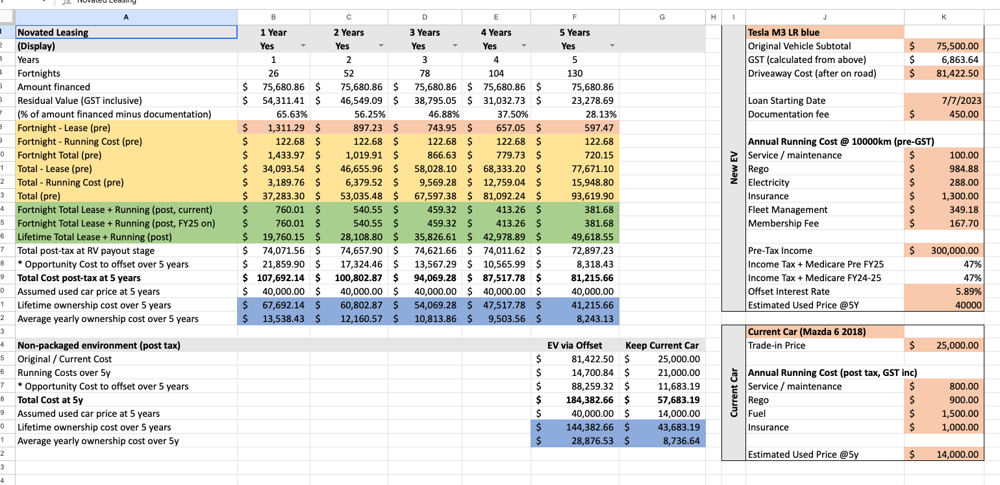
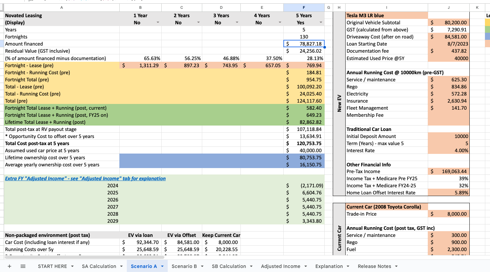
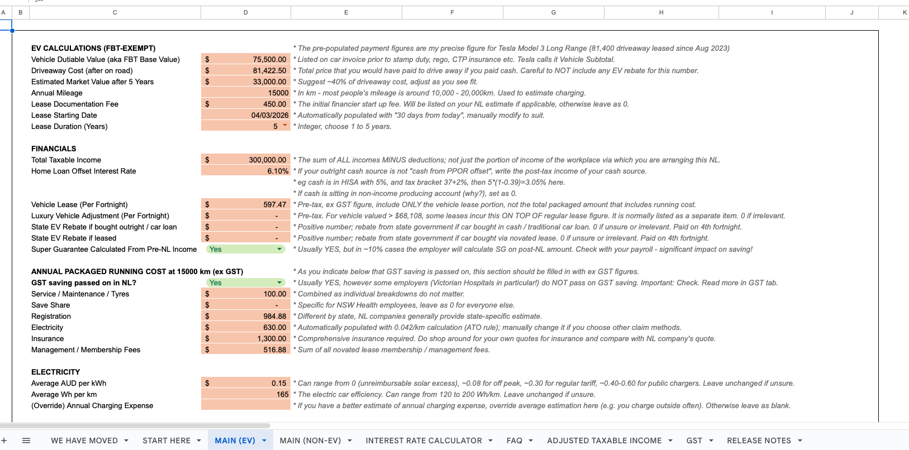
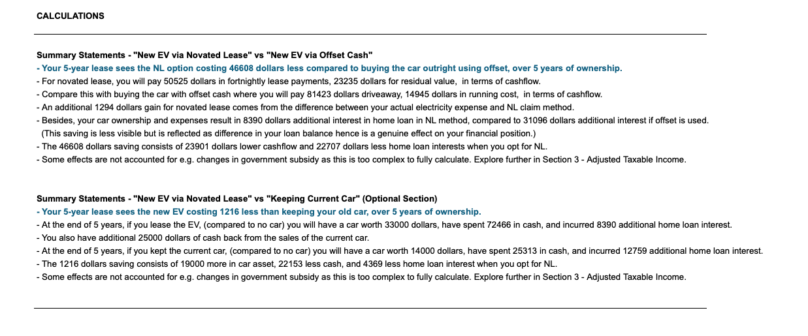
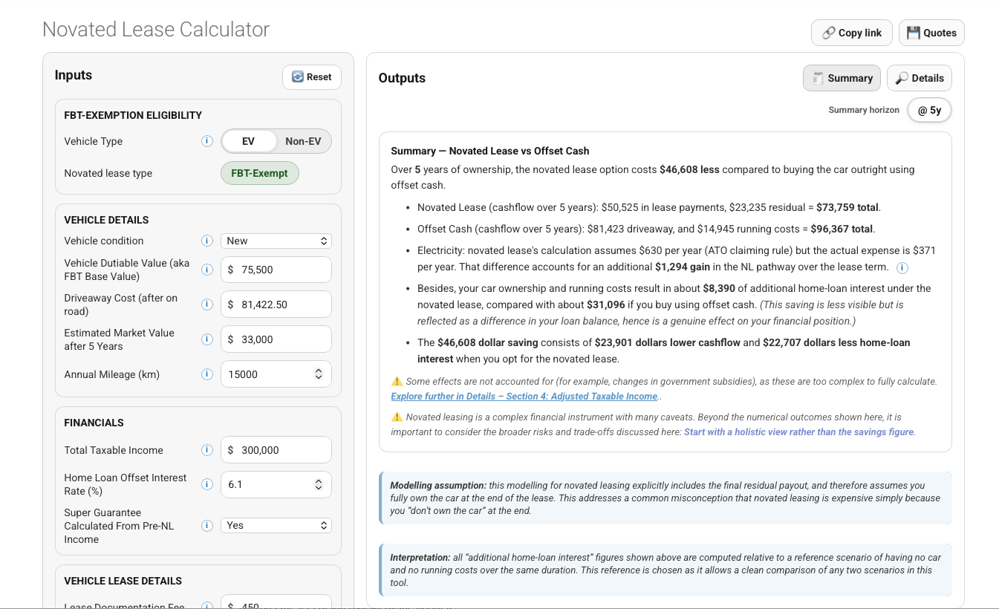

# History of the novated lease calculator

This calculator did not start as a web application. It began as a personal spreadsheet to answer a very specific and personal question: *Does a novated lease work out for me?*

Over time, the model evolved through several distinct phases, each addressing shortcomings or misconceptions observed in the previous version. It was also released to the public at the encouragement of early users who found it helpful. 

---

## Early 2023: First version — manual spreadsheet and rough opportunity cost

The earliest version of the calculator was a heavily manual spreadsheet. Many inputs were typed in by hand, and I manually compared 1- to 5-year leases by listing them in five columns. It was also EV only, as that was what I was looking into. 

At this stage, the concept of *opportunity cost* was introduced to explain an often-overlooked issue: using cash (or redraw/offset funds) to buy a car has a real financial consequence, even if it does not feel like an explicit payment. The spreadsheet attempted to capture this by estimating foregone interest savings from offset accounts.

However, this early presentation of opportunity cost was nebulous and did not inspire confidence. 

---

## Mid 2023: Second version — recognising Adjusted Taxable Income

The second major evolution came with the recognition that EV novated leases can *increase* Adjusted Taxable Income (ATI), even when they reduce headline taxable income. This is a subtle but important adverse effect that is rarely discussed, and was largely unknown to many users at the time, often only becoming apparent later through higher HECS repayments or reduced childcare subsidy.

This version explicitly modelled ATI and highlighted downstream consequences for means-tested systems such as:

- childcare subsidy
- HECS/HELP repayments
- Medicare levy surcharge

By separating taxable income from ATI, the spreadsheet began to show that novated leases are not universally beneficial, and that their impact depends heavily on a household’s broader financial context.

---

## Early 2024: Third version — full rewrite with asset, liability and cashflow simulation

The next major step was a complete rewrite of the spreadsheet from first principles. Instead of relying on adjustments and heuristics, the model was restructured to explicitly track:

- cashflow (pre-tax and post-tax)
- assets (vehicle value over time)
- liabilities (including home loan balances and the interest effects of changes in offset account usage)

The effect on the home loan offset is the feature I consider most important, and one that most other novated lease calculators leave out. A lease keeps cash in your offset that buying outright would take away, and every fortnight that money saves you home loan interest. The model simulates this precisely, fortnight by fortnight: each fortnight's cash flow under each option is compounded at your home loan rate to the end of the period, so the interest difference is calculated rather than estimated.

This allowed genuine *apples-to-apples* comparisons between pathways, such as:

- EV via novated lease
- EV via traditional car loan or cash
- keeping an existing vehicle

I also included a layman friendly "summary" for those who connect better with written sentences than tables. 

Later evolution also introduced a separate worksheet for **non-EV vehicles**, where Fringe Benefits Tax (FBT) applies. This made it possible to model FBT-applicable scenarios alongside FBT-exempt EVs.

Additional features over time: 

- explicit warnings about the impact of novated leasing on superannuation (for employers who calculate super guarantee on post-NL income)
- the ATO 4.2c/km electricity claim method
- scenarios where GST savings are *not* passed on by employers or salary packaging providers
- back-calculation of effective interest rate from fortnightly lease figure
- year-by-year (financial year) breakdowns, particularly relevant for users close to marginal tax bracket thresholds

At this point, the spreadsheet had become a comprehensive financial simulator rather than a simple calculator. With this it received increasing mention in Reddit, Facebook and Whirlpool discussions. 

---

## Early 2026: Transition to a web-based calculator and accompanying guide 

The spreadsheet had become powerful but clunky. Users had to make their own copies to try scenarios, and it was easy to break a formula by accident. To be widely usable and robust, the calculator needed to become an application.

It was fortunate that the whole model had first been built and stress-tested as a spreadsheet. Every formula was auditable, and nearly three years of public use had shaken out many small bugs and edge cases through informal peer review in online discussions. The spreadsheet became the *gold standard* reference for the underlying method. It is no longer updated for each year's tax changes; the web app now carries the current figures.

For a long time, a web app felt out of reach. I could read code but was never a self-sufficient programmer, and a few volunteers' offers to build one did not progress. Large language models removed that roadblock: ChatGPT, and subsequently Claude, helped with everything from the choice of framework to small details like warnings for values beyond regulatory thresholds, turning months of trial and error into weeks.

I deliberately did *not* copy the spreadsheet cell by cell into the browser, which would have been clunky and hard to maintain. The calculation engine was rewritten from first principles instead, starting from dozens of foundational rules, such as tax from taxable income, fortnightly payment schedules from a start date, and financial-year and FBT-year periods, with everything else built on top.

---

## How the maths is checked

Unlike many "vibe-coded" calculators, this one did not start with an AI prompt. I built the underlying maths model by hand in a spreadsheet, formula by formula and column by column, from my own working of the tax and accounting rules. The web app turned that model into something easier to use, but the maths underneath is the same, and every formula is still open to inspect in [the original spreadsheet](https://docs.google.com/spreadsheets/d/1CtpBXmuhRW3HrBjqJqnPeFhOfqCbPK-wXA17oz_1fuA/).

These are the checks it goes through:

- **Two independent models that must agree.** Before launch, test scenarios were run side by side in the spreadsheet and the web app until every output matched to the cent. Getting two separately built models to agree exactly gave strong confidence in the maths, and a great deal of personal satisfaction. Since then the web app has taken on the 2026-27 GST cap and tax brackets, which the spreadsheet doesn't have, so results now differ slightly: by tens of dollars at higher incomes, and more at lower incomes, where the bracket change bites hardest. Every remaining difference traces back to these updates.
- **Constants checked against primary sources.** Tax brackets, the Medicare levy, the car limit and GST cap, the luxury car tax threshold, ATO residual percentages, the EV charging rate and the FBT phase-out tiers are checked against ATO and Treasury documents, and re-checked when they change (usually each July and each Budget).
- **Real quotes.** Readers' quotes are run through the calculator and compared with what the provider printed. Where a provider uses its own convention, such as Smart Leasing and MillarX holding back reserve months, the calculator explains the difference and offers a correction.
- **Full workings, not a black box.** Novated lease providers typically state "your interest rate is 8.0%" and leave it there. For the harder concepts, the calculator shows the working instead: the effective interest rate comes with its full amortisation schedule, month by month, and early termination with a table of what you would owe at each point in the lease. Anyone can rebuild the figures from those tables and check the result for themselves.

Some things are left out on purpose, because modelling them would mean false precision: partial-year leases, and expected share or crypto returns as the opportunity cost of the cash a lease spares you from spending on the car (a safe return, such as an offset account, is used instead).

---

## The guiding principle

Throughout its evolution, the guiding principle of the calculator has remained consistent: **compare net outcomes, not marketing figures**.

Rather than advertising tax saving, the calculator aims to show users:

- what cash actually leaves their pocket
- what assets and liabilities they hold 
- how sensitive outcomes are to assumptions such as interest rates, income levels, and impact on subsidy, super etc. 

The web-based version is not an endpoint, but the latest iteration of an ongoing attempt to make novated leasing analysis more transparent and grounded in real financial outcomes. Since launch it has added a step-by-step Guided mode for first-timers, alongside the [pre-signing checklist](/tools/checklist/) and the [BYO employer checker](/tools/byo-employer-check/).
