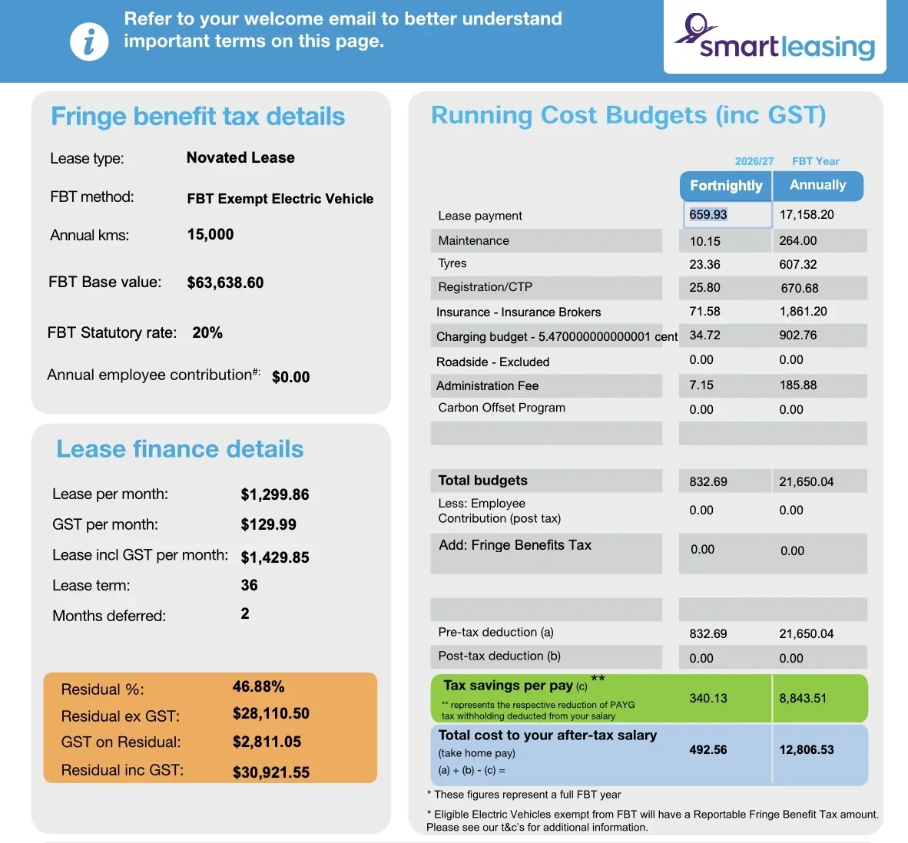

# GST not passed on: a 7.9% lease that costs you like 11%

Every novated lease payment includes GST. Most employers can claim that GST back from the tax office, and they pass the saving on to you. In that case, you are effectively only paying the price without GST.

A few employers don't do this. From what readers tell me, this is mostly some Victorian public hospitals. If you work for one of them, you pay the full price including GST. That applies to the car's finance as well as to running costs like insurance and servicing.

This makes the interest rate on your lease confusing, because there are now two ways to look at it, and both are correct:

- **The rate the lender charges.** The lender doesn't keep the GST; it goes to the tax office. So the lender's rate is worked out from the payment without GST. In the example below, that is 7.9%.
- **The rate that matches what you pay.** Because you pay the GST as well, you pay as much as someone whose employer passes on GST would pay on a much dearer lease. In the example below, that is about 11%.

This article uses a real Smart Leasing quote to show how it works. For the GST on running costs, see [Failure to pass on GST savings](/running-costs/failure-to-pass-gst-saving/).

---

## How to tell if this applies to you

Check your quote for two things:

1. The amounts are shown **including GST** (often written "inc GST").
2. **Nothing takes the GST back off.** Look for a line such as "Less GST credit" or "Input tax credit". If there isn't one, and the amount taken from your pay before tax is the full total including GST, your employer is not passing on the GST.

<figure class="quote-evidence">

<figcaption>A reader's Smart Leasing quote (quote number removed). The table heading says "inc GST", and the amount taken from pay before tax is the same as the total: no GST is taken back off.</figcaption>
</figure>

On this quote:

- The table heading says "Running Cost Budgets (inc GST)", so every amount in it includes GST.
- The "Lease payment" of $659.93 a fortnight is the monthly finance payment including GST ($1,429.85), converted to fortnights.
- "Total budgets" and "Pre-tax deduction" are both $832.69. Nothing has been taken off for GST.

So this person pays GST on everything, including the car's finance.

---

## Step 1: take out Smart Leasing's buffer

Smart Leasing takes a little more from your pay than the lender actually needs. On this 3-year lease, the first 2 months have no finance payment, so the lender only gets 34 monthly payments. But Smart Leasing spreads those 34 payments across all 36 months of your pay. The extra builds up as a buffer, which you get back at the end if it isn't used. There is more detail in [Smart Leasing and MillarX — why their quoted figure needs adjusting](/special-and-policy/smart-leasing-millarx-payment-structure/).

So the real cost of the finance each fortnight is:

$$659.93 \times \frac{34}{36} = 623.27$$

**$623.27 a fortnight, including GST,** is what this person actually pays for the car's finance.

---

## Step 2: the two rates

**The lender's rate: 7.9%.** Of the $623.27, one eleventh is GST, which goes to the tax office. The lender receives:

$$623.27 \div 1.1 = 566.61$$

Based on $566.61 a fortnight, the lender is charging about 7.9% a year. That is a good rate. Someone with the same deal, at an employer that passes on GST, would pay only $566.61 a fortnight.

**The rate that matches what you pay: 11.0%.** But this person pays $623.27, not $566.61. For someone at an employer that passes on GST to pay $623.27 a fortnight for this same car, their lease would need an interest rate of about **11.0%**.

| | Employer passes on GST | Employer doesn't pass on GST |
|---|---|---|
| Interest rate the lender charges | 7.9% | 7.9% |
| What you pay for the finance each fortnight (before tax) | $566.61 | $623.27 |
| Same as what someone else pays on a lease at | 7.9% | **11.0%** |

The difference is $56.66 a fortnight. Over the 3 years, that is about $4,400 taken from your pay before tax, just for the GST on the finance. The GST on running costs comes on top of that.

---

## What the calculator does

First, tell the calculator that your employer doesn't pass on GST. Then enter the finance payment including GST, exactly as your quote shows it.

- **Guided:** on the running costs step, when asked what the heading says, choose "Including GST". Then answer "No" when asked whether a GST credit is taken off. On the payment step, choose "Including GST".
- **Advanced:** in the running costs section, set "GST saving passed on to you" to No. The finance box then asks for the payment including GST.

The calculator then:

- works out your costs from what really comes out of your pay ($623.27 here);
- shows the lender's rate (7.9%) as the effective interest rate;
- adds a second line: "GST not passed on: you pay what a 11.0% lease costs elsewhere".

The Smart Leasing / MillarX adjustment works the same way: enter $659.93, choose "Inc GST", and it fills in $623.27.

**If you used the calculator for a quote like this before this update (November 2026):** it took the GST off your payment even when your employer doesn't pass it on. The interest rate it showed was right, but it made the lease look cheaper than it really is. Run your quote again to see the full cost.

---

## What can you do?

- **Don't expect a lower interest rate to fix this.** 7.9% is already a good rate. The extra cost comes from how your employer handles GST, not from the lender.
- **Ask your payroll or HR team** whether they claim back GST on novated leases and pass it on to staff. Policies can change, and some employers have more than one arrangement.
- **Check whether the lease is still worth it.** Run your full quote in the calculator with GST set to "not passed on". For many people a lease still comes out ahead of paying cash for the car, but by less.

---

## Related reading

- [Failure to pass on GST savings (running costs)](/running-costs/failure-to-pass-gst-saving/)
- [Smart Leasing and MillarX — why their quoted figure needs adjusting](/special-and-policy/smart-leasing-millarx-payment-structure/)
- [Why novated lease effective interest rates look high](/costs-and-savings/why-nl-interest-looks-high/)
- [Why effective interest rates are higher on short leases and cheaper cars](/costs-and-savings/effective-interest-rate-short-leases-cheaper-cars/)
- [Novated Lease Calculator](/calculator/)
