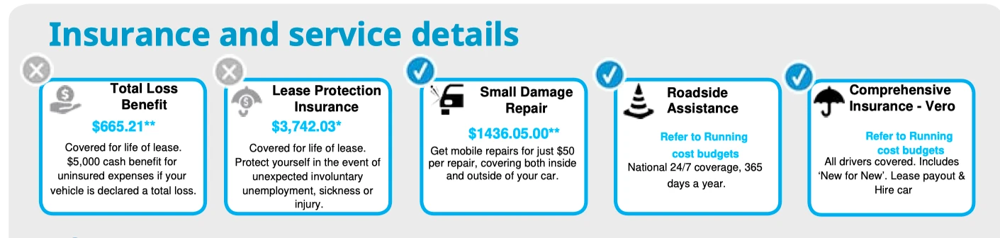
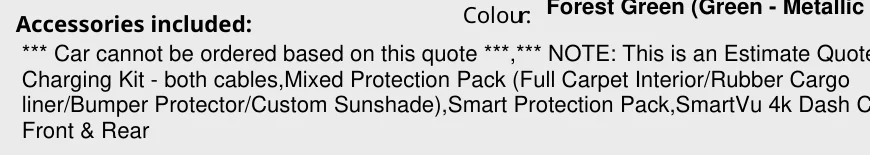
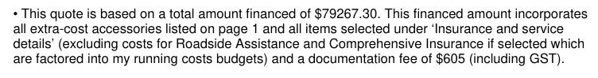
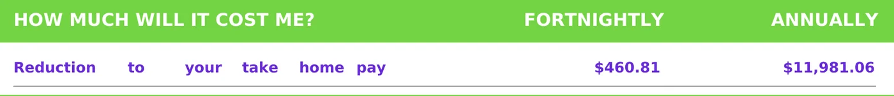
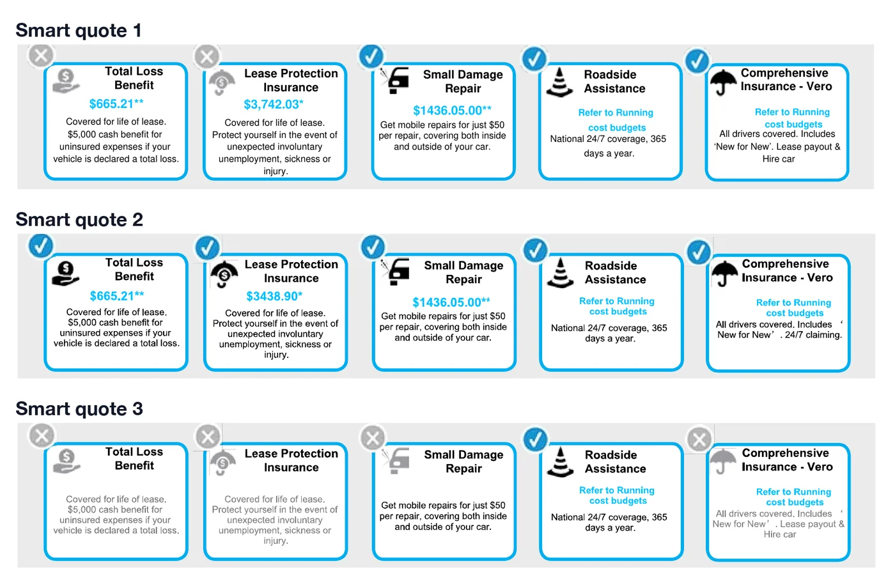
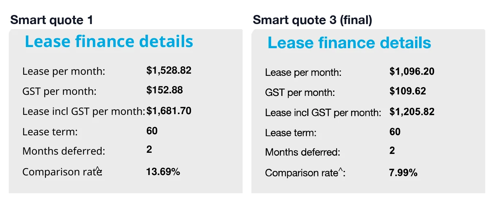

# Real-life example: How the calculator helped cut a Smartleasing lease by $22,000

*Shared anonymously, with the reader's permission. Figures are from his quotes, entered into the calculator and checked by me.*

---

## Executive summary

A reader leased a new Zeekr EV through a workplace that deals with **only one novated lease provider**, Smartleasing (Smart). Over about a month he received four quotes for the same car:

| Quote | Financed beyond the car | Effective interest rate | Total out-of-pocket cost (after tax, incl. residual) |
|---|---|---|---|
| Smart, quote 1 | ~$14,700 | 10.79% | $96,753 |
| Smart, quote 2 (after finance approval) | ~$6,600 | 10.79% | $87,768 |
| Novated Lease Australia (BYO finance) | none | 10.01% | $76,752 |
| Smart, quote 3 (final) | ~$840 (including the $560 window tint) | **7.30%** | **$74,488** |
| *For comparison: paying cash for the same car (before home-loan interest)* | *none* | *n/a* | *$89,874[^cash]* |

Same car, same five-year term. The final quote costs **$22,265 less** over the lease than the first.

[^cash]: The cash row counts money spent, but has not yet included the impact of home loan interest. Counting his home-loan offset (6.22%), paying cash costs about **$18,700 more in interest** over the five years, so the final quote comes out about $34,100 ahead of cash, not $15,400.

Not all of the $22,265 is a real saving:

| Where the $22,265 came from | Amount | Real saving? |
|---|---|---|
| A lower finance rate (10.79% → 7.30%) | ~$5,400 | Yes |
| Extras no longer financed | ~$12,600 | Partly. He didn't want them, but he no longer gets the products either |
| Lower running cost budgets (mostly cheaper insurance) | ~$4,200 | Mostly. About $2,900 is cheaper insurance[^ins]; the rest is budgets that true up |

So the lease itself became about **$18,000** cheaper, and cheaper insurance saves about **$2,900** more.

[^ins]: Smart's first two quotes budgeted for a Vero policy arranged by Smart (its quotes note that it may receive commissions for arranging insurance). The final quote budgeted for a Budget Direct policy he arranged himself, which may not cover the same things. Compare what a policy covers and pays out, not just the premium.

Three things got him there:

1. He checked the quote's numbers himself, using the [calculator](/calculator/).
2. He realised a single-provider workplace need not be a dead end, and got a **competing quote**.
3. He showed that quote to Smart, and to the dealer, who then offered to approach Smart for a better deal.

---

## Context

- **Vehicle:** new Zeekr 7X EV, FBT-exempt. Five years, lease starting late August 2026, 15,000 km a year on the NLA and final quotes.
- **Income:** $111,815 a year. **Employer:** deals only with Smart.
- **Cash alternative:** home loan offset account at 6.22%.

:::info[Audit this example yourself]
Each quote below links to the [calculator](/calculator/) with the reader's figures pre-filled.
:::

---

## The four quotes side by side

| | Smart 1 | NLA | Smart 2 | Smart 3 (final) |
|---|---|---|---|---|
| **FBT base value** (inc GST) | **$69,918** ⚠ | $68,139 | $67,045 | $67,605 |
| **Drive-away price**[^drive] | **$73,389** ⚠ | $70,275 | $69,326 | $69,886 |
| Residual (inc GST) | $20,743 | $19,828 | $19,565 | $19,723 |
| Amount financed (ex GST) | $79,267 | $64,081 | $71,400 | $65,576 |
| Effective interest rate (this site's methodology) | 10.79% | 10.01% | 10.79% | **7.30%** |
| Out of pocket per fortnight (PDF figure, pre-correction) | $632 | $461 | $571 | $456 |
| **Net** out of pocket per fortnight (our calculator, post-correction)[^reserve] | **$616** | $461 | **$552** | **$445** |
| Annotation | **Inflated by accessories** | Car only | Paint and delivery; insurance financed | Paint, delivery and tint ($560) |

[^drive]: NLA itemises its price ($68,139 + $1,363 stamp duty + $773 rego and CTP). Smart does not, so its figures are worked back from the residual (residual ÷ 28.13% + the GST saving), as Guided mode does.

[^reserve]: Smart collects the lease payment for 60 months but the financier is only paid for 58. The two extra months are a refundable reserve, so part of Smart's printed fortnightly figure is not a true cost. Our calculator removes it (see [Smart Leasing and MillarX quotes](/special-and-policy/smart-leasing-millarx-payment-structure/)). NLA has no reserve.

---

## Smart quote 1: inflated by accessories

| | |
|---|---|
| FBT base value | $69,918, about **$2,870 above quote 2's** for the same car |
| Drive-away price (from the residual) | $73,389, about **$4,000 above** the car-only drive-away price on quote 2 |
| Amount financed | $79,267, about **$14,700 more than the car** needs (about $64,500) |
| Effective interest rate | 10.79% on the full $79,267 financed, accessories and insurance included, so not comparable with a provider financing only the car |
| Out of pocket (PDF figure, pre-correction) | $632 a fortnight |
| Net out of pocket (our calculator, post-correction)[^reserve] | $616 a fortnight |

- **Far more financed than the car needs.** Drive-away price plus documentation fee, minus the GST saved, is about $64,500. The quote financed $79,267, so **about $14,700 is accessories and insurance**. The quote does not make clear what that buys: two products are priced but crossed out (lease protection insurance $3,742, total loss benefit $665), small-damage repair ($1,436) is ticked, and the accessories (two protection packs, front and rear dash camera, EV charging kit) carry no price. The buyer cannot tell what they are paying for.[^estimate]

[^estimate]: Marked "Estimate Quote", but it is the quote he was given.

<figure class="quote-evidence">

<figcaption>Smart quote 1, page 2: two products priced but crossed out, one priced and ticked. Roadside and comprehensive insurance come out of the running costs.</figcaption>
</figure>

<figure class="quote-evidence">

<figcaption>Smart quote 1, page 1: the accessories added to the car.</figcaption>
</figure>

<figure class="quote-evidence">

<figcaption>Smart quote 1, terms and conditions on page 3.</figcaption>
</figure>

[Open quote 1 in the calculator →](https://novatedlease.guide/calculator/?c=eyJ2IjoxLCJpbnB1dHMiOnsidmVoaWNsZVR5cGUiOiJFViIsInZlaGljbGVDb25kaXRpb24iOiJOZXciLCJ1c2VkQ2FyRmlyc3RIZWxkQWZ0ZXJKdWwyMDIyIjpmYWxzZSwidXNlZENhckxjdE5ldmVyUGF5YWJsZSI6ZmFsc2UsInZlaGljbGVCYXNlVmFsdWUiOjY5OTE3LjU1LCJkcml2ZWF3YXlDb3N0Ijo3MzM4OSwiZXN0aW1hdGVkTWFya2V0VmFsdWVBdEVuZCI6MjgwMDAsImFubnVhbE1pbGVhZ2VLbSI6MjAwMDAsImxlYXNlRG9jRmVlIjo1NTAsImxlYXNlU3RhcnREYXRlIjoiMjAyNi0wOC0yOCIsImxlYXNlRHVyYXRpb25ZZWFycyI6NSwibW9udGhzRGVmZXJyZWQiOjIsInRvdGFsVGF4YWJsZUluY29tZSI6MTExODE1LCJob21lTG9hbk9mZnNldEludGVyZXN0UmF0ZSI6Ni4yMiwibHV4dXJ5VmVoaWNsZUFkalBlckZuIjowLCJzdXBlckZyb21QcmVObEluY29tZSI6IlllcyIsImdzdFNhdmluZ1Bhc3NlZE9uIjoiWWVzIiwic2VydmljZU1haW50VHlyZXNBbm51YWwiOjEzNTYuNjgsInNhdmVTaGFyZUFubnVhbCI6MCwicmVnaXN0cmF0aW9uQW5udWFsIjo3ODkuMzYsImVsZWN0cmljaXR5QW5udWFsIjoxMDk0LCJmdWVsQW5udWFsIjowLCJpbnN1cmFuY2VBbm51YWwiOjI0OTkuOSwiaW5zdXJhbmNlRmluYW5jZWRGaXJzdFllYXIiOjAsIm1hbmFnZW1lbnRGZWVzQW5udWFsIjo5MC40OCwiYXZnQXVkUGVyS3doIjowLjA4LCJhdmdXaFBlckttIjoxNzAsImNvbXBhcmVXaXRoQ3VycmVudENhciI6ZmFsc2UsImN1cnJlbnRDYXJNYXJrZXRWYWx1ZU5vdyI6MjUwMDAsImN1cnJlbnRDYXJNYXJrZXRWYWx1ZUF0RW5kIjoxNDAwMCwiY3VycmVudFNlcnZpY2VNYWludFR5cmVzQW5udWFsIjo4MDAsImN1cnJlbnRSZWdpc3RyYXRpb25Bbm51YWwiOjkwMCwiY3VycmVudEZ1ZWxBbm51YWwiOjIzNjIuNSwiY3VycmVudEluc3VyYW5jZUFubnVhbCI6MTAwMCwiY29tcGFyZVdpdGhDYXJMb2FuIjpmYWxzZSwiY2FyTG9hbkluaXRpYWxEZXBvc2l0IjoxMDAwMCwiY2FyTG9hbkludGVyZXN0UmF0ZVBjdCI6OCwiY2FyTG9hbk1vbnRobHlGZWUiOjI1LCJmaW5hbmNlZEFtb3VudEZvckludGVyZXN0Q2FsY0V4R3N0Ijo3OTI2Ny4zLCJyZXNpZHVhbFZhbHVlRXhHc3QiOjE4ODU3LjMzLCJ2ZWhpY2xlTGVhc2VQZXJGbiI6NjgyLjA5fX0)

:::warning[Check the amount financed]
The car needs about its drive-away price plus any fees financed, minus the GST saving. If the quote's "amount financed" is much higher, find out why: you pay for the difference, with interest.
:::

---

## Novated Lease Australia: car only

| | |
|---|---|
| FBT base value | $68,139 |
| Drive-away price | **$70,275**, itemised on the quote |
| Amount financed | $64,081: the car and nothing else |
| Effective interest rate | 10.01% |
| Out of pocket | $461 a fortnight |

- **How he found it:** from reading this site and Reddit, he realised that a competing quote could come in cheaper, so he reached out to NLA.
- **Car only:** no accessories or insurance extras. The effective interest rate dropped modestly (10.79% to 10.01%); most of the fall in the fortnightly cost ($632 to $461) is from the lower financed amount.

<figure class="quote-evidence">

<figcaption>NLA's quote: $460.81 a fortnight out of pocket.</figcaption>
</figure>

[Open the NLA quote in the calculator →](https://novatedlease.guide/calculator/?c=eyJ2IjoxLCJpbnB1dHMiOnsidmVoaWNsZVR5cGUiOiJFViIsInZlaGljbGVDb25kaXRpb24iOiJOZXciLCJ1c2VkQ2FyRmlyc3RIZWxkQWZ0ZXJKdWwyMDIyIjpmYWxzZSwidXNlZENhckxjdE5ldmVyUGF5YWJsZSI6ZmFsc2UsInZlaGljbGVCYXNlVmFsdWUiOjY4MTM5LCJkcml2ZWF3YXlDb3N0Ijo3MDI3NSwiZXN0aW1hdGVkTWFya2V0VmFsdWVBdEVuZCI6MjgwMDAsImFubnVhbE1pbGVhZ2VLbSI6MTUwMDAsImxlYXNlRG9jRmVlIjowLCJsZWFzZVN0YXJ0RGF0ZSI6IjIwMjYtMDgtMjciLCJsZWFzZUR1cmF0aW9uWWVhcnMiOjUsIm1vbnRoc0RlZmVycmVkIjoyLCJ0b3RhbFRheGFibGVJbmNvbWUiOjExMTgxNSwiaG9tZUxvYW5PZmZzZXRJbnRlcmVzdFJhdGUiOjYuMjIsImx1eHVyeVZlaGljbGVBZGpQZXJGbiI6MCwic3VwZXJGcm9tUHJlTmxJbmNvbWUiOiJZZXMiLCJnc3RTYXZpbmdQYXNzZWRPbiI6IlllcyIsInNlcnZpY2VNYWludFR5cmVzQW5udWFsIjo5MTkuODgsInNhdmVTaGFyZUFubnVhbCI6MCwicmVnaXN0cmF0aW9uQW5udWFsIjo4MzYuMTYsImVsZWN0cmljaXR5QW5udWFsIjo4MjAuNTYsImZ1ZWxBbm51YWwiOjAsImluc3VyYW5jZUFubnVhbCI6MTQ5MC4wNiwibWFuYWdlbWVudEZlZXNBbm51YWwiOjI2LCJhdmdBdWRQZXJLd2giOjAuMDgsImF2Z1doUGVyS20iOjE3MCwiY29tcGFyZVdpdGhDdXJyZW50Q2FyIjpmYWxzZSwiY3VycmVudENhck1hcmtldFZhbHVlTm93IjoyNTAwMCwiY3VycmVudENhck1hcmtldFZhbHVlQXRFbmQiOjE0MDAwLCJjdXJyZW50U2VydmljZU1haW50VHlyZXNBbm51YWwiOjgwMCwiY3VycmVudFJlZ2lzdHJhdGlvbkFubnVhbCI6OTAwLCJjdXJyZW50RnVlbEFubnVhbCI6MjM2Mi41LCJjdXJyZW50SW5zdXJhbmNlQW5udWFsIjoxMDAwLCJjb21wYXJlV2l0aENhckxvYW4iOmZhbHNlLCJjYXJMb2FuSW5pdGlhbERlcG9zaXQiOjEwMDAwLCJjYXJMb2FuSW50ZXJlc3RSYXRlUGN0Ijo4LCJjYXJMb2FuTW9udGhseUZlZSI6MjUsImZpbmFuY2VkQW1vdW50Rm9ySW50ZXJlc3RDYWxjRXhHc3QiOjY0MDgwLjU0NTQ1NDU0NTQ1NiwicmVzaWR1YWxWYWx1ZUV4R3N0IjoxODAyNS44NTc0MzYzNjM2MzYsInZlaGljbGVMZWFzZVBlckZuIjo1MjEuNH19)

---

## Smart quote 2: accessories gone, insurance financed

| | |
|---|---|
| FBT base value | $67,045 (paint and delivery only) |
| Drive-away price (from the residual) | $69,326 |
| Amount financed | $71,400, about **$6,600 more than the car** |
| Effective interest rate | 10.79%, unchanged |
| Out of pocket (PDF figure, pre-correction) | $571 a fortnight |
| Net out of pocket (our calculator, post-correction)[^reserve] | $552 a fortnight |

- The accessories were gone, but total loss benefit and lease protection insurance (crossed out on quote 1) were now selected alongside the repair cover: about $5,540 financed.
- **Why it came:** he told Smart quote 1 was not competitive, and Smart asked to see the NLA quote, so he sent it with his colleague's cheaper four-year lease. Smart called quote 1 "just a rough quote" and offered a better one after finance approval, which he reluctantly applied for.
- **Still not competitive:** with the running-cost budgets made identical, NLA was still about **$14,000 cheaper** over the lease on the pre-tax lease figures, and Smart was still dearer than his colleague's shorter lease.

<figure class="quote-evidence">

<figcaption>The insurance and service row from each of Smart's quotes. A tick means the item was selected.</figcaption>
</figure>

[Open Smart's second quote in the calculator →](https://novatedlease.guide/calculator/?c=eyJ2IjoxLCJpbnB1dHMiOnsidmVoaWNsZVR5cGUiOiJFViIsInZlaGljbGVDb25kaXRpb24iOiJOZXciLCJ1c2VkQ2FyRmlyc3RIZWxkQWZ0ZXJKdWwyMDIyIjpmYWxzZSwidXNlZENhckxjdE5ldmVyUGF5YWJsZSI6ZmFsc2UsInZlaGljbGVCYXNlVmFsdWUiOjY3MDQ0LjUsImRyaXZlYXdheUNvc3QiOjY5MzI2LCJlc3RpbWF0ZWRNYXJrZXRWYWx1ZUF0RW5kIjoyODAwMCwiYW5udWFsTWlsZWFnZUttIjoyMDAwMCwibGVhc2VEb2NGZWUiOjU1MCwibGVhc2VTdGFydERhdGUiOiIyMDI2LTA4LTI4IiwibGVhc2VEdXJhdGlvblllYXJzIjo1LCJtb250aHNEZWZlcnJlZCI6MiwidG90YWxUYXhhYmxlSW5jb21lIjoxMTE4MTUsImhvbWVMb2FuT2Zmc2V0SW50ZXJlc3RSYXRlIjo2LjIyLCJsdXh1cnlWZWhpY2xlQWRqUGVyRm4iOjAsInN1cGVyRnJvbVByZU5sSW5jb21lIjoiWWVzIiwiZ3N0U2F2aW5nUGFzc2VkT24iOiJZZXMiLCJzZXJ2aWNlTWFpbnRUeXJlc0FubnVhbCI6MTM1Ni42OCwic2F2ZVNoYXJlQW5udWFsIjowLCJyZWdpc3RyYXRpb25Bbm51YWwiOjc4OS4zNiwiZWxlY3RyaWNpdHlBbm51YWwiOjEwOTQsImZ1ZWxBbm51YWwiOjAsImluc3VyYW5jZUFubnVhbCI6MjA4NS4yMDAwMDAwMDAwMDAzLCJpbnN1cmFuY2VGaW5hbmNlZEZpcnN0WWVhciI6MCwibWFuYWdlbWVudEZlZXNBbm51YWwiOjkwLjQ4LCJhdmdBdWRQZXJLd2giOjAuMDgsImF2Z1doUGVyS20iOjE3MCwiY29tcGFyZVdpdGhDdXJyZW50Q2FyIjpmYWxzZSwiY3VycmVudENhck1hcmtldFZhbHVlTm93IjoyNTAwMCwiY3VycmVudENhck1hcmtldFZhbHVlQXRFbmQiOjE0MDAwLCJjdXJyZW50U2VydmljZU1haW50VHlyZXNBbm51YWwiOjgwMCwiY3VycmVudFJlZ2lzdHJhdGlvbkFubnVhbCI6OTAwLCJjdXJyZW50RnVlbEFubnVhbCI6MjM2Mi41LCJjdXJyZW50SW5zdXJhbmNlQW5udWFsIjoxMDAwLCJjb21wYXJlV2l0aENhckxvYW4iOmZhbHNlLCJjYXJMb2FuSW5pdGlhbERlcG9zaXQiOjEwMDAwLCJjYXJMb2FuSW50ZXJlc3RSYXRlUGN0Ijo4LCJjYXJMb2FuTW9udGhseUZlZSI6MjUsImZpbmFuY2VkQW1vdW50Rm9ySW50ZXJlc3RDYWxjRXhHc3QiOjcxNDAwLjQzLCJyZXNpZHVhbFZhbHVlRXhHc3QiOjE3Nzg2Ljc4LCJ2ZWhpY2xlTGVhc2VQZXJGbiI6NjA5LjcyfX0)

---

## Smart quote 3 (final, via the dealer)

| | |
|---|---|
| FBT base value | $67,605 (quote 2 plus $560 window tint) |
| Drive-away price (from the residual) | $69,886 |
| Amount financed | $65,576: about $840 more than the car, including the $560 window tint |
| Effective interest rate | **7.30%**, down from 10.79% and well below NLA's 10.01% |
| Out of pocket (PDF figure, pre-correction) | $456 a fortnight |
| Net out of pocket (our calculator, post-correction)[^reserve] | $445 a fortnight |

- The dealer said Zeekr had its own partnership with Smart. He sent NLA's latest quote and Smart came back lower; it looks as though Smart set out to match the competing **fortnightly cost**, which meant beating NLA's rate by more than two and a half points. I cannot independently confirm whether there is a subvention finance deal between Zeekr and Smart, and an online search did not turn up anything obvious.
- All three insurance products were gone.[^later]

<figure class="quote-evidence">

<figcaption>Smart's first and final quotes, same car and term. The comparison rate fell from 13.69% to 7.99%.</figcaption>
</figure>

[Open the final quote in the calculator →](https://novatedlease.guide/calculator/?c=eyJ2IjoxLCJpbnB1dHMiOnsidmVoaWNsZVR5cGUiOiJFViIsInZlaGljbGVDb25kaXRpb24iOiJOZXciLCJ1c2VkQ2FyRmlyc3RIZWxkQWZ0ZXJKdWwyMDIyIjpmYWxzZSwidXNlZENhckxjdE5ldmVyUGF5YWJsZSI6ZmFsc2UsInZlaGljbGVCYXNlVmFsdWUiOjY3NjA0Ljk1LCJkcml2ZWF3YXlDb3N0Ijo2OTg4NiwiZXN0aW1hdGVkTWFya2V0VmFsdWVBdEVuZCI6MjgwMDAsImFubnVhbE1pbGVhZ2VLbSI6MTUwMDAsImxlYXNlRG9jRmVlIjo1NTAsImxlYXNlU3RhcnREYXRlIjoiMjAyNi0wOC0yOCIsImxlYXNlRHVyYXRpb25ZZWFycyI6NSwibW9udGhzRGVmZXJyZWQiOjIsInRvdGFsVGF4YWJsZUluY29tZSI6MTExODE1LCJob21lTG9hbk9mZnNldEludGVyZXN0UmF0ZSI6Ni4yMiwibHV4dXJ5VmVoaWNsZUFkalBlckZuIjowLCJzdXBlckZyb21QcmVObEluY29tZSI6IlllcyIsImdzdFNhdmluZ1Bhc3NlZE9uIjoiWWVzIiwic2VydmljZU1haW50VHlyZXNBbm51YWwiOjEwMjMuMTAwMDAwMDAwMDAwMSwic2F2ZVNoYXJlQW5udWFsIjowLCJyZWdpc3RyYXRpb25Bbm51YWwiOjc4OS4zNiwiZWxlY3RyaWNpdHlBbm51YWwiOjgyMC41LCJmdWVsQW5udWFsIjowLCJpbnN1cmFuY2VBbm51YWwiOjE2MzkuMDQsImluc3VyYW5jZUZpbmFuY2VkRmlyc3RZZWFyIjowLCJtYW5hZ2VtZW50RmVlc0FubnVhbCI6MjYsImF2Z0F1ZFBlckt3aCI6MC4wOCwiYXZnV2hQZXJLbSI6MTcwLCJjb21wYXJlV2l0aEN1cnJlbnRDYXIiOmZhbHNlLCJjdXJyZW50Q2FyTWFya2V0VmFsdWVOb3ciOjI1MDAwLCJjdXJyZW50Q2FyTWFya2V0VmFsdWVBdEVuZCI6MTQwMDAsImN1cnJlbnRTZXJ2aWNlTWFpbnRUeXJlc0FubnVhbCI6ODAwLCJjdXJyZW50UmVnaXN0cmF0aW9uQW5udWFsIjo5MDAsImN1cnJlbnRGdWVsQW5udWFsIjoyMzYyLjUsImN1cnJlbnRJbnN1cmFuY2VBbm51YWwiOjEwMDAsImNvbXBhcmVXaXRoQ2FyTG9hbiI6ZmFsc2UsImNhckxvYW5Jbml0aWFsRGVwb3NpdCI6MTAwMDAsImNhckxvYW5JbnRlcmVzdFJhdGVQY3QiOjgsImNhckxvYW5Nb250aGx5RmVlIjoyNSwiZmluYW5jZWRBbW91bnRGb3JJbnRlcmVzdENhbGNFeEdzdCI6NjU1NzUuOTUsInJlc2lkdWFsVmFsdWVFeEdzdCI6MTc5MzAuMSwidmVoaWNsZUxlYXNlUGVyRm4iOjQ4OS4wOH19)

[^later]: He later made some small adjustments to the final quote (for example removing roadside assistance and changing some running-cost budgets). They are not reflected in the quotes I have seen and are left out here for simplicity.

---

## What the difference is worth

| | Quote 1 | Final quote | Difference |
|---|---|---|---|
| Amount financed (ex-GST) | $79,267 | $65,576 | $13,691 |
| Effective interest rate | 10.79% | 7.30% | 3.49 points |
| Vehicle lease (pre-tax, per fortnight) | $682.09 | $489.08 | $193.01 |
| Residual (inc GST) | $20,743 | $19,723 | $1,020 |
| Total out-of-pocket cost (after tax, incl. residual) | $96,753 | $74,488 | **$22,265** |

The residual drops too, because it is a fixed percentage of the car's price including accessories.

Of the $22,265, about **$5,400** is the lower rate alone (financing the final package at quote 1's 10.79% instead of 7.30%). That is the genuine negotiating win.

About **$12,600** is the extras that were no longer financed. Whether that counts as a saving depends on whether he wanted them.

The remaining **$4,200** is the running-cost budgets. About $2,900 is cheaper insurance[^ins]. The last $1,300 or so is not a saving: it comes from budgeting for fewer kilometres and small differences between the quotes. Budgets are estimates, and unused amounts are refunded at the end of the lease.

---

## Key takeaways

- **A single-provider workplace may not be the end of the road.** A competing quote was enough to move Smart here, and some employers also allow BYO finance with another provider; [check yours](/tools/byo-employer-check/).
- **Check what is being financed.** Two of the four quotes financed thousands of dollars of accessories and insurance on top of the car. Compare the quote's amount financed with what the car alone needs, and ask for anything you did not choose to be removed.
- **The first quote is an opening offer.** The same provider, for the same car, went from 10.79% with $14,700 of extras to 7.30% with almost none.
- **Ask everyone in the chain.** The best quote came after the dealer offered to approach Smart, something the reader had not thought to ask.
- **Shop around for your own insurance.** Cheaper insurance was about $2,900 of the running-cost saving here, and the lowest budget came from a policy he arranged himself. Compare cover, not just the premium.
- **Compare like with like.** Set the same kilometres and budgets, strip out the extras, and compare the vehicle lease line, the amount financed and the residual.

---

## Related reading

- [How to read a novated lease quote](/start-here/how-to-read-a-novated-lease-quote/)
- [Why novated lease interest rates look high](/costs-and-savings/why-nl-interest-looks-high/)
- [BYO / self-managed novated lease: employer checker](/tools/byo-employer-check/)
- [Real-life example: a $21,320 "saving" that was a $5,591 loss](/costs-and-savings/false-saving-example/)
