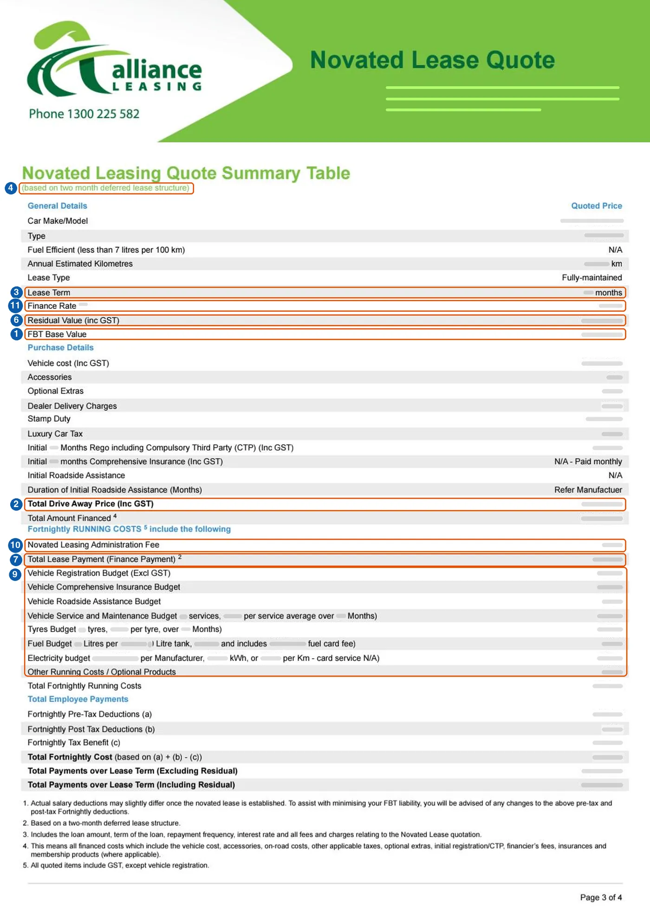
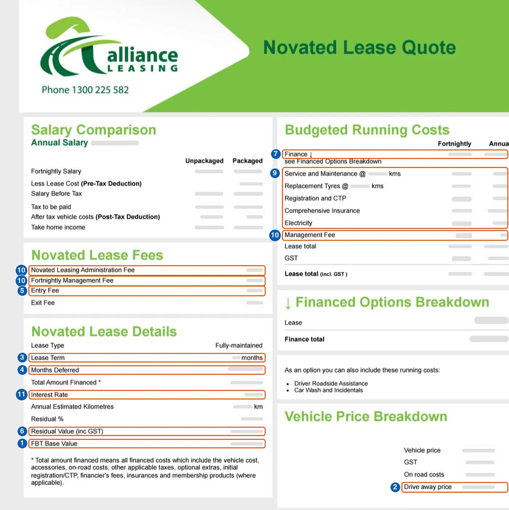
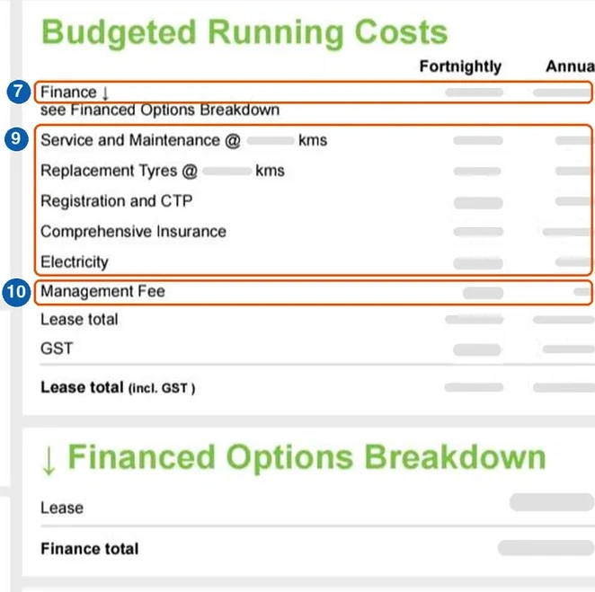

# How to read an Alliance Leasing novated lease quote

<!-- quote-review:begin -->
*Checked against 3 quote examples; latest layout reviewed Nov 2026.*
<!-- quote-review:end -->

This numbered example shows an Alliance Leasing quote layout we reviewed. Match each marker to the table, then check the period and GST label on your own quote.

<!-- provider-traps:begin -->
## What catches people out on an Alliance Leasing quote

- **Drive-away price:** Use “Total Drive Away Price (Inc GST)” in Purchase Details. Don’t use “Total Amount Financed”.
<!-- provider-traps:end -->

*Customer values and identifying details removed. Your quote may use a different layout.*

## Numbered field guide

<!-- provider-table:begin -->
| # | On the quote | In Guided |
|---|---|---|
| 1 | FBT Base Value | FBT base value |
| 2 | Total Drive Away Price (Inc GST) | Use “Total Drive Away Price (Inc GST)” in Purchase Details. Don’t use “Total Amount Financed”. |
| 3 | Lease Term | Lease term |
| 4 | "(based on two month deferred lease structure)" | If you see “based on two month deferred lease structure”, choose 2 months. |
| 6 | Residual Value (inc GST) | Residual, "Including GST" |
| 7 | Total Lease Payment (Finance Payment), fortnightly | This page 3 figure includes GST under footnote 5. For an ex-GST figure, choose the marked Finance row on page 2 below. |
| 9 | Registration, insurance, roadside, service and maintenance, tyres, fuel, electricity, other | These page 3 amounts include GST under footnote 5, except registration. For ex-GST amounts, use the page 2 budget below. |
| 10 | Novated Leasing Administration Fee | Add this to lease management fees only if it is distinct from the page 2 Management Fee. |
| 11 | Finance Rate | Compare with the effective rate Guided shows. Footnote 3 says it includes all fees and charges |
<!-- provider-table:end -->

## Page 2: fees, finance and the price breakdown

*Page 2 of the same quote, with figures and customer details removed.*

*The page 2 budget lists GST separately. Use the marked amounts as printed with Excluding GST.*

| # | On page 2 | In Guided |
|---|---|---|
| 5 | Entry Fee, under Novated Lease Fees | Documentation fee |
| 7 | Finance, under Budgeted Running Costs | Choose “Finance” under “Budgeted Running Costs” on page 2. On this quote, GST has its own line, so choose Excluding GST. |
| 9 | Service and Maintenance, Replacement Tyres, Registration and CTP, Comprehensive Insurance, Electricity | Use the page 2 “Budgeted Running Costs” figures as printed. GST is a separate line, so choose Excluding GST. |
| 10 | Management Fee, under Budgeted Running Costs | Use “Management Fee” in the page 2 budget. GST is listed separately, so enter the amount as printed. Count any separate administration or management fee once. |
| 2 | Drive away price, under Vehicle Price Breakdown | Drive-away price (the same figure as page 3's Total Drive Away Price) |

Page 2 also repeats the lease term (3), months deferred (4), interest rate (11), residual (6) and
FBT base value (1).

Not shown on these pages: **8 luxury vehicle adjustment** (shown as "Luxury car charge" on the
payroll page when it applies).

[Open Guided mode →](/calculator/) · [All provider quote guides →](/start-here/provider-quote-guides/)
