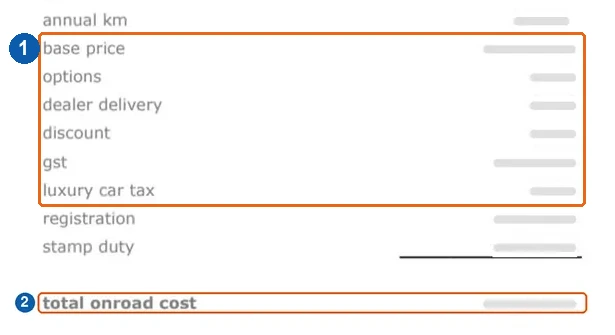

# How to read an Autopia novated lease quote

<!-- quote-review:begin -->
*Checked against 1 quote example; latest layout reviewed Nov 2026.*
<!-- quote-review:end -->

This numbered example shows an Autopia quote layout we reviewed. Match each marker to the table, then check the period and GST label on your own quote.

<!-- provider-traps:begin -->
## What catches people out on an Autopia quote

- **FBT base value:** “Base price” excludes GST. On this layout, use “total onroad cost” minus registration and stamp duty for the FBT base value.
<!-- provider-traps:end -->

*Customer values and identifying details removed. Your quote may use a different layout.*

*The quote prints “base price” before GST. Field 1 is worked out from the price breakdown.*

## Numbered field guide

<!-- provider-table:begin -->
| # | On the quote | In Guided |
|---|---|---|
| 1 | base price, GST and the other vehicle price lines | “Base price” excludes GST. On this layout, use “total onroad cost” minus registration and stamp duty for the FBT base value. |
| 2 | total onroad cost | Use “total onroad cost” in vehicle details for the drive-away price. |
| 3 | lease term | Lease term |
| 5 | autopia setup fee | If you see “autopia setup fee”, enter it as the documentation fee. |
| 6 | residual payment (inc gst) | Residual, "Including GST" |
| 7 | finance, under "monthly rental details" | Finance payment, per month. The lines are ex GST (GST is added as its own line below), so choose Excluding GST |
| 8 | luxury non-deductible (payroll calcs, ANNUAL column) | Use “luxury non-deductible” in the ANNUAL column. Choose Per year and enter it as printed. |
| 9 | maintenance, tyres, fuel, registration & ctp, insurance | Running-cost boxes, per month, ex GST |
| 10 | management fee | Lease management fees (add administration cost and reporting services if not $0) |
<!-- provider-table:end -->

The final **FBT base value** isn't printed on this sample. Its "base price" is the vehicle price
**excluding GST**, so use the marked breakdown to work out the GST-inclusive value before
registration and stamp duty. On another layout, confirm the lessor's FBT base value if the
purchase price or discount differs. The [ATO's employer guide](https://www.ato.gov.au/law/view/pdf?DocId=SAV%2FFBTGEMP%2F00012&PiT=99991231235958&filename=law%2Fview%2Fpdf%2Fsos%2Ffbtgemp20241122.pdf)
explains what belongs in a car's base value. Also not shown: **11 interest rate**.
"fringe benefit value" in the FBT calcs is the taxable value, not the base value.

<!-- provider-missing:begin -->
## If a figure isn't on your quote

- **Months deferred:** Can’t find months deferred on your Autopia quote? Choose “Not sure” (we’ll assume 2) unless told otherwise.
<!-- provider-missing:end -->

[Open Guided mode →](/calculator/) · [All provider quote guides →](/start-here/provider-quote-guides/)
