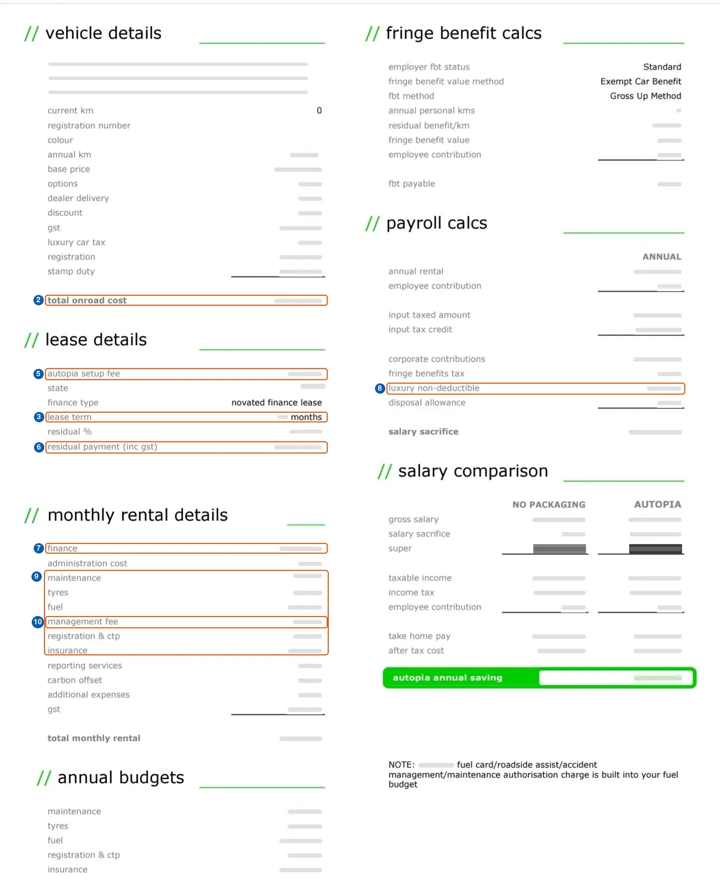

# How to read an Autopia novated lease quote

<!-- quote-review:begin -->
*Checked against 1 quote example; latest layout reviewed Nov 2026.*
<!-- quote-review:end -->

This numbered example shows an Autopia quote layout reviewed in November 2026. Match each marker to the table, then check the period and GST label on your own quote.

*Customer values and identifying details removed. Your quote may use a different layout.*

## Numbered field guide

<!-- provider-table:begin -->
| # | On the quote | In Guided |
|---|---|---|
| 2 | total onroad cost | Use “total onroad cost” in vehicle details for the drive-away price. Confirm your quote includes GST in that figure. |
| 3 | lease term | Lease term |
| 5 | autopia setup fee | If you see “autopia setup fee”, enter it as the documentation fee. |
| 6 | residual payment (inc gst) | Residual, "Including GST" |
| 7 | finance, under "monthly rental details" | Finance payment, per month. The lines are ex GST (GST is added as its own line below), so choose Excluding GST |
| 8 | luxury non-deductible (payroll calcs, ANNUAL column) | Luxury vehicle adjustment: divide the annual figure into your payment period |
| 9 | maintenance, tyres, fuel, registration & ctp, insurance | Running-cost boxes, per month, ex GST |
| 10 | management fee | Lease management fees (add administration cost and reporting services if not $0) |
<!-- provider-table:end -->

Not shown on this sample: **1 FBT base value**. Autopia doesn't print it, and its "base price" is the vehicle
price **excluding GST**: don't use it as the FBT base value. Add GST to the base price, options and
delivery instead (Guided's FBT tooltip explains). Also not shown: **4 deferral** (use "Not sure") and
**11 interest rate**. "fringe benefit value" in the FBT calcs is the taxable value, not the base value.

[Open Guided mode →](/calculator/) · [All provider quote guides →](/start-here/provider-quote-guides/)
