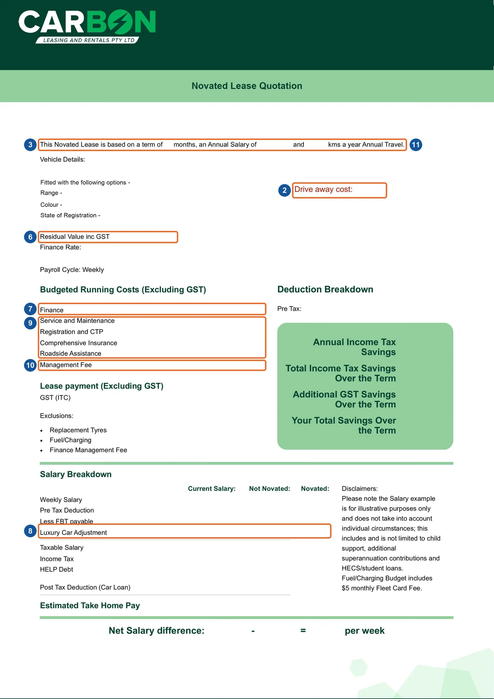

# How to read a CarBon novated lease quote

<!-- quote-review:begin -->
*Checked against 3 quote examples; latest layout reviewed Oct 2026.*
<!-- quote-review:end -->

The numbered example is a one-page [CarBon Leasing and Rentals quote](https://www.reddit.com/r/NovatedLeasingAU/comments/1s8dvmb/) from March 2026. Two later CarBon quotes ([May 2026](https://www.reddit.com/r/NovatedLeasingAU/comments/1tglqjr/), [October 2026](https://www.reddit.com/r/NovatedLeasingAU/comments/1xgrene/)) use the same layout. Check the period and GST labels on your own quote before entering a figure.

<!-- provider-traps:begin -->
## What catches people out on a CarBon quote

- **Finance payment:** Use “Finance” in “Budgeted Running Costs (Excluding GST)”, not “Lease payment”. The period is the “Payroll Cycle”.
<!-- provider-traps:end -->

*Customer values and identifying details removed. This pictured example is from March 2026; your quote may use a different layout.*

## Numbered field guide

| # | On the quote | In Guided |
|---|---|---|
| 2 | Drive away cost | Drive-away price, including GST. Not every CarBon quote prints it; if yours doesn't, work it out from the residual. |
| 3 | “based on a term of … months” in the first line | Lease term in months. |
| 6 | Residual Value inc GST | Residual; choose Including GST. |
| 7 | Finance, under Budgeted Running Costs (Excluding GST) | Finance payment; choose Excluding GST, per Payroll Cycle. Don't use “Lease payment”, which adds the running costs. |
| 8 | Luxury Car Adjustment, Novated column | Luxury adjustment, per Payroll Cycle. |
| 9 | Service and Maintenance, Replacement Tyres, Registration and CTP, Comprehensive Insurance, Fuel/Charging, Roadside Assistance | Running-cost budgets; choose Excluding GST, per Payroll Cycle. Add roadside to servicing. |
| 10 | Management Fee | Lease management fees. If it's $0 or listed under Exclusions, ask who will manage the lease and what they charge. |
| 11 | “… kms a year Annual Travel” in the first line | Kilometres per year. |

The pay period for every figure is the **Payroll Cycle** printed above the table: weekly on the pictured quote, fortnightly on the later two. The table's heading says Excluding GST; **GST (ITC)** below it is the GST credit, not part of the payment.

Lines listed under **Exclusions** aren't budgeted in the lease. Enter what you'd expect to spend on them yourself. The pictured quote excludes tyres and charging; the later two budget both. The March and May disclaimers note that the Fuel/Charging budget includes a monthly fleet card fee.

On the October quote, CarBon [explained](https://www.reddit.com/r/NovatedLeasingAU/comments/1xgrene/) that the management fee was $0 because another company would manage the lease. The March and May quotes list a “Finance Management Fee” under Exclusions without an amount; ask CarBon whether it's charged elsewhere.

<!-- provider-missing:begin -->
## If a figure isn't on your quote

- **FBT base value:** Can't find it on your CarBon quote? Ask CarBon, or take the drive-away price and subtract stamp duty, rego and CTP.
- **Months deferred:** Can’t find months deferred on your CarBon quote? Choose “Not sure” (we’ll assume 2) unless told otherwise.
- **Documentation fee:** CarBon quotes we've seen don't list fees added to the loan. Ask CarBon for the amount financed and any establishment fee. Leave this at $0 if CarBon confirms there are none.
<!-- provider-missing:end -->

[Open Guided mode →](/calculator/) · [All provider quote guides →](/start-here/provider-quote-guides/)
