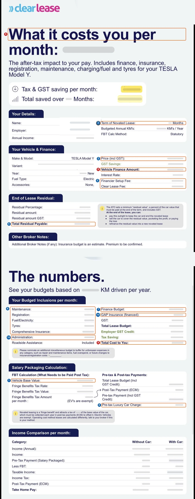

# How to read a Clear Lease novated lease quote

<!-- quote-review:begin -->
*Checked against 1 quote example; latest layout reviewed Nov 2026.*
<!-- quote-review:end -->

A Clear Lease quote opens with "What it costs you per month" in large print. That's the change to your take-home pay, not the finance payment. The figures to enter are on the page headed "The numbers".

<!-- provider-traps:begin -->
## What catches people out on a Clear Lease quote

- **Drive-away price:** Use “Price (incl GST)” under “Your Vehicle & Finance”. Don't use “Vehicle Finance Amount”: it has the GST saving taken off.
- **Finance payment:** Use “Finance Budget”, per month. Don't use “What it costs you per month” or “Total Cost to You”: they're after tax.
<!-- provider-traps:end -->

*Customer values and identifying details removed. Your quote may use a different layout.*

<!-- provider-table:begin -->
| # | On this quote | In Guided mode |
| --- | --- | --- |
| 1 | Vehicle Base Value, in FBT Calculation | Use “Vehicle Base Value” under “FBT Calculation”, on the page headed “The numbers”. |
| 2 | Price (incl GST), in Your Vehicle & Finance | Use “Price (incl GST)” under “Your Vehicle & Finance”. Don't use “Vehicle Finance Amount”: it has the GST saving taken off. |
| 3 | Term of Novated Lease | Lease term. |
| 5 | Financier Setup Fee and Clear Lease Fee | Add “Financier Setup Fee” and “Clear Lease Fee” together. |
| 6 | Total Residual Payable | If you see “Total Residual Payable”, choose Including GST. “Residual amount” is without GST. |
| 7 | Finance Budget, in Your Budget/ Inclusions per month | Use “Finance Budget”, per month. Don't use “What it costs you per month” or “Total Cost to You”: they're after tax. |
| 8 | Pre-tax Luxury Car Charge | If you see “Pre-tax Luxury Car Charge”, that's this line. |
| 9 | Maintenance, registration, fuel or electricity, tyres and comprehensive insurance | Use “Maintenance” to “Comprehensive Insurance” under “Your Budget/ Inclusions per month”, and choose Per month. |
| 10 | Administration, and GAP Insurance (financed) | Enter “Administration” as the management fee, and add “GAP Insurance (financed)” to it. |
<!-- provider-table:end -->

The red ✕ marks figures to avoid: *Vehicle Finance Amount* for the drive-away price, and *What it costs you per month* and *Total Cost to You* for the finance payment.

## Other things to know

- **GST:** the budget lists GST on its own line, then takes it off again as the *Employer GST Credit*.
- **Interest rate:** Clear Lease prints it under *Your Vehicle & Finance*. Guided works out the effective rate from the payment, so you can compare the two.
- **Savings boxes:** the savings at the top are Clear Lease's estimates. Guided works out your own from the figures above.

<!-- provider-missing:begin -->
## If a figure isn't on your quote

- **Months deferred:** Can’t find months deferred on your Clear Lease quote? Choose “Not sure” (we’ll assume 2) unless told otherwise.
<!-- provider-missing:end -->

[Open Guided mode →](/calculator/) · [All provider guides →](/start-here/provider-quote-guides/)
