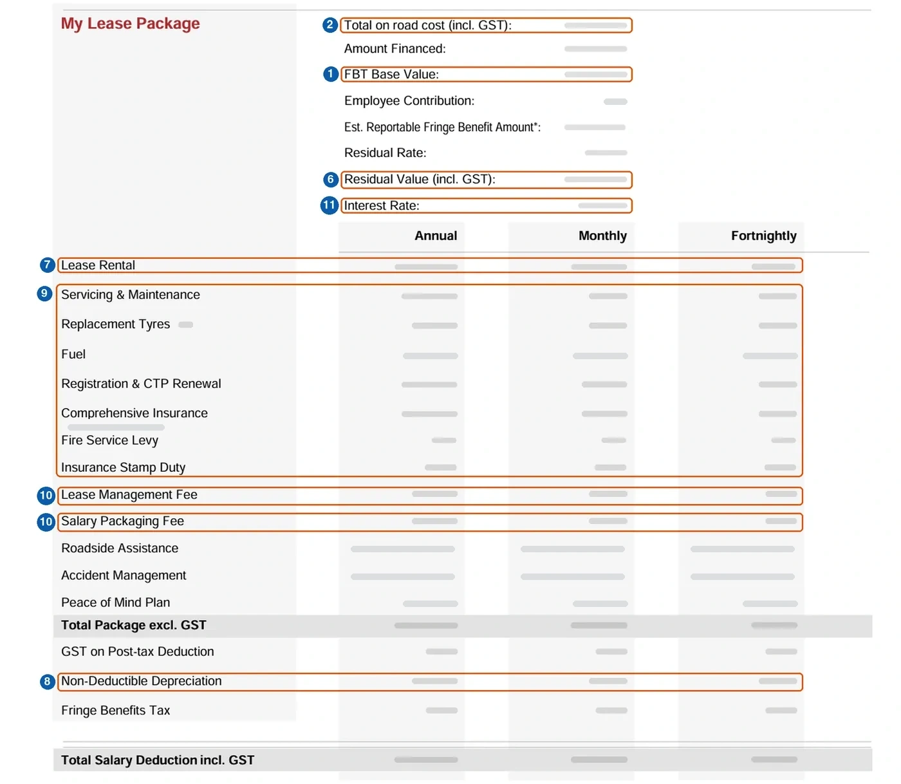

# How to read a Custom Fleet novated lease quote

<!-- quote-review:begin -->
*Checked against 1 quote example; latest layout reviewed Nov 2026.*
<!-- quote-review:end -->

This numbered example shows a Custom Fleet quote layout reviewed in November 2026. Match each marker to the table, then check the period and GST label on your own quote.

<!-- provider-traps:begin -->
## What catches people out on a Custom Fleet quote

Nothing on the Custom Fleet quotes we checked looked easy to misread. The table below shows where each figure is.
<!-- provider-traps:end -->

*Customer values and identifying details removed. Your quote may use a different layout.*

## Numbered field guide

<!-- provider-table:begin -->
| # | On the quote | In Guided |
|---|---|---|
| 1 | FBT Base Value | FBT base value |
| 2 | Total on road cost (incl. GST) | Use “Total on road cost (incl. GST)” near the top of “My Lease Package”. |
| 6 | Residual Value (incl. GST) | Residual, "Including GST" |
| 7 | Lease Rental (Annual / Monthly / Fortnightly columns) | Finance payment: pick one column and the matching period; ex GST (the section totals "Total Package excl. GST") |
| 8 | Non-Deductible Depreciation | If you see “Non-Deductible Depreciation”, that's the luxury vehicle adjustment. |
| 9 | Servicing & Maintenance, Replacement Tyres, Fuel, Registration & CTP, Comprehensive Insurance, Fire Service Levy, Insurance Stamp Duty | Running-cost boxes (same period as you chose) |
| 10 | Lease Management Fee + Salary Packaging Fee | If you see both “Lease Management Fee” and “Salary Packaging Fee”, include both in lease management fees. |
| 11 | Interest Rate | Compare with the effective rate Guided shows |
<!-- provider-table:end -->

Not shown on this sample: **3 lease term** (find the term on another page or ask the provider),
**4 deferral**, **5 doc fee**. Roadside Assistance and Accident Management are "Included in Lease
Rental"; leave them out.

[Open Guided mode →](/calculator/) · [All provider quote guides →](/start-here/provider-quote-guides/)
