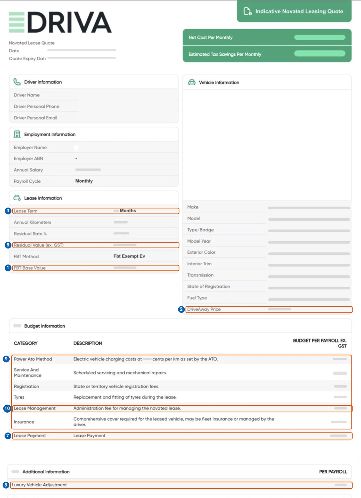

# How to read a Driva novated lease quote

<!-- quote-review:begin -->
*Checked against 1 quote example; latest layout reviewed Aug 2026.*
<!-- quote-review:end -->

This numbered example shows a Driva quote layout we reviewed. Match each marker to the table, then check the period and GST label on your own quote.

<!-- provider-traps:begin -->
## What catches people out on a Driva quote

- **Drive-away price:** If you see both “DriveAway Price” and a lower “Effective novated vehicle price”, use “DriveAway Price” including GST.
<!-- provider-traps:end -->

*Customer values and identifying details removed. Your quote may use a different layout.*

## Numbered field guide

<!-- provider-table:begin -->
| # | On the quote | In Guided |
|---|---|---|
| 1 | FBT Base Value | FBT base value |
| 2 | DriveAway Price (Vehicle Information) | If you see both “DriveAway Price” and a lower “Effective novated vehicle price”, use “DriveAway Price” including GST. |
| 3 | Lease Term | Lease term |
| 6 | Residual Value (ex. GST) | If you see “Residual Value (ex. GST)”, choose Excluding GST. |
| 7 | Lease Payment, in "Budget per payroll ex. GST" | If you see “Lease Payment” under “Budget per payroll ex. GST”, enter it excluding GST and choose the payroll period shown. |
| 8 | Luxury Vehicle Adjustment (page 2) | Luxury vehicle adjustment, per payroll |
| 9 | Power, Service and Maintenance, Registration, Tyres, Insurance | Running-cost boxes, per payroll, ex GST |
| 10 | Lease Management | Lease management fees |
<!-- provider-table:end -->

Not shown on this sample: **4 deferral**, **5 documentation fee**, **11 interest rate**. Use "Not sure" for
the deferral.

<!-- provider-missing:begin -->
## If a figure isn't on your quote

- **Months deferred:** Can’t find months deferred on your Driva quote? Choose “Not sure” (we’ll assume 2) unless told otherwise.
- **Documentation fee:** Can’t find a documentation or establishment fee on your Driva quote? Leave this at $0 unless yours lists one.
<!-- provider-missing:end -->

[Open Guided mode →](/calculator/) · [All provider quote guides →](/start-here/provider-quote-guides/)
