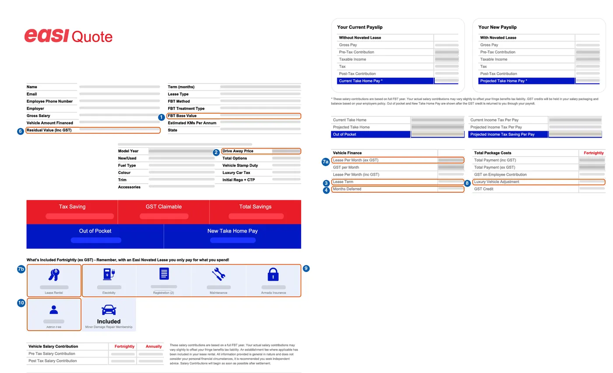

# How to read an Easi novated lease quote

<!-- quote-review:begin -->
*Checked against 3 quote examples; latest layout reviewed Nov 2026.*
<!-- quote-review:end -->

This example has **Lease Per Month (ex GST)** and a separate fortnightly **Lease Rental** tile. The fortnightly figure equals the monthly figure × 12 ÷ 26, allowing for rounding. Enter either one with its matching period and GST basis.

<!-- provider-traps:begin -->
## What catches people out on an Easi (EasiFleet) quote

- **Finance payment:** Use “Lease Per Month” per month or the fortnightly “Lease Rental” tile. Follow the GST heading on your quote.
<!-- provider-traps:end -->

*Customer values and identifying details removed. Your quote may use a different layout.*

<!-- provider-table:begin -->
| # | On this quote | In Guided mode |
| --- | --- | --- |
| 1 | FBT Base Value | FBT base value. |
| 2 | Drive Away Price | Use “Drive Away Price”, including GST. |
| 3 | Lease Term | Lease term. |
| 4 | Months Deferred | Months before payments start. |
| 6 | Residual Value (Inc GST) | Residual, *Including GST*. |
| 7a | Lease Per Month (ex GST) | Use per month, excluding GST as labelled. It reconciles with 7b after × 12 ÷ 26. |
| 7b | Lease Rental tile | Use “Lease Per Month” per month or the fortnightly “Lease Rental” tile. Follow the GST heading on your quote. |
| 8 | Luxury Vehicle Adjustment | Enter only if this adjustment applies to your quote. |
| 9 | Electricity, registration, maintenance and insurance | Running-cost budgets, with the period and GST basis shown. |
| 10 | Admin Fee | Lease management fee. |
<!-- provider-table:end -->

[Easi's finance-schedule guide](https://support.easifleet.com.au/novated-finance-schedule) explains the deferral: its example collects salary contributions over 60 months, then pays 58 larger financier instalments. Easi says the **total paid is the same**. The deferral does not make either quote figure wrong for this calculator. Check the payment's GST heading on your own quote.

An establishment fee may already be included in Lease Rental. Check your quote's footnote before adding a separate fee.

<!-- provider-missing:begin -->
## If a figure isn't on your quote

- **Documentation fee:** Can’t find a documentation or establishment fee on your Easi (EasiFleet) quote? Leave this at $0 unless yours lists one.
<!-- provider-missing:end -->

[Open Guided mode →](/calculator/) · [All provider guides →](/start-here/provider-quote-guides/)
