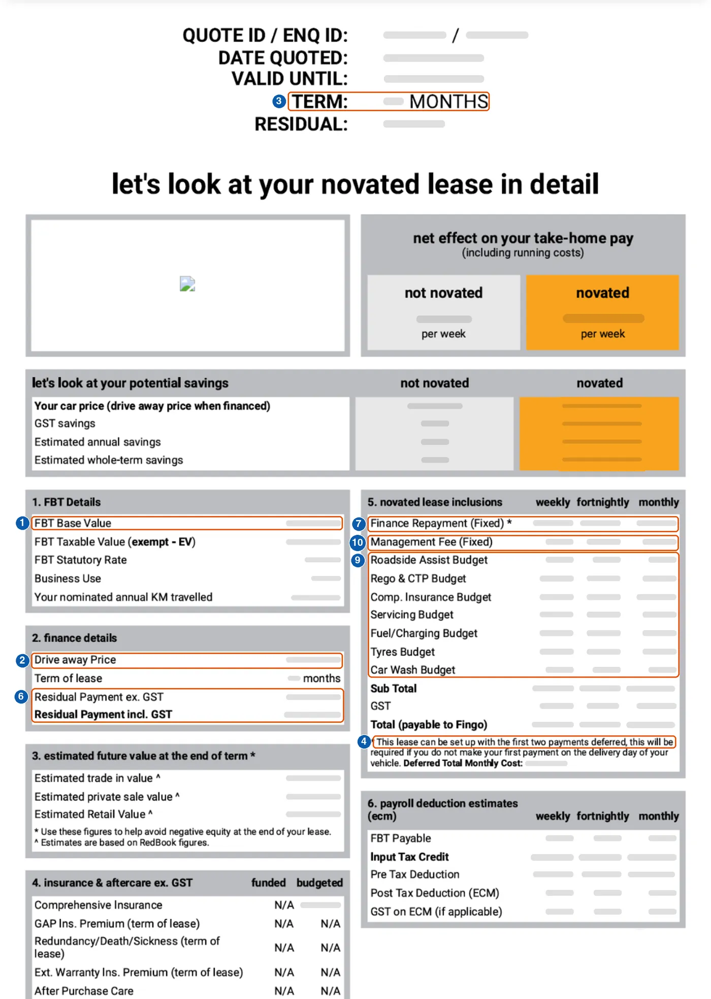

# How to read a Fingo novated lease quote

<!-- quote-review:begin -->
*Checked against 1 quote example; latest layout reviewed Nov 2026.*
<!-- quote-review:end -->

This numbered example shows a Fingo quote layout reviewed in November 2026. Match each marker to the table, then check the period and GST label on your own quote.

<!-- provider-traps:begin -->
## What catches people out on a Fingo (Automotive Lease Packaging) quote

- **Drive-away price:** If you see “Your car price (drive away price when financed)”, it has the GST saving taken off. Use the full “Drive away Price” instead.
<!-- provider-traps:end -->

*Customer values and identifying details removed. Your quote may use a different layout.*

## Numbered field guide

<!-- provider-table:begin -->
| # | On the quote | In Guided |
|---|---|---|
| 1 | FBT Base Value | FBT base value |
| 2 | Drive away Price (section 2, finance details) | If you see “Your car price (drive away price when financed)”, it has the GST saving taken off. Use the full “Drive away Price” instead. |
| 3 | TERM (also "Term of lease") | Lease term |
| 4 | Footnote: "This lease can be set up with the first two payments deferred" | If the footnote says the first two payments can be deferred, check whether your quote uses that option before choosing 2 months. |
| 6 | Residual Payment ex. GST / Residual Payment incl. GST | Residual: enter either and choose the matching GST answer |
| 7 | Finance Repayment (Fixed), weekly / fortnightly / monthly | Use “Finance Repayment (Fixed)” with the period shown in its column. Check the subtotal for GST. |
| 9 | Roadside, Rego & CTP, Comp. Insurance, Servicing, Fuel/Charging, Tyres, Car Wash budgets | Running-cost boxes, ex GST, in the same period |
| 10 | Management Fee (Fixed) | Lease management fees |
<!-- provider-table:end -->

The example has GST as a separate line below the finance subtotal. Check that your quote uses the same treatment before choosing the finance payment's GST basis.

"Input Tax Credit" in section 6 is the employer's GST credit on the package; with running costs
entered ex GST, choose "Excluding GST" for the running-cost heading.

Not shown on this sample: **5 documentation fee**, **8 luxury vehicle adjustment**, **11 interest rate**.

[Open Guided mode →](/calculator/) · [All provider quote guides →](/start-here/provider-quote-guides/)
