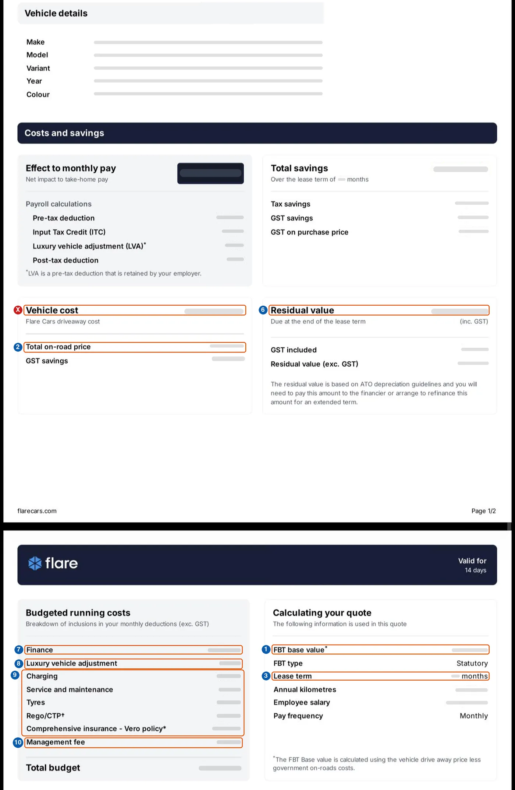

# How to read a Flare novated lease quote

<!-- quote-review:begin -->
*Checked against 2 quote examples; latest layout reviewed Nov 2026.*
<!-- quote-review:end -->

Flare shows both **Vehicle cost** and **Total on-road price** on this layout. Use the full *Total on-road price* for the drive-away field; Vehicle cost is after the quoted GST saving.

<!-- provider-traps:begin -->
## What catches people out on a Flare quote

- **Drive-away price:** If you see “Vehicle cost — Flare Cars driveaway cost”, don't use it: it has the GST saving taken off. Use “Total on-road price”.
<!-- provider-traps:end -->

*Customer values and identifying details removed. Your quote may use a different layout.*

<!-- provider-table:begin -->
| # | On this quote | In Guided mode |
| --- | --- | --- |
| 1 | FBT base value | FBT base value. |
| 2 | Total on-road price | If you see “Vehicle cost — Flare Cars driveaway cost”, don't use it: it has the GST saving taken off. Use “Total on-road price”. |
| 3 | Lease term | Lease term. |
| 6 | Residual value (inc. GST) | Residual, *Including GST*. |
| 7 | Finance, in Budgeted running costs | If you see “Finance” under “Budgeted running costs”, that's the fortnightly payment. |
| 8 | Luxury vehicle adjustment | Enter if it applies to your quote. |
| 9 | Charging, service, tyres, registration and insurance | Running-cost budgets, excluding GST. |
| 10 | Management fee | Lease management fee. |
<!-- provider-table:end -->

The red ✕ beside Vehicle cost marks the figure to avoid for the drive-away field. Deferral is not stated on these pages; choose *I'm not sure* if your quote does not confirm it.

[Open Guided mode →](/calculator/) · [All provider guides →](/start-here/provider-quote-guides/)
