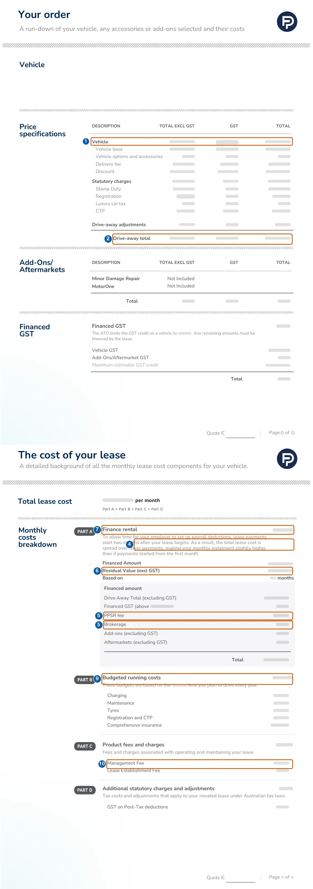

# How to read a FleetPartners novated lease quote

<!-- quote-review:begin -->
*Checked against 2 quote examples; latest layout reviewed Nov 2026.*
<!-- quote-review:end -->

On this layout, the monthly lease cost is split into **Part A** finance rental, **Part B** running-cost budgets, **Part C** product fees, and **Part D** other adjustments. Enter the relevant components separately in Guided mode.

<!-- provider-traps:begin -->
## What catches people out on a FleetPartners quote

- **Documentation fee:** If “Lease Establishment Fee” is monthly, add it to management fees instead. Add the one-off PPSR fee and any financed brokerage.
<!-- provider-traps:end -->

*Customer values, vehicle details and identifying details removed. Your quote may use a different layout.*

<!-- provider-table:begin -->
| # | On this quote | In Guided mode |
| --- | --- | --- |
| 2 | Drive-away total, Total column | Use “Drive-away total” in the Total column, including GST. |
| 4 | Part A: "lease payments start two months after your lease begins", and "Based on 58 months" | Use the stated delay before lease payments start, or subtract “Based on” months from the lease term. |
| 5 | PPSR fee and Brokerage, in Financed amount | Check both one-off fees. Enter PPSR as a documentation fee; check how brokerage is handled in your quote. |
| 6 | Residual Value (excl GST) | Residual, *Excluding GST*. |
| 7 | Finance rental, Part A | Finance payment, *Per month*. |
| 9 | Budgeted running costs, Part B | Enter the listed budgets separately. |
| 10 | Management Fee, Part C | Lease management fee. |
| 10 | Lease Establishment Fee, Part C (a monthly amount) | Add it to lease management fees, not the documentation fee: it's charged every month. |
<!-- provider-table:end -->

Here the deferral is 60 lease months minus 58 payment months, or 2 months.

**FBT base value (1)** isn't labelled on these pages. On the "Your order" page, use the **Total column of the "Vehicle" line**: the car after any discount, with options and delivery, including GST, before on-road costs. On the quote checked it matched the FBT base value another provider printed for the same car.

Do not enter **Total lease cost** as the finance payment: it also includes the other parts.

[Open Guided mode →](/calculator/) · [All provider guides →](/start-here/provider-quote-guides/)
