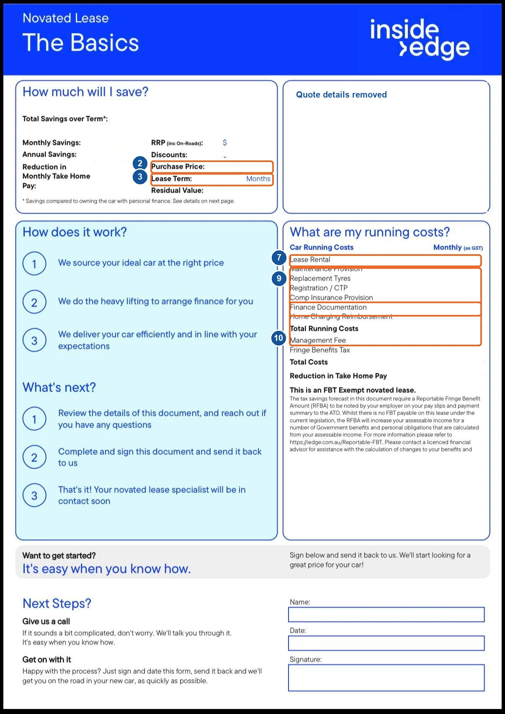
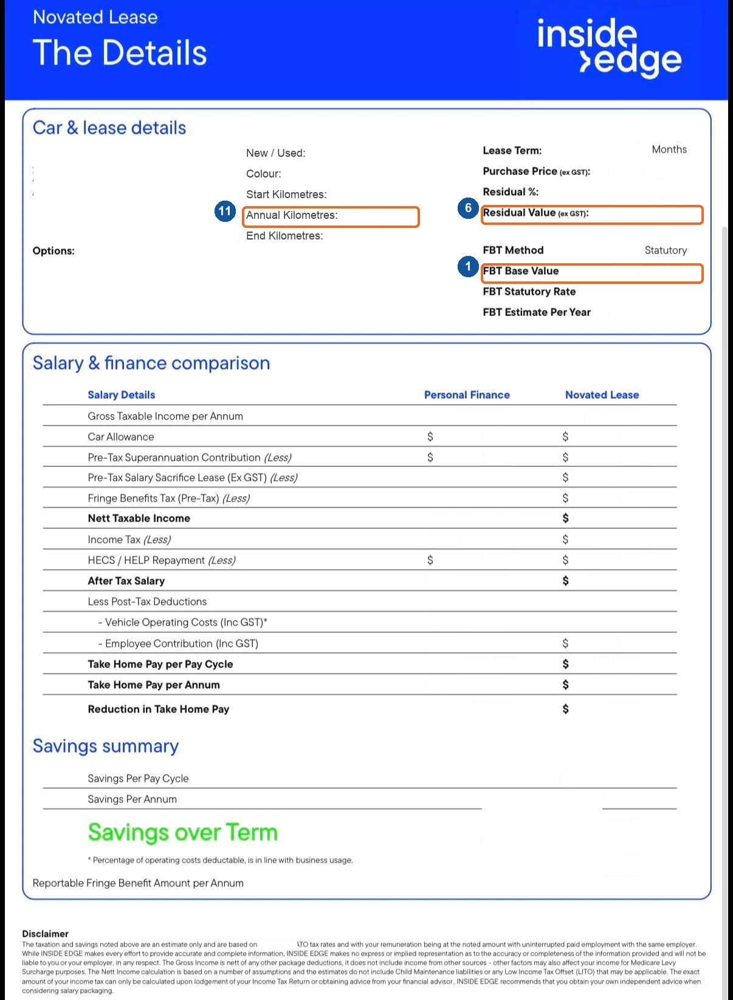

# How to read an Inside Edge novated lease quote

<!-- quote-review:begin -->
*Checked against 3 quote examples; latest layout reviewed May 2026.*
<!-- quote-review:end -->

The numbered example uses **The Basics** and **The Details** pages from the [same Inside Edge quote](https://www.reddit.com/r/NovatedLeasingAU/comments/1p2wqvv/). A [later Inside Edge quote](https://www.reddit.com/r/NovatedLeasingAU/comments/1t2cg4z/quote_review_pls_inside_edge_vs_sg_fleet/) shows the same Basics layout. Check the period and GST labels on your own quote before entering a figure.

## The Basics

<!-- provider-traps:begin -->
## What catches people out on an Inside Edge quote

- **Drive-away price:** Use “Purchase Price” on The Basics page. Check it includes on-road costs. Don't use “Purchase Price (ex GST)” on The Details page.
- **Documentation fee:** If “Finance Documentation” is monthly, add it to management fees. Enter a one-off documentation fee only if listed separately.
<!-- provider-traps:end -->

## The Details

*Customer values and identifying details removed. This pictured example is from November 2025; your quote may use a different layout.*

## Numbered field guide

<!-- provider-table:begin -->
| # | On the quote | In Guided |
|---|---|---|
| 1 | FBT Base Value, The Details | FBT base value, including GST. |
| 2 | Purchase Price, The Basics | Drive-away price, including GST. Compare it with “RRP (inc On-Roads)” and confirm it includes on-road costs. |
| 3 | Lease Term | Lease term in months. |
| 6 | Residual Value (ex GST), The Details | Residual; choose Excluding GST. |
| 7 | Lease Rental under Car Running Costs | Finance payment; use the period and GST basis printed in the heading on your quote. |
| 9 | Maintenance Provision, Replacement Tyres, Registration / CTP, Comp Insurance Provision, Home Charging Reimbursement | Running-cost budgets; use the period and GST basis printed in the heading. Leave out Lease Rental and totals. |
| 10 | Management Fee and Finance Documentation | Add both recurring charges as lease management fees. |
| 11 | Annual Kilometres, The Details | Kilometres per year. |
<!-- provider-table:end -->

The Basics page also prints a “Residual Value” without a GST label. The Details page labels its residual **ex GST**, making the choice in Guided clear. The example does not state months deferred; choose “Not sure” unless your own quote says otherwise.

<!-- provider-missing:begin -->
## If a figure isn't on your quote

- **Months deferred:** Can’t find months deferred on your Inside Edge quote? Choose “Not sure” (we’ll assume 2) unless told otherwise.
<!-- provider-missing:end -->

[Open Guided mode →](/calculator/) · [All provider quote guides →](/start-here/provider-quote-guides/)
