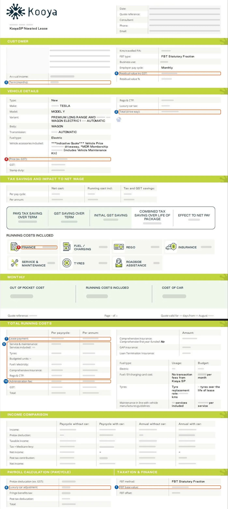
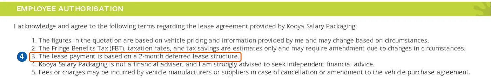

# How to read a Kooya novated lease quote

<!-- quote-review:begin -->
*Checked against 3 quote examples; latest layout reviewed Aug 2026.*
<!-- quote-review:end -->

A Kooya quote shows most figures twice: once in the coloured tiles on page 1 and again in the tables. The two don't match. Use the tables.

<!-- provider-traps:begin -->
## What catches people out on a Kooya quote

- **Drive-away price:** Use “Total (drive way)”. Don't use “Price (ex. GST)”: it has the GST saving taken off.
- **Finance payment:** Use “Lease payment” under “Total running costs”. Don't use the “Finance” tile on page 1: it's a different figure.
<!-- provider-traps:end -->

*Customer values and identifying details removed. Your quote may use a different layout.*

<!-- provider-table:begin -->
| # | On this quote | In Guided mode |
| --- | --- | --- |
| 1 | FBT base value, in Taxation & finance | Look for “FBT base value” under “Taxation & finance”, near the end of the quote. |
| 2 | Total (drive way), in Vehicle details | Use “Total (drive way)”. Don't use “Price (ex. GST)”: it has the GST saving taken off. |
| 3 | Term (months) | Lease term. |
| 4 | “based on a 2-month deferred lease structure”, in Employee authorisation | If you see “based on a 2-month deferred lease structure” under “Employee authorisation”, choose 2 months. |
| 6 | Residual value inc GST | If you see “Residual value inc GST”, choose Including GST. |
| 7 | Lease payment, in Total running costs | Use “Lease payment” under “Total running costs”. Don't use the “Finance” tile on page 1: it's a different figure. |
| 8 | Luxury car adjustment, in Payroll calculation | If you see “Luxury car adjustment” under “Payroll calculation”, that's this line. |
| 9 | Service & maintenance, tyres, fuel or electricity, insurance, and rego & CTP | Use the “Per paycycle” lines under “Total running costs”, not the tiles on page 1. Choose the period shown in “Employer pay cycle”. |
| 10 | Administration fee | Lease management fee. |
<!-- provider-table:end -->

The red ✕ marks figures to avoid: *Price (ex. GST)* for the drive-away price, and the *Finance* tile for the lease payment.

The deferral (4) isn't on the pages above. It was in the *Employee authorisation* section of a separate Kooya quote:

*Part of a separate Kooya quote, with the deferral line marked 4.*

## Other things to know

- **Pay period:** “Per paycycle” follows *Employer pay cycle* near the top. It was monthly on one quote we checked and fortnightly on another.
- **Savings boxes:** the savings figures on page 1 are Kooya's estimates. Guided works out your own from the figures above.
- **First-year insurance:** every Kooya quote we checked said *Comprehensive first year funded: No*. If yours says Yes, ask Kooya how much of the premium is in the amount financed.

<!-- provider-missing:begin -->
## If a figure isn't on your quote

- **Documentation fee:** Can’t find a documentation or establishment fee on your Kooya quote? Leave this at $0 unless yours lists one.
<!-- provider-missing:end -->

[Open Guided mode →](/calculator/) · [All provider guides →](/start-here/provider-quote-guides/)
