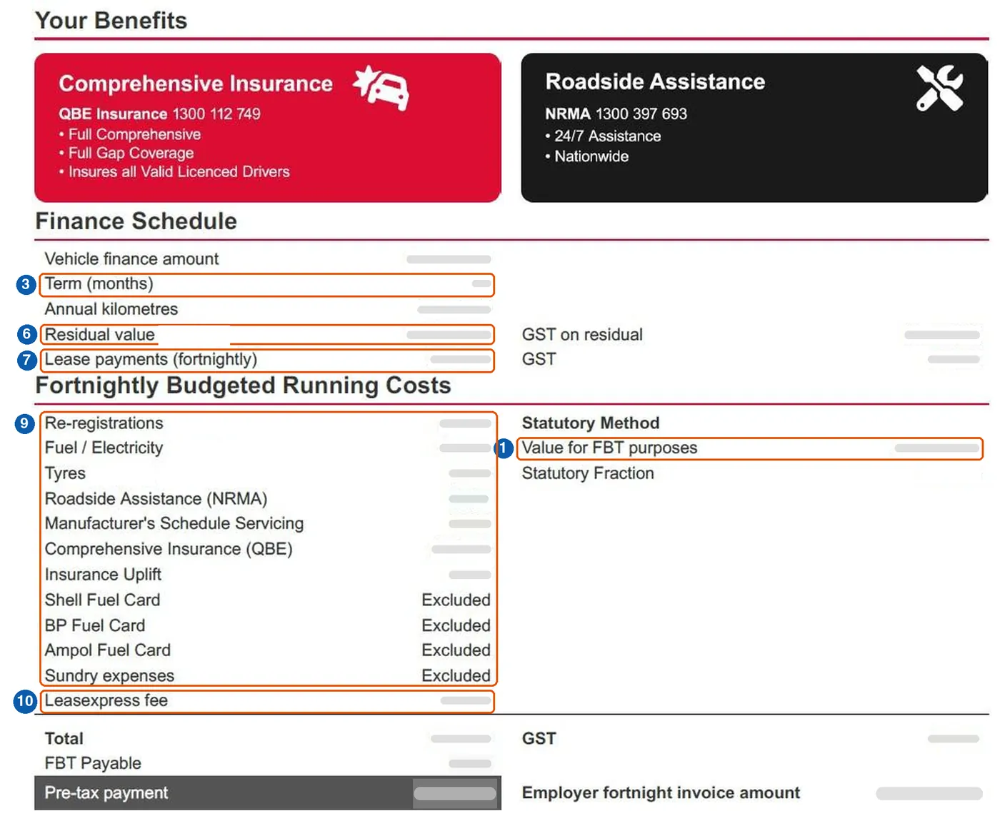

# How to read a LeaseExpress novated lease quote

<!-- quote-review:begin -->
*Checked against 1 quote example; latest layout reviewed Nov 2026.*
<!-- quote-review:end -->

This numbered example shows a LeaseExpress quote layout reviewed in November 2026. Match each marker to the table, then check the period and GST label on your own quote.

*Customer values and identifying details removed. Your quote may use a different layout.*

## Numbered field guide

<!-- provider-table:begin -->
| # | On the quote | In Guided |
|---|---|---|
| 1 | Value for FBT purposes | If you see “Value for FBT purposes”, that's the FBT base value. |
| 3 | Term (months) | Lease term |
| 6 | Residual value | If “GST on residual” sits beside “Residual value”, enter the residual figure and choose Excluding GST. |
| 7 | Lease payments (fortnightly) | If “Lease payments (fortnightly)” has GST in a separate column, enter the payment per fortnight, excluding that GST. |
| 9 | Re-registrations to Sundry expenses (fortnightly) | Running-cost boxes, per fortnight. "Excluded" lines are $0; Insurance Uplift goes with insurance; roadside goes in Servicing |
| 10 | Leasexpress fee | Lease management fees |
<!-- provider-table:end -->

"Vehicle finance amount" is the amount financed, not the drive-away price. Ask for the full
on-road price including GST, or use Guided's residual helper if it is unavailable.

Not shown on this sample: **2 drive-away price** (use the calculator's residual helper), **4 deferral**
(choose "Not sure" if your quote does not say), **5 documentation fee**, **8 luxury vehicle adjustment**,
**11 interest rate**.

[Open Guided mode →](/calculator/) · [All provider quote guides →](/start-here/provider-quote-guides/)
