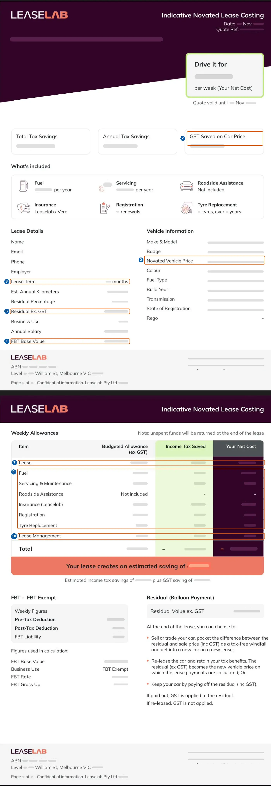

# How to read a LeaseLab novated lease quote

<!-- quote-review:begin -->
*Checked against 1 quote example; latest layout reviewed Nov 2026.*
<!-- quote-review:end -->

This numbered example shows a LeaseLab quote layout we reviewed. Match each marker to the table, then check the period and GST label on your own quote.

<!-- provider-traps:begin -->
## What catches people out on a LeaseLab quote

- **Drive-away price:** On page 1, add “GST Saved on Car Price” to “Novated Vehicle Price”, or ask for the full on-road price.
<!-- provider-traps:end -->

*Customer values and identifying details removed. Your quote may use a different layout.*

## Numbered field guide

<!-- provider-table:begin -->
| # | On the quote | In Guided |
|---|---|---|
| 1 | FBT Base Value | FBT base value |
| 2 | “GST Saved on Car Price” near the top of page 1 + “Novated Vehicle Price” in Vehicle Information below | On page 1, add “GST Saved on Car Price” to “Novated Vehicle Price”, or ask for the full on-road price. |
| 3 | Lease Term | Lease term |
| 6 | Residual Ex. GST (also "Residual Value ex. GST" on page 2) | If the residual is labelled ex GST, choose “Excluding GST”. |
| 7 | Lease, under "Weekly Allowances" (or "Fortnightly Allowances") … "Budgeted Allowance (ex GST)" | If “Lease” is under “Budgeted Allowance (ex GST)”, choose the period in the heading (Weekly or Fortnightly Allowances) and Excluding GST. |
| 9 | Fuel, Servicing & Maintenance, Roadside, Insurance, Registration, Tyre Replacement | Running-cost boxes, **per week or per fortnight** as the heading says, ex GST. Roadside goes with Servicing |
| 10 | Lease Management | Lease management fees, same period as the heading |
<!-- provider-table:end -->

Drive-away price (2) isn't printed as a total. On **page 1**, “GST Saved on Car Price” is the
right-hand savings tile near the top. “Novated Vehicle Price” is in the **Vehicle Information**
box farther down on the right. Add them to reverse the GST reduction, then check the sum
against the dealer's full on-road price if you have it.

The page notes "unspent funds will be returned at the end of the lease": the allowances are
budgets, not fixed fees.

Not shown on this sample: **8 luxury vehicle adjustment**, **11 interest rate**.

<!-- provider-missing:begin -->
## If a figure isn't on your quote

- **Months deferred:** Can’t find months deferred on your LeaseLab quote? Choose “Not sure” (we’ll assume 2) unless told otherwise.
- **Documentation fee:** Can’t find a documentation or establishment fee on your LeaseLab quote? Leave this at $0 unless yours lists one.
<!-- provider-missing:end -->

[Open Guided mode →](/calculator/) · [All provider quote guides →](/start-here/provider-quote-guides/)
