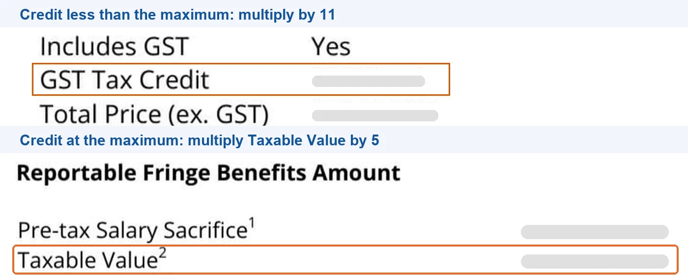

# How to read a Lendly novated lease quote

<!-- quote-review:begin -->
*Checked against 2 quote examples; latest layout reviewed Oct 2026.*
<!-- quote-review:end -->

This numbered example shows a Lendly quote layout we reviewed. Match each marker to the table, then check the period and GST label on your own quote.

<!-- provider-traps:begin -->
## What catches people out on a Lendly quote

- **Drive-away price:** Add “Total Price (ex. GST)” and “GST Tax Credit”. Don't use “Total Price (ex. GST)” on its own.
<!-- provider-traps:end -->

*Customer values and identifying details removed. Your quote may use a different layout.*

## Numbered field guide

<!-- provider-table:begin -->
| # | On the quote | In Guided |
|---|---|---|
| 2 | GST Tax Credit + Total Price (ex. GST) | Add “Total Price (ex. GST)” and “GST Tax Credit”. Don't use “Total Price (ex. GST)” on its own. |
| 3 | Monthly running costs (N mths / … kms) | Lease term = N months |
| 6 | Residual Value | Residual, "Including GST" (only the definition below says so) |
| 7 | Lease | Finance payment, per month. GST basis isn't labelled; choose "I'm not sure" |
| 8 | Luxury Vehicle Adjustment | Luxury vehicle adjustment, per month |
| 9 | Monthly running costs: charging, insurance, registration, maintenance, tyres, car wash, roadside | Running-cost boxes, per month |
| 10 | Licence Fee | Lease management fees |
<!-- provider-table:end -->

Note: the "^" on Lease says the lease includes add-ons (tint, dash cam, scratch & dent, membership). On the quote reviewed, those add-ons are financed on top of the “Drive Away” price: “Total Price (ex. GST)” is about $2,490 more than the drive-away price less the GST credit. Adding “Total Price (ex. GST)” and “GST Tax Credit” gives a drive-away figure that includes them. On a [Lendly quote](https://www.reddit.com/r/NovatedLeasingAU/comments/1t93tpn/) with its extras inside the drive-away price, the two methods agree to the cent.

The FBT base value is not printed, but Lendly's own figure can be worked out two ways. On the quote reviewed, “GST Tax Credit” × 11 and “Taxable Value” × 5 gave the same figure to the cent. Use the second when the credit is at the maximum.

Not shown on this sample: **11 interest rate**.

<!-- provider-missing:begin -->
## If a figure isn't on your quote

- **FBT base value:** Find “GST Tax Credit”. Less than $6,353? Multiply it by 11. At $6,353, the maximum? Multiply “Taxable Value” by 5. “Taxable Value” is under “Reportable Fringe Benefits Amount”, near the end of the quote.

  
- **Months deferred:** Can’t find months deferred on your Lendly quote? Choose “Not sure” (we’ll assume 2) unless told otherwise.
- **Documentation fee:** Can’t find a documentation or establishment fee on your Lendly quote? Leave this at $0 unless yours lists one.
<!-- provider-missing:end -->

[Open Guided mode →](/calculator/) · [All provider quote guides →](/start-here/provider-quote-guides/)
