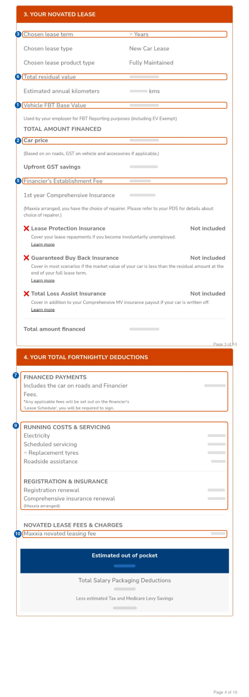

# How to read a Maxxia novated lease quote

<!-- quote-review:begin -->
*Checked against 2 quote examples; latest layout reviewed Nov 2026.*
<!-- quote-review:end -->

The Maxxia layouts reviewed in November 2026 use **Financed payments** for the lease payment. They may include financier fees and the first year's comprehensive insurance in the amount financed. Check those inclusions when comparing the quote with another offer.

*Quote-page example with customer values and identifying details removed. Match the blue numbers to the table below; your layout may differ.*

<!-- provider-table:begin -->
| # | Guided field | Look for on the quote | What to enter |
| --- | --- | --- | --- |
| 1 | FBT base value | **Vehicle FBT Base Value** | The value as printed, including GST. |
| 2 | Drive-away price | **Car price (based on on roads)** | Use this price, not the FBT base value. They can differ. |
| 5 | Documentation fee and financed insurance | **Financier's Establishment Fee** and **1st year Comprehensive Insurance** | Enter “Financier's Establishment Fee” here. If year-one insurance is financed, use Guided's separate insurance question. |
| 6 | Residual | **Total residual value** | The reviewed layout does not label GST clearly. Choose *I'm not sure* if your own quote does not clarify it. |
| 7 | Finance payment | **Financed payments** | Enter the payment in the period shown. Check the heading or ask Maxxia whether it includes GST. |
| 9 | Insurance | **Comprehensive insurance renewal** under running costs | Enter the full yearly insurance premium, including year one. Guided accounts for any financed first-year premium separately. |
<!-- provider-table:end -->

## First-year insurance

The Maxxia quotes reviewed include the first year's comprehensive insurance in the amount financed ("1st year Comprehensive Insurance"). Their running costs budget for renewals ("Comprehensive insurance renewal").

1. **Documentation fee:** enter only "Financier's Establishment Fee". Answer **Yes** to the separate first-year insurance question and enter "1st year Comprehensive Insurance" there. Both amounts enter the financed amount used for the effective interest rate.
2. **Insurance running cost:** enter your expected full yearly premium, not just the renewal budget. The cash comparison needs a full year of insurance every year. Guided removes the financed first-year premium from the lease's running-cost budget, so it is counted once through the finance payment.

The financed payment can include fees or insurance that another provider lists separately. The [general quote guide](/start-here/how-to-read-a-novated-lease-quote/) explains why comparing only the payment or a quoted rate can mislead.

[Open Guided mode →](/calculator/) · [All provider quote guides →](/start-here/provider-quote-guides/)
