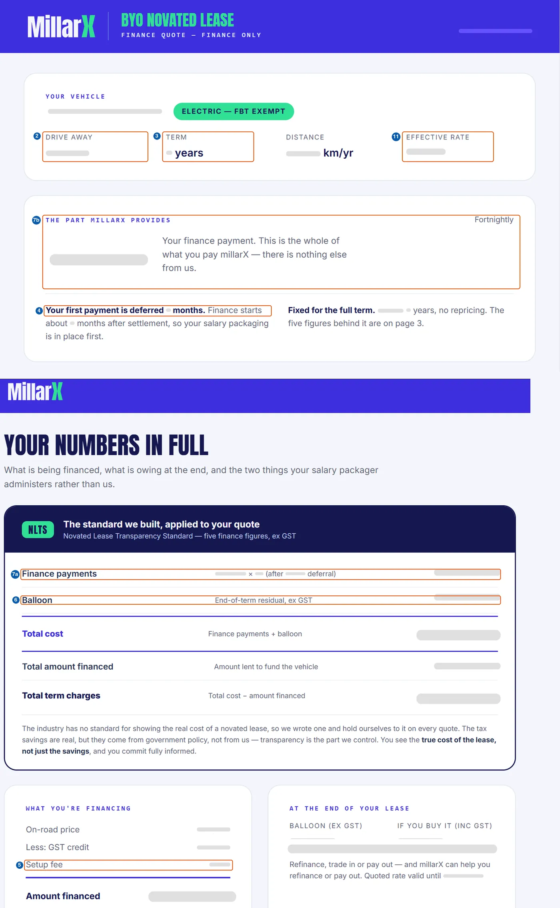

# How to read a MillarX novated lease quote

<!-- quote-review:begin -->
*Checked against 3 quote examples; latest layout reviewed Oct 2026.*
<!-- quote-review:end -->

This numbered example shows a MillarX quote layout we reviewed. Match each marker to the table, then check the period and GST label on your own quote.

<!-- provider-traps:begin -->
## What catches people out on a MillarX quote

- **Finance payment:** Use the fortnightly payment or “$X/mth × N” with its matching period, then run the correction tool.
<!-- provider-traps:end -->

*Customer values and identifying details removed. Your quote may use a different layout.*

## Numbered field guide

<!-- provider-table:begin -->
| # | On the quote | In Guided |
|---|---|---|
| 2 | DRIVE AWAY (cover); also "On-road price" under What you're financing | Drive-away price |
| 3 | TERM | Lease term |
| 4 | "Your first payment is deferred N months"; also "$X/mth × N" (term − N = deferral) | First payment: after that many months |
| 5 | Setup fee | Documentation fee |
| 6 | Balloon (End-of-term residual, ex GST) | Residual, "Excluding GST" (the "If you buy it (inc GST)" figure is the same amount inc GST) |
| 7a | Finance payments "$X/mth × N" | Use the fortnightly payment or “$X/mth × N” with its matching period, then run the correction tool. |
| 7b | THE PART MILLARX PROVIDES, Fortnightly | Or this one, per fortnight, with the matching GST answer and the MillarX correction (buffer = the deferral months) |
| 11 | EFFECTIVE RATE | Compare with the effective rate Guided shows |
<!-- provider-table:end -->

Check the payment's GST heading and footnotes on your own quote. In the correction tool, use the deferred months as the buffer.

Older MillarX quotes show "Finance + fee" per fortnight: that includes the monthly management fee,
so take it out before using 7b (or use 7a). On those quotes the management fee is a separate card
("Management fee, per month") — enter it in Guided's lease management fees.

Not shown on this sample: **1 FBT base value**, **8 luxury vehicle adjustment**, **9 running costs** and
**10 lease management fees** (this is a finance-only BYO quote; running costs and fees come from your
salary packager).

[Open Guided mode →](/calculator/) · [All provider quote guides →](/start-here/provider-quote-guides/)
