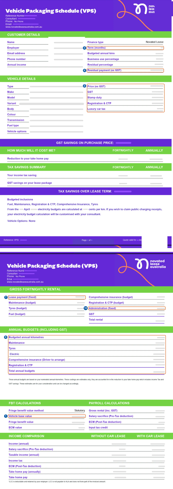

# How to read an NLA novated lease quote

<!-- quote-review:begin -->
*Checked against 1 quote example; latest layout reviewed Nov 2026.*
<!-- quote-review:end -->

The NLA Vehicle Packaging Schedule shown here separates the vehicle price components and labels the residual **ex GST**. Use the GST basis printed beside each figure.

*Customer values and identifying details removed. Your quote may use a different layout.*

<!-- provider-table:begin -->
| # | On this quote | In Guided mode |
| --- | --- | --- |
| 1 | Vehicle base value, FBT calculations | If you see “Vehicle base value” in the FBT calculations box, that's the FBT base value. |
| 2 | Price (ex GST), GST, stamp duty, registration and CTP | If no drive-away total is printed, add the vehicle price, GST, stamp duty, registration and CTP shown on the quote. |
| 3 | Term (months) | Lease term. |
| 6 | Residual payment (ex GST) | If you see “Residual payment (ex GST)”, choose Excluding GST. |
| 7 | Lease payment (fixed), Gross fortnightly rental | Under “Gross fortnightly rental”, enter “Lease payment (fixed)” per fortnight, excluding its GST line—not take-home-pay reduction. |
| 9 | Annual budgets | Running-cost budgets; convert their period when Guided asks. |
| 10 | Administration (fixed) | Lease management fee. |
<!-- provider-table:end -->

Keep the **reduction to your take-home pay** out of the finance-payment field.

[Open Guided mode →](/calculator/) · [All provider guides →](/start-here/provider-quote-guides/)
