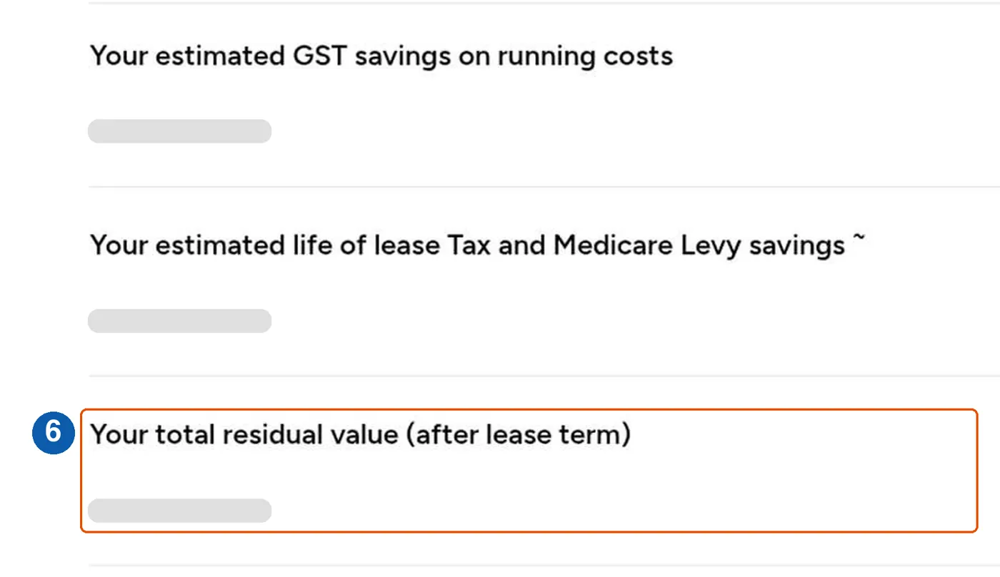

# How to read an Oly novated lease quote

<!-- quote-review:begin -->
*Checked against 2 quote examples; latest layout reviewed Nov 2026.*
<!-- quote-review:end -->

This numbered example shows an Oly quote layout we reviewed. Match each marker to the table, then check the period and GST label on your own quote.

<!-- provider-traps:begin -->
## What catches people out on an Oly quote

- **Drive-away price:** Don’t use “Oly driveaway price”: it has the GST saving taken off. Use “Recommended retail price” if it includes all on-road charges.
- **Documentation fee:** Enter only “Financier's Establishment fee” as the documentation fee. Financed year-one insurance has its own question.
<!-- provider-traps:end -->

*Customer values and identifying details removed. Your quote may use a different layout.*

## Numbered field guide

<!-- provider-table:begin -->
| # | On the quote | In Guided |
|---|---|---|
| 2 | Recommended retail price (shown struck out) | On this example it reconciles to the on-road price including GST. Check that the figure on your own quote includes all on-road charges; otherwise use the dealer's full drive-away price. "Your Oly novated leasing price" / "Oly driveaway price" has the GST saving taken off. |
| 3 | Your chosen novated lease term | Lease term |
| 5 | Financier's Establishment fee and First year Comprehensive Insurance | Enter only “Financier's Establishment fee” as the documentation fee. Financed year-one insurance has its own question. |
| 7 | Car lease payments | Finance payment, per month (the page says "Monthly"). No GST label: choose "I'm not sure" unless your quote says. |
| 9 | Monthly running-cost budget lines | Running-cost boxes, per month. Incidentals and roadside → Servicing. |
<!-- provider-table:end -->

## Residual, at the end of the estimate

*The last section of the same estimate, with figures removed.*

| # | On the quote | In Guided |
|---|---|---|
| 6 | Your total residual value (after lease term) | Residual. On the estimate checked it included GST and equalled the ATO minimum on Oly's ex-GST price, plus GST. Check the GST wording on yours. |

## First-year insurance

The Oly quote reviewed includes the first year's comprehensive insurance in the amount financed ("First year Comprehensive Insurance - (Oly arranged)"). Its footnote says annual renewals are covered by the running costs.

1. **Documentation fee:** enter only "Financier's Establishment fee". Answer **Yes** to the separate first-year insurance question and enter "First year Comprehensive Insurance" there. Both amounts enter the financed amount used for the effective interest rate.
2. **Insurance running cost:** enter your expected full yearly premium, not just the monthly renewal budget. The cash comparison needs a full year of insurance every year. Guided removes the financed first-year premium from the lease's running-cost budget, so it is counted once through the finance payment.

Not shown on this sample: **1 FBT base value**, **4 deferral**, **8 luxury vehicle adjustment**,
**10 management fee**, **11 interest rate**. Use "Not sure" for the deferral.

<!-- provider-missing:begin -->
## If a figure isn't on your quote

- **FBT base value:** Can't find it on your Oly quote? Multiply the “GST” line by 11. Doesn't work if the credit is $6,353, the most allowed. Then ask Oly, or take the drive-away price and subtract stamp duty, rego and CTP.

  
- **Months deferred:** Can’t find months deferred on your Oly quote? Choose “Not sure” (we’ll assume 2) unless told otherwise.
- **Management fees:** Can’t find a management fee on your Oly quote? Leave this at $0 unless yours lists one.
<!-- provider-missing:end -->

[Open Guided mode →](/calculator/) · [All provider quote guides →](/start-here/provider-quote-guides/)
