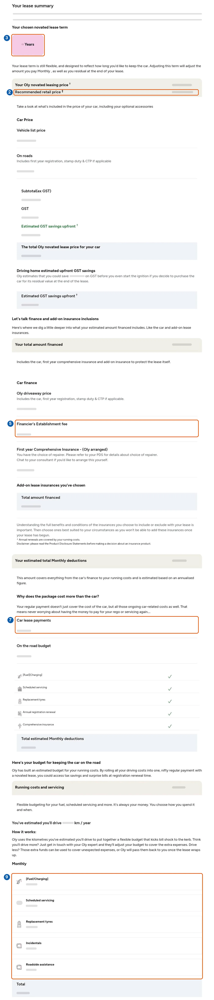
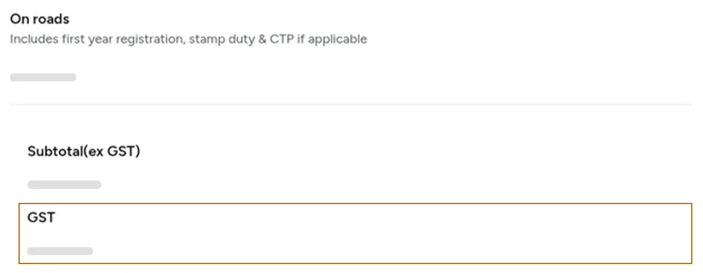

# How to read an Oly novated lease quote

<!-- quote-review:begin -->
*Checked against 2 quote examples; latest layout reviewed Nov 2026.*
<!-- quote-review:end -->

This numbered example shows an Oly quote layout we reviewed. Match each marker to the table, then check the period and GST label on your own quote.

<!-- provider-traps:begin -->
## What catches people out on an Oly quote

- **Drive-away price:** Don’t use “Oly driveaway price”: it has the GST saving taken off. Use “Recommended retail price” if it includes all on-road charges.
<!-- provider-traps:end -->

*Customer values and identifying details removed. Your quote may use a different layout.*

## Numbered field guide

<!-- provider-table:begin -->
| # | On the quote | In Guided |
|---|---|---|
| 2 | Recommended retail price (shown struck out) | On this example it reconciles to the on-road price including GST. Check that the figure on your own quote includes all on-road charges; otherwise use the dealer's full drive-away price. "Your Oly novated leasing price" / "Oly driveaway price" has the GST saving taken off. |
| 3 | Your chosen novated lease term | Lease term |
| 5 | Financier's Establishment fee | Enter “Financier's Establishment fee” under “Car finance”. Add-on insurances go in the next box. |
| 7 | Car lease payments | Finance payment, per month (the page says "Monthly"). No GST label: choose "I'm not sure" unless your quote says. |
| 9 | Monthly running-cost budget lines | Running-cost boxes, per month. Incidentals and roadside → Servicing. |
<!-- provider-table:end -->

## Residual, at the end of the estimate

*The last section of the same estimate, with figures removed.*

| # | On the quote | In Guided |
|---|---|---|
| 6 | Your total residual value (after lease term) | Residual, *Including GST*. On both Oly estimates we checked it equalled the ATO minimum on Oly's ex-GST price, plus GST. |

## First-year insurance

The Oly quote reviewed includes the first year's comprehensive insurance in the amount financed ("First year Comprehensive Insurance - (Oly arranged)"). Its footnote says annual renewals are covered by the running costs.

1. **Documentation fee:** enter "Financier's Establishment fee" only. Enter any "Add-on lease insurances you've chosen" in the separate covers question, added together. Don't add the first-year insurance to either. Answer **Yes** to the separate first-year insurance question and enter "First year Comprehensive Insurance" there. Both amounts enter the financed amount used for the effective interest rate.
2. **Insurance running cost:** enter "Comprehensive Insurance" under "Registration and car insurances" as printed. It budgets the renewals only. Guided adds the financed first year back, so paying cash is compared with a full year of insurance every year and the lease counts year one once, through the finance payment.

Not shown on this sample: **8 luxury vehicle adjustment**, **11 interest rate**.

<!-- provider-missing:begin -->
## If a figure isn't on your quote

- **FBT base value:** Can't find it on your Oly quote? Multiply the “GST” line in the price breakdown by 11. Don't use “Estimated GST savings upfront”. Or add “Vehicle list price” and “Dealer delivery charges”, then add 10%.

  
- **Months deferred:** Can’t find months deferred on your Oly quote? Choose “Not sure” (we’ll assume 2) unless told otherwise.
- **Management fees:** Can’t find a management fee on your Oly quote? Leave this at $0 unless yours lists one.
<!-- provider-missing:end -->

[Open Guided mode →](/calculator/) · [All provider quote guides →](/start-here/provider-quote-guides/)
