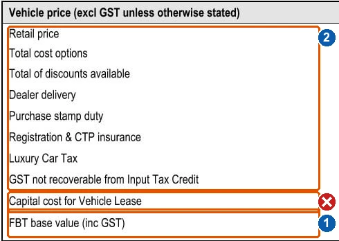
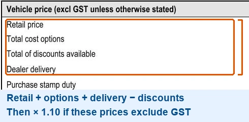
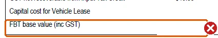

# How to read an ORIX novated lease quote

<!-- quote-review:begin -->
*Checked against 4 quote examples; latest layout reviewed Nov 2026.*
<!-- quote-review:end -->

We checked an [ORIX petrol-car quote from September 2025](https://www.reddit.com/r/NovatedLeasingAU/comments/1nnfgrg/), two EV quotes ([September 2026](https://www.reddit.com/r/NovatedLeasingAU/comments/1wb57rl/), [November 2026](https://www.reddit.com/r/NovatedLeasingAU/comments/1xo5ufn/)), and a [November comparison quote](https://www.reddit.com/r/NovatedLeasingAU/comments/1xp2oq9/). The petrol quote prints a nonzero FBT base value. The EV quotes print $0.00 in that field despite showing vehicle prices. None of these ORIX screenshots prints a single drive-away total.

<!-- provider-traps:begin -->
## What catches people out on an ORIX quote

- **FBT base value:** Use printed FBT base (inc GST) if nonzero. If $0, add retail, options and delivery, subtract discounts, then add GST. Confirm.
- **Drive-away price:** No total printed? Add GST to the car-price rows, then add on-road costs. Confirm the result with ORIX or the dealer.
<!-- provider-traps:end -->

*An excerpt from the September 2025 quote. Field 1 is a printed nonzero FBT base value. Field 2 highlights the parts of an on-road price; the red cross marks “Capital cost for Vehicle Lease”, which is not a GST-inclusive drive-away total. All quoted amounts and identifying details were removed.*

*For ex-GST car-price rows, add retail, options and delivery, then subtract the discount and multiply by 1.10. If the discount already has a minus sign, add that signed amount instead; do not subtract it twice. Stamp duty sits outside the box.*

*A different ORIX EV quote incorrectly printed $0.00 for FBT base value. FBT exemption does not make the car's base value zero. Estimate it from the car-price rows, then ask ORIX to confirm.*

*The agreement page comes from the November comparison quote. Customer values and identifying details removed. Your quote may use a different layout.*

## Numbered field guide

<!-- provider-table:begin -->
| # | On the quote | In Guided |
|---|---|---|
| 1 | FBT base value (inc GST), when nonzero | FBT base value, including GST. If ORIX prints $0.00, estimate it from the vehicle-price rows and ask ORIX to confirm. |
| 2 | Vehicle price table, if there is no printed drive-away total | Add the GST-inclusive car price and on-road costs as a check, then confirm the total with ORIX or the dealer. “Capital cost for Vehicle Lease” is not the drive-away total. |
| 3 | Term (months) | Lease term |
| 5 | "Other Fees" paragraph or fine print (e.g. Non-Appointed Dealer Fee, Establishment Fee) | Documentation fee, ex GST. Check whether it is capitalised into the lease rental. |
| 6 | Residual value (ex GST) | If you see “Residual value (ex GST)”, choose Excluding GST. |
| 7 | Lease Rental (Charge (Monthly)) | Finance payment, per month. Check your quote's GST heading and footnote before choosing the GST basis. |
| 8 | Luxury vehicle non-deductible (if applicable) | Luxury vehicle adjustment, per month |
| 9 | Maintenance, Tyres, Energy, Comprehensive insurance, Registration renewal | Running-cost boxes, per month, ex GST |
| 10 | ORIX management fee | Lease management fees |
| 11 | Interest Rate | Compare with the effective rate Guided shows |
<!-- provider-table:end -->

One reviewed agreement page says “Unless clearly stated otherwise … exclusive of GST”. Check that footnote and the headings on your own quote before choosing the payment's GST basis.

**ORIX is wrong to label the FBT base value as $0.00 on the reviewed EV quotes.** An eligible EV can be exempt from FBT, but that exemption does not erase the car's cost-based FBT base value. The [ATO says](https://www.ato.gov.au/businesses-and-organisations/hiring-and-paying-your-workers/fringe-benefits-tax/types-of-fringe-benefits/fbt-on-cars-other-vehicles-parking-and-tolls/electric-cars-exemption) an exempt EV benefit can still require a *notional taxable value* for reportable fringe benefits. To estimate the base value when ORIX prints $0.00, start with **retail price + options + dealer delivery − discount**. If the quote prints the discount as a negative amount, add that signed amount instead of subtracting it twice. If those rows are labelled excluding GST, multiply their *net total* by **1.10**. Do not add GST to the retail row alone. Do not include stamp duty or registration/CTP. The pictured petrol quote's nonzero printed FBT value reconciles this way. The [ATO's car base-value guidance](https://www.ato.gov.au/businesses-and-organisations/hiring-and-paying-your-workers/fringe-benefits-tax/types-of-fringe-benefits/fbt-on-cars-other-vehicles-parking-and-tolls/cars-and-fbt/taxable-value-of-a-car-fringe-benefit) includes GST in the car's cost price and excludes registration and stamp duty. Ask ORIX to confirm the estimate on your quote.

To check a **drive-away price**, add purchase stamp duty and registration/CTP to that GST-inclusive car subtotal. The “GST not recoverable from Input Tax Credit” row also adds into ORIX's printed *capital cost*, but the quote does not explain whether it belongs in the dealer's drive-away price or is a separate financed cost. Ask ORIX which it is; count it once in the right place. [ATO guidance](https://www.ato.gov.au/law/view/pdf/adhoc-sgml/gstir-motor%20vehicle-ch11.pdf) says CTP insurance can include GST while government registration and stamp duty do not, but that does not identify this ORIX charge. **This is a check from the rows, not a drive-away price printed by ORIX.** Confirm the final on-road price with ORIX or the dealer, especially if luxury car tax or a different GST treatment appears. Guided's residual-based helper remains available when no total is printed.

In the [November sanity-check thread](https://www.reddit.com/r/NovatedLeasingAU/comments/1xo5ufn/sanity_check/), the poster later found an establishment fee in the quote's fine print. It explained a gap between the printed capital cost and the base implied by the residual. Check for such a fee on your own quote and ask ORIX whether it is financed and included in the residual calculation. That quote also labels a *discount rate*; it does not establish that the rate equals the effective interest rate calculated from the payments. Ask ORIX for the rate definition and repayment schedule if the figures differ.

<!-- provider-missing:begin -->
## If a figure isn't on your quote

- **Months deferred:** Can’t find months deferred on your ORIX quote? Choose “Not sure” (we’ll assume 2) unless told otherwise.
<!-- provider-missing:end -->

[Open Guided mode →](/calculator/) · [All provider quote guides →](/start-here/provider-quote-guides/)
