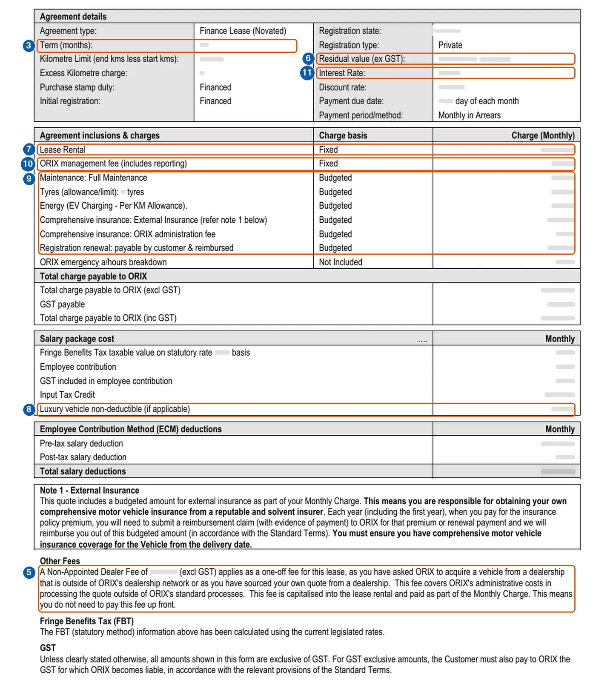

# How to read an ORIX novated lease quote

<!-- quote-review:begin -->
*Checked against 4 quote examples; latest layout reviewed Nov 2026.*
<!-- quote-review:end -->

We checked an [ORIX petrol-car quote from September 2025](https://www.reddit.com/r/NovatedLeasingAU/comments/1nnfgrg/), two EV quotes ([September 2026](https://www.reddit.com/r/NovatedLeasingAU/comments/1wb57rl/), [November 2026](https://www.reddit.com/r/NovatedLeasingAU/comments/1xo5ufn/)), and a [November comparison quote](https://www.reddit.com/r/NovatedLeasingAU/comments/1xp2oq9/). The petrol quote prints a nonzero FBT base value. The EV quotes print $0.00 in that field despite showing vehicle prices. None of these ORIX screenshots prints a single drive-away total.

<!-- provider-traps:begin -->
## What catches people out on an ORIX quote

- **FBT base value:** Use “FBT base value (inc GST)” when more than $0. If your EV quote says $0, ask ORIX for the real value.
- **Drive-away price:** No total printed? Ask ORIX or the dealer for the on-road price including GST. Don't use “Capital cost for Vehicle Lease”.
<!-- provider-traps:end -->

*An excerpt from the September 2025 quote. Field 1 is a printed nonzero FBT base value. Field 2 highlights the parts of an on-road price; the red cross marks “Capital cost for Vehicle Lease”, which is not a GST-inclusive drive-away total. All quoted amounts and identifying details were removed.*

*A different ORIX EV quote printed $0.00 for FBT base value. That is not the car's actual base value; ask ORIX for the figure.*

*The agreement page comes from the November comparison quote. Customer values and identifying details removed. Your quote may use a different layout.*

## Numbered field guide

<!-- provider-table:begin -->
| # | On the quote | In Guided |
|---|---|---|
| 1 | FBT base value (inc GST), when nonzero | FBT base value, including GST. Do not copy a $0.00 placeholder from an EV quote. |
| 2 | Vehicle price table, if there is no printed drive-away total | Ask ORIX or the dealer for the full on-road price including GST. The marked rows can help check it; “Capital cost for Vehicle Lease” is not the drive-away total. |
| 3 | Term (months) | Lease term |
| 5 | "Other Fees" paragraph (e.g. Non-Appointed Dealer Fee, Establishment Fee) | Documentation fee, ex GST. It's capitalised into the lease rental, so it belongs in the amount financed |
| 6 | Residual value (ex GST) | If you see “Residual value (ex GST)”, choose Excluding GST. |
| 7 | Lease Rental (Charge (Monthly)) | Finance payment, per month. Check your quote's GST heading and footnote before choosing the GST basis. |
| 8 | Luxury vehicle non-deductible (if applicable) | Luxury vehicle adjustment, per month |
| 9 | Maintenance, Tyres, Energy, Comprehensive insurance, Registration renewal | Running-cost boxes, per month, ex GST |
| 10 | ORIX management fee | Lease management fees |
| 11 | Interest Rate | Compare with the effective rate Guided shows |
<!-- provider-table:end -->

One reviewed agreement page says “Unless clearly stated otherwise … exclusive of GST”. Check that footnote and the headings on your own quote before choosing the payment's GST basis.

For the pictured petrol quote, the printed FBT base value matches **(retail price + options − discounts + dealer delivery) × 1.10**. The quote says those rows exclude GST. The [ATO's car base-value guidance](https://www.ato.gov.au/businesses-and-organisations/hiring-and-paying-your-workers/fringe-benefits-tax/types-of-fringe-benefits/fbt-on-cars-other-vehicles-parking-and-tolls/cars-and-fbt/taxable-value-of-a-car-fringe-benefit) includes GST in the car's cost price but excludes registration and stamp duty.

The same table can help check a drive-away figure: start with the GST-inclusive car price, then add the quoted purchase stamp duty, registration and CTP, plus any separately listed “GST not recoverable”. **This is a calculation from the rows, not a drive-away price printed by ORIX.** Ask ORIX or the dealer to confirm the final on-road price, especially if luxury car tax or a different GST treatment appears. You can also use Guided's residual-based helper when no total is available.

<!-- provider-missing:begin -->
## If a figure isn't on your quote

- **Months deferred:** Can’t find months deferred on your ORIX quote? Choose “Not sure” (we’ll assume 2) unless told otherwise.
<!-- provider-missing:end -->

[Open Guided mode →](/calculator/) · [All provider quote guides →](/start-here/provider-quote-guides/)
