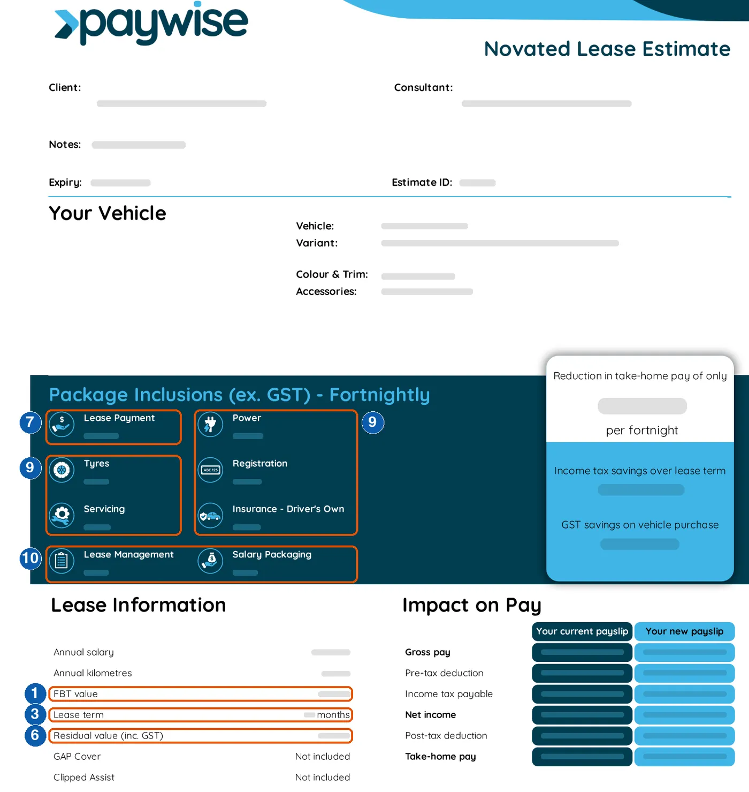

# How to read a Paywise novated lease quote

<!-- quote-review:begin -->
*Checked against 1 quote example; latest layout reviewed Nov 2026.*
<!-- quote-review:end -->

The Paywise layout we reviewed puts the finance payment under **Package Inclusions (ex. GST) – Fortnightly**. It also shows separate **Lease Management** and **Salary Packaging** fees.

<!-- provider-traps:begin -->
## What catches people out on a Paywise quote

Nothing on the Paywise quotes we checked looked easy to misread. The table below shows where each figure is.
<!-- provider-traps:end -->

*Quote-page example with customer values and identifying details removed. Match the blue numbers to the table below; your layout may differ.*

<!-- provider-table:begin -->
| # | Guided field | Look for on the quote | What to enter |
| --- | --- | --- | --- |
| 1 | FBT base value | **FBT value** | The value as printed, including GST. |
| — | Drive-away price | It may not be printed as one total | Use Guided's price helper or your dealer's full drive-away price. |
| — | Months deferred | It may not be stated | Choose *I'm not sure* unless your own quote or provider confirms it. |
| 6 | Residual | **Residual value (inc. GST)** | Choose *Including GST*. |
| 7 | Finance payment | **Lease Payment** under **Package Inclusions (ex. GST) – Fortnightly** | Use “Lease Payment” under “Package Inclusions (ex. GST) – Fortnightly”, not the package total. If you see “(ex. GST)”, choose Excluding GST. |
| 10 | Lease management fees | **Lease Management** and **Salary Packaging** | If you see separate “Lease Management” and “Salary Packaging” lines, add both under lease management fees using the quote's period. |
<!-- provider-table:end -->

<!-- provider-missing:begin -->
## If a figure isn't on your quote

- **Months deferred:** Can’t find months deferred on your Paywise quote? Choose “Not sure” (we’ll assume 2) unless told otherwise.
- **Documentation fee:** Can’t find a documentation or establishment fee on your Paywise quote? Leave this at $0 unless yours lists one.
<!-- provider-missing:end -->

[Open Guided mode →](/calculator/) · [All provider quote guides →](/start-here/provider-quote-guides/)
