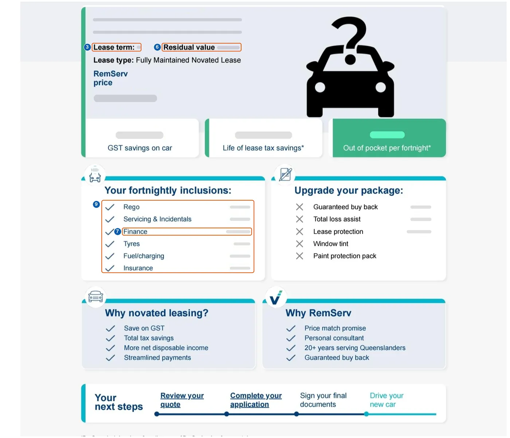
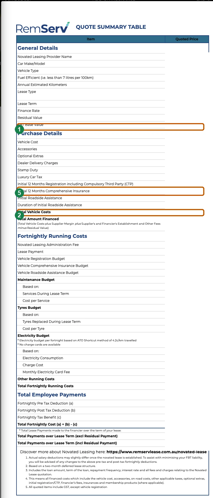
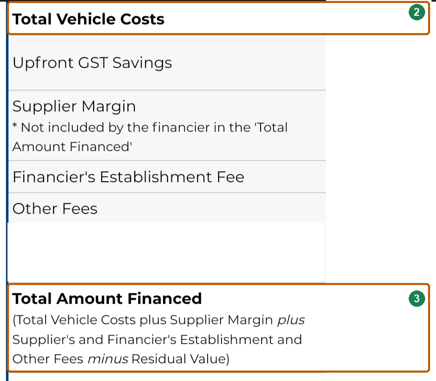
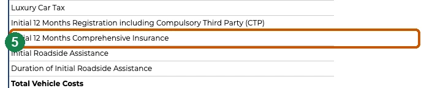
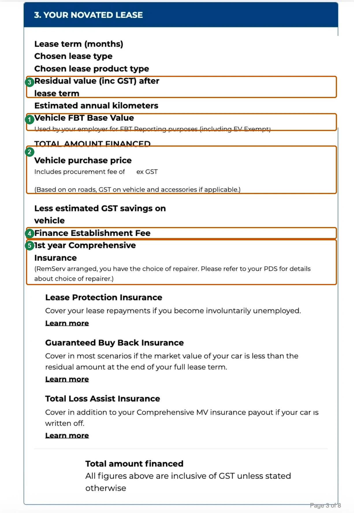
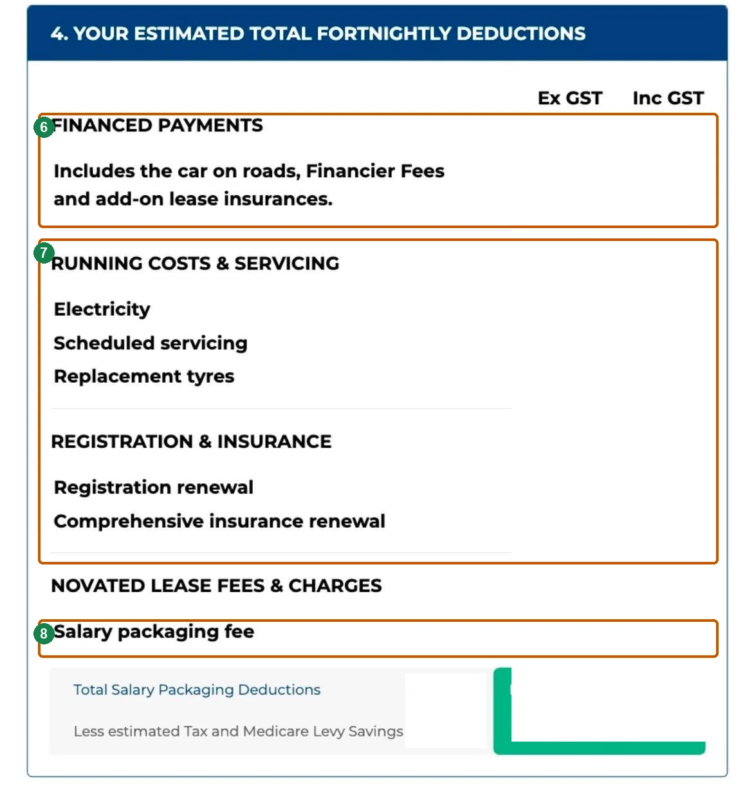

# How to read a RemServ novated lease quote

<!-- quote-review:begin -->
*Checked against 4 quote examples; latest layout reviewed Nov 2026.*
<!-- quote-review:end -->

RemServ quotes in the examples we reviewed use a short estimate, two styles of summary table and a detailed lease breakdown. Find the layout that looks like yours before choosing a figure. The same “Total Amount Financed” label does not mean the same thing on every layout.

<!-- provider-traps:begin -->
## What catches people out on a RemServ quote

- **Drive-away price:** Summary: scroll to “Purchase Details”. Add on-road charges to “Vehicle Cost”. Don't use “Total Vehicle Costs”. Ask about gaps.
- **First-year insurance:** If “1st year Comprehensive Insurance” is in “Total Amount Financed”, answer Yes and enter it. Keep the renewal budget separate.
<!-- provider-traps:end -->

**Short estimate.** The numbered picture shows only part of RemServ's quote details.

The short estimate does not establish whether “RemServ price” includes every on-road charge, or whether its “Finance” line includes GST. Get the full quote or ask RemServ before treating either as a confirmed amount.

### Summary table

On the [summary-table example](https://www.reddit.com/r/NovatedLeasingAU/comments/1rpt6ql/quote_base_cost_doesnt_seem_competitive/), “FBT Base Value” is printed under General Details. For drive-away price, add “Vehicle Cost” and any separately printed accessories, extras, delivery, stamp duty, luxury car tax and initial rego/CTP. **Leave out “Initial 12 Months Comprehensive Insurance”.** “Total Vehicle Costs” includes that premium, so it is not the car's drive-away price.

In the newer summary, scroll **up to Purchase Details**. The box below covers the visible “Vehicle Cost” and on-road rows. The insurance row sits outside the box and is entered separately if financed. However, the posted screenshots skip a line between “Initial Roadside Assistance” and “Total Vehicle Costs”. The total is higher than the visible car-price and insurance rows added together. **The missing amount is unexplained, so this post does not establish the drive-away price.** Ask RemServ what the missing line is and request the full on-road price including GST before entering a figure.

Another [RemServ summary example](https://www.reddit.com/r/NovatedLeasingAU/comments/1x6eio8/gwm_ora_5_ultra_quote_check/) prints the same rows in a larger, split table. Its “Total Amount Financed” explicitly subtracts “Residual Value” from vehicle costs and fees. The earlier summary also prints this definition. **Do not use that net figure as the drive-away price or enter it as a separate loan amount in Guided:** the calculator takes the car price and residual separately. A net figure plus a separate residual can make the calculated interest rate misleadingly high.

The larger summary also has a “Supplier Margin” line. Its note says the financier excludes that margin from “Total Amount Financed”, while the formula under the total adds it. Those statements conflict. Check with RemServ whether the margin is financed before entering it as a one-off fee; count it only once. “Other Fees” may list optional add-on insurance, which belongs with other upfront fees if financed. Use the separate “Lease Payment” per fortnight for Guided's finance payment, not the “Total Amount Financed” line.

The table's final footnote says quoted items include GST except vehicle registration. Use that footnote to choose the matching GST answer for the residual and “Lease Payment”; the registration budget is entered as printed. The footnote also mentions a two-month deferred structure, but does not show a payment schedule. If you cannot confirm the number of skipped finance payments, choose “Not sure” for months deferred.

### Detailed lease breakdown

On the [detailed example](https://www.reddit.com/r/NovatedLeasingAU/comments/1t4254u/model_3_performance/), “Vehicle FBT Base Value”, “Vehicle purchase price”, “Residual value (inc GST)” and “Finance Establishment Fee” are printed separately. The purchase price is based on on-road costs. Enter “1st year Comprehensive Insurance” in Guided's separate financed first-year box; it is inside “Total amount financed”. The “Comprehensive insurance renewal” line on the deductions page goes in the running-cost insurance box. Guided counts the first year once.

The deductions page shows **Ex GST** and **Inc GST** columns. For “FINANCED PAYMENTS” and each running-cost line, use one column and select its matching GST answer. “Salary packaging fee” is the management fee. If optional lease protection, guaranteed buy back or total loss cover is selected and financed, include its upfront premium with the documentation fee. Do not enter “Total amount financed” or “Total Salary Packaging Deductions” as a single calculator field.

- **Residual:** If the full quote says “Residual value (inc GST)”, choose Including GST. The summary table's GST footnote also covers residual value.
- **Finance payment:** Use “FINANCED PAYMENTS” per fortnight on the full deductions page. Choose the “Ex GST” or “Inc GST” column to match what you enter.

*All images are based on real quotes with amounts and identifying details removed. Your quote may differ.*

## Short-estimate numbered field guide

<!-- provider-table:begin -->
| # | On the quote | In Guided |
|---|---|---|
| 3 | Lease term | Lease term |
| 6 | Residual value (no GST label) | Choose “I'm not sure” unless your full quote or RemServ confirms its GST basis. |
| 7 | Finance (fortnightly inclusion; no GST label) | Enter it per fortnight; choose “I'm not sure” for GST unless confirmed. |
| 9 | Fortnightly inclusions: Rego, Servicing & Incidentals, Tyres, Fuel/charging, Insurance | Running-cost boxes, per fortnight |
<!-- provider-table:end -->

On the **short estimate**, “Upgrade your package” items are optional and not included; leave them out. On the **detailed breakdown**, check whether those products are selected and financed before entering their cost.

Not shown on the short-estimate sample: **2 drive-away**, **8 luxury vehicle adjustment**, **11 interest rate**. The full layouts show more detail.

<!-- provider-missing:begin -->
## If a figure isn't on your quote

- **Months deferred:** Can’t find months deferred on your RemServ quote? Choose “Not sure” (we’ll assume 2) unless told otherwise.
<!-- provider-missing:end -->

[Open Guided mode →](/calculator/) · [All provider quote guides →](/start-here/provider-quote-guides/)
