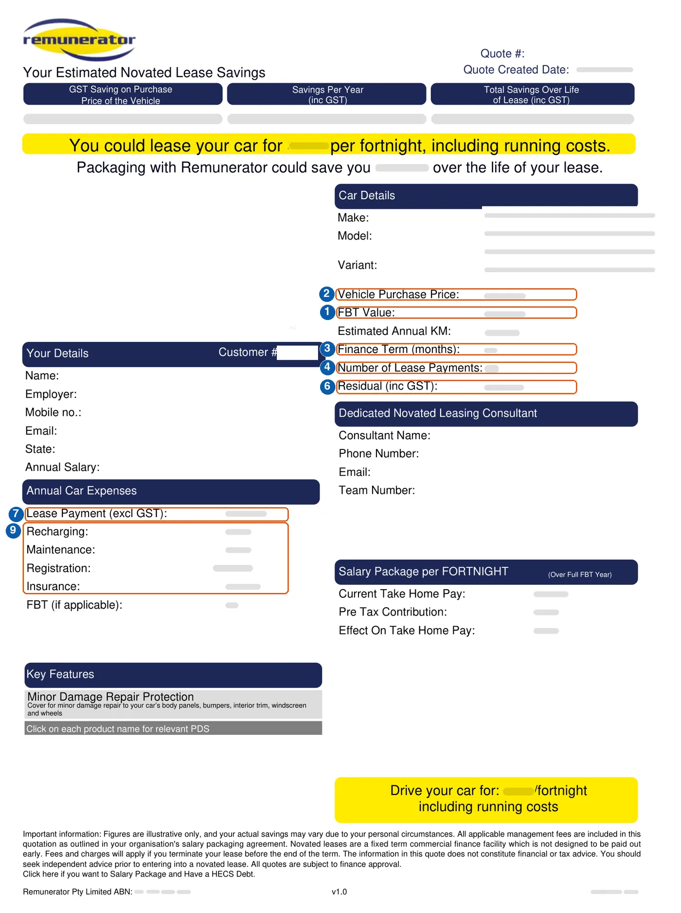

# How to read a Remunerator novated lease quote

<!-- quote-review:begin -->
*Checked against 3 quote examples; latest layout reviewed Nov 2026.*
<!-- quote-review:end -->

This Remunerator example prints a **Lease Payment (excl GST)** separately from the annual car expenses. Use that lease-payment line for finance; the highlighted headline amount includes running costs.

<!-- provider-traps:begin -->
## What catches people out on a Remunerator quote

- **Drive-away price:** “Vehicle Purchase Price” may omit on-road costs. Check it includes GST and all on-road charges before using it.
- **Finance payment:** If you see “Lease Payment (excl GST)” under “Annual Car Expenses”, it's a yearly total: choose “Per year (total)”.
<!-- provider-traps:end -->

*Customer values and identifying details removed. Your quote may use a different layout.*

<!-- provider-table:begin -->
| # | On this quote | In Guided mode |
| --- | --- | --- |
| 1 | FBT Value | FBT base value. |
| 2 | Vehicle Purchase Price | “Vehicle Purchase Price” may omit on-road costs. Check it includes GST and all on-road charges before using it. |
| 3 | Finance Term (months) | Lease term. |
| 4 | Number of Lease Payments | If you see “Number of Lease Payments: 59” on a 60-month term, that's a 1-month deferral. |
| 6 | Residual (inc GST) | Residual, *Including GST*. |
| 7 | Lease Payment (excl GST), under Annual Car Expenses | If you see “Lease Payment (excl GST)” under “Annual Car Expenses”, it's a yearly total: choose “Per year (total)”. |
| 9 | Recharging, maintenance, registration and insurance | Running-cost budgets. |
<!-- provider-table:end -->

The quote's effect on take-home pay is a different calculation; do not use it for the finance payment.

<!-- provider-missing:begin -->
## If a figure isn't on your quote

- **Documentation fee:** Can’t find a documentation or establishment fee on your Remunerator quote? Leave this at $0 unless yours lists one.
- **Management fees:** Remunerator's summary has no fee line and says management fees are included in its figures. Leave this at $0 unless your quote lists one.
<!-- provider-missing:end -->

[Open Guided mode →](/calculator/) · [All provider guides →](/start-here/provider-quote-guides/)
