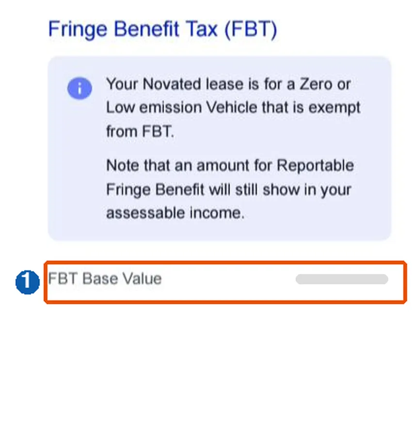
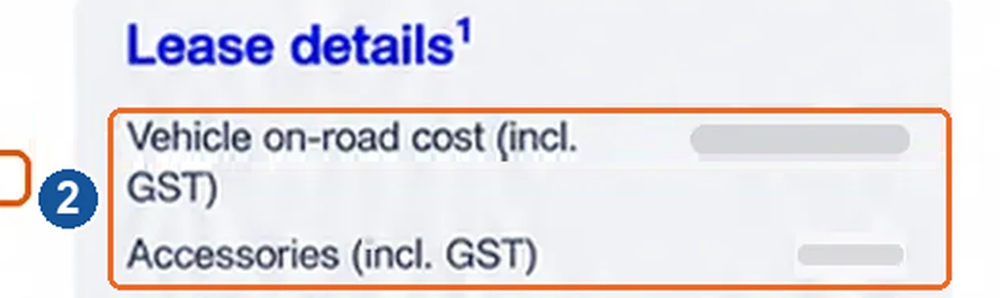
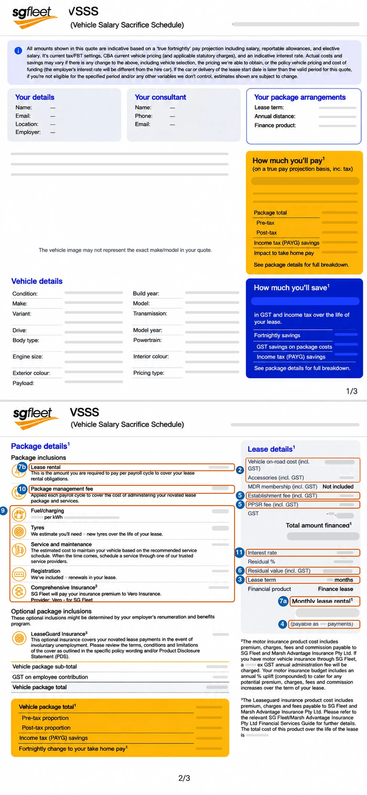

# How to read an SG Fleet novated lease quote

<!-- quote-review:begin -->
*Checked against 3 quote examples; latest layout reviewed Nov 2026.*
<!-- quote-review:end -->

SG Fleet layouts we reviewed show a per-pay **Lease rental** in Package details and a **Monthly lease rental** in Lease details. Use the per-pay **Lease rental**. The **Monthly lease rental** is paid fewer times than the lease has months ("payable as 34 payments" on 36 months), so entering it would overstate your rate.

## Where to find the FBT base value

The first two pages of the VSSS example below **do not show FBT Base Value**. Look for the **Fringe Benefit Tax (FBT)** section on a later page. This redacted crop is from a different SG Fleet *Indicative quote* layout and marks the line with **1**. Do not substitute **Vehicle on-road cost** for the FBT base value. If your quote has no such line, ask SG Fleet for it.

<!-- provider-traps:begin -->
## What catches people out on an SG Fleet quote

- **Finance payment:** Use “Lease rental” per pay. Don't use “Monthly lease rental”: it may cover fewer payments than the lease has months.
- **FBT base value:** Look for “FBT Base Value” in the FBT section, which may be on a later page. Don't use “Vehicle on-road cost”.
<!-- provider-traps:end -->

## Where to find the drive-away price

On the VSSS sample, go to **Lease details** on page 2. The line marked **2**, **Vehicle on-road cost (incl. GST)**, is the drive-away price. It is different from both FBT Base Value and Total amount financed.

## Other fields on the VSSS example

*Quote-page example with customer values and identifying details removed. Match the blue numbers to the table below; your layout may differ.*

<!-- provider-table:begin -->
| # | Guided field | Look for on the quote | What to enter |
| --- | --- | --- | --- |
| 1 (separate example above) | FBT base value | **FBT Base Value** in the **Fringe Benefit Tax (FBT)** section | Look for “FBT Base Value” in the FBT section, which may be on a later page. Don't use “Vehicle on-road cost”. |
| 2 | Drive-away price | **Vehicle on-road cost (incl. GST)** | Use “Vehicle on-road cost (incl. GST)” under “Lease details”. |
| 3 | Lease term | **Lease term** or the term in Package arrangements | The term shown on your quote. |
| 4 | Months deferred | **Monthly lease rental**, followed by **payable as … payments** | Subtract the number of payable months from the full term in months. If the count is unclear, choose *I'm not sure*. |
| 5 | Documentation fee | **Establishment fee** and **PPSR fee** in Lease details | Check both lines and their GST labels. |
| 6 | Residual | **Residual value (incl. GST)** | Choose *Including GST*. |
| 7a / 7b | Finance payment | Per-pay **Lease rental** in Package details (7b). Not the **Monthly lease rental** in Lease details (7a) | Use “Lease rental” per pay. Don't use “Monthly lease rental”: it may cover fewer payments than the lease has months. |
| 9 | Running costs | Package details, below Lease rental | Enter the budget lines using the period printed on your quote. Keep the package total and change to take-home pay out of the finance-payment box. |
<!-- provider-table:end -->

Check the finance payment's GST heading and footnotes on your own quote; the basis can vary by employer.

On weekly-pay quotes, both the lease rental and running costs may be shown **per week**. Choose *Per week* for each matching question in Guided mode.

[Open Guided mode →](/calculator/) · [All provider quote guides →](/start-here/provider-quote-guides/)
