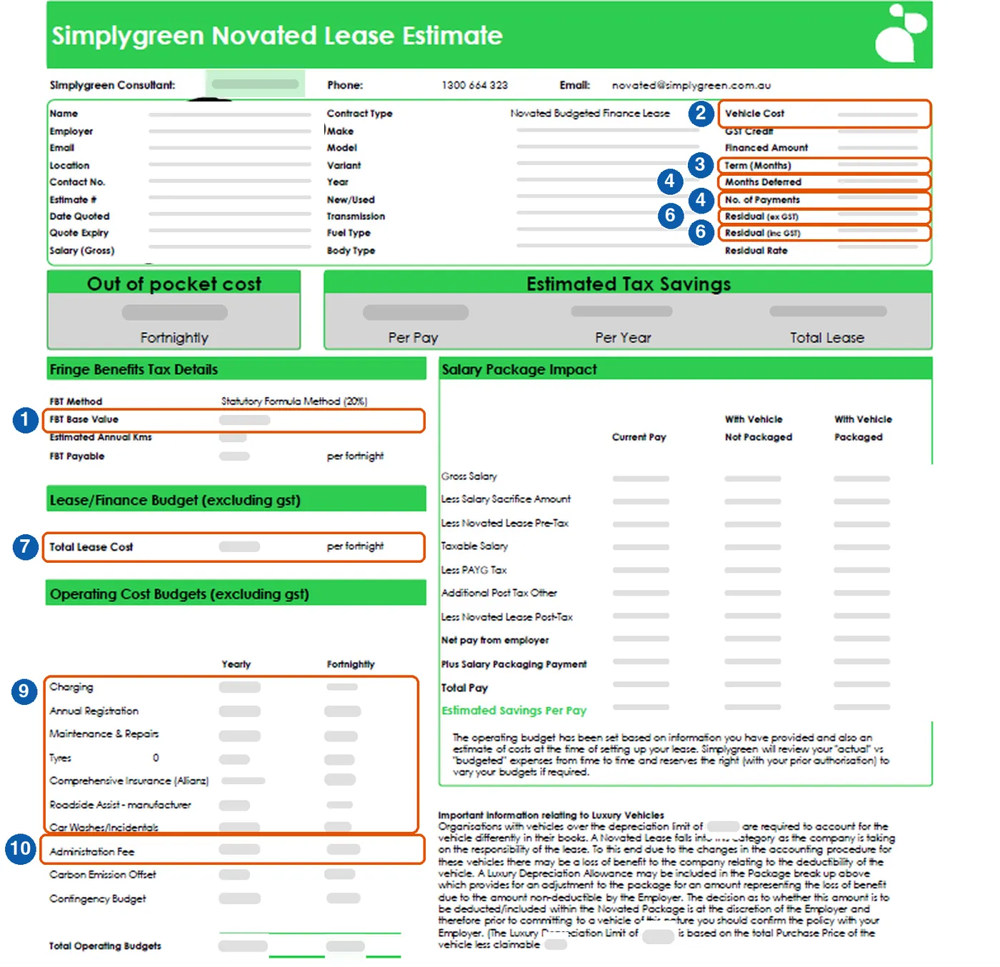

# How to read a Simplygreen novated lease quote

<!-- quote-review:begin -->
*Checked against 1 quote example; latest layout reviewed Nov 2026.*
<!-- quote-review:end -->

This numbered example shows a Simplygreen quote layout we reviewed. Match each marker to the table, then check the period and GST label on your own quote.

<!-- provider-traps:begin -->
## What catches people out on a Simplygreen quote

Nothing on the Simplygreen quotes we checked looked easy to misread. The table below shows where each figure is.
<!-- provider-traps:end -->

*Customer values and identifying details removed. Your quote may use a different layout.*

## Numbered field guide

<!-- provider-table:begin -->
| # | On the quote | In Guided |
|---|---|---|
| 1 | FBT Base Value | FBT base value |
| 2 | Vehicle Cost (top-right block, above GST Credit and Financed Amount) | Use “Vehicle Cost”, the line before “GST Credit” and “Financed Amount”. Check that it includes GST. |
| 3 | Term (Months) | Lease term |
| 4 | Months Deferred; No. of Payments | Use “Months Deferred” as printed. If only “No. of Payments” appears, subtract it from the lease term in months. |
| 6 | Residual (ex GST) and Residual (inc GST) | Residual: enter either, with the matching GST answer |
| 7 | Total Lease Cost, per fortnight, under "Lease/Finance Budget (excluding gst)" | If you see “Total Lease Cost” under “Lease/Finance Budget (excluding gst)”, enter that figure excluding GST in the period shown. |
| 9 | Operating Cost Budgets (excluding gst): Charging to Car Washes/Incidentals, yearly and fortnightly | Running-cost boxes, ex GST, in whichever period you use. Roadside and car washes go in Servicing |
| 10 | Administration Fee | Lease management fees |
<!-- provider-table:end -->

Below the numbered box: "Carbon Emission Offset" is optional (include only if you're keeping it),
and "Contingency Budget" is a refundable buffer, so leave it out.

Not shown on this sample: **5 documentation fee**, **8 luxury vehicle adjustment** (the page has a general
note about cars above the depreciation limit, not a figure), **11 interest rate**.

[Open Guided mode →](/calculator/) · [All provider quote guides →](/start-here/provider-quote-guides/)
