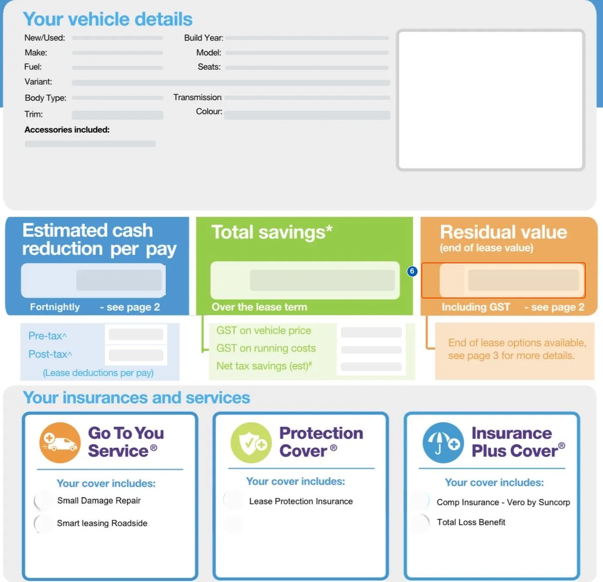
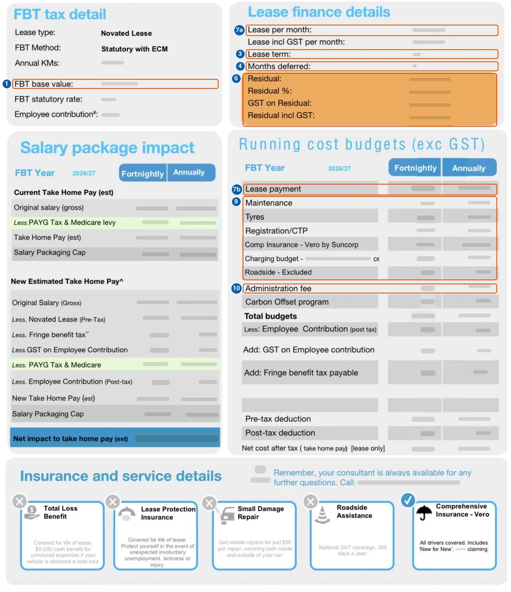
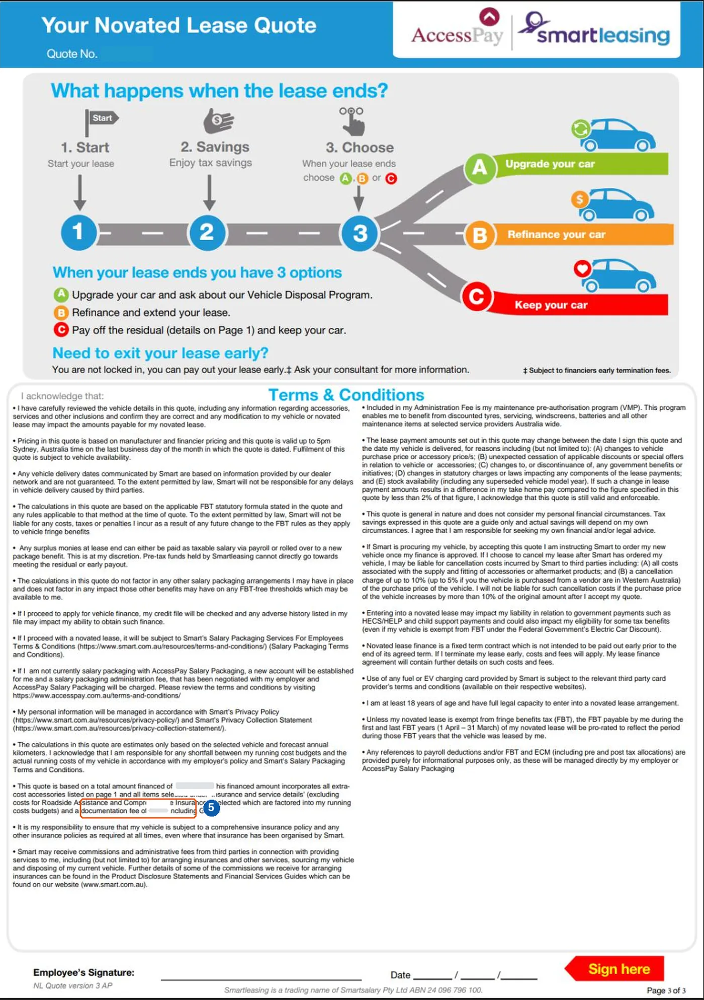

# How to read a Smart Leasing novated lease quote

<!-- quote-review:begin -->
*Checked against 4 quote examples; latest layout reviewed Nov 2026.*
<!-- quote-review:end -->

These two pages come from the same [Smart Leasing quote shared in November 2026](https://www.reddit.com/r/NovatedLeasingAU/comments/1xocshn/). Page 1 shows the vehicle and payment summary; page 2 shows the FBT, finance and running-cost details. Its third page was not shared. A **terms page from another quote** appears below. On page 2, **Lease per month** can be entered as printed with *Per month*. The fortnightly lease payment may include a budget reserve; use Guided's correction tool if you choose that figure.

<!-- provider-traps:begin -->
## What catches people out on a Smart Leasing quote

- **Finance payment:** Use “Lease payment” or “Lease per month”, then run the correction tool. Both need it.
<!-- provider-traps:end -->

*Both available pages have customer values and vehicle details removed. Match the blue numbers to the table below; your layout may differ.*

<!-- provider-table:begin -->
| # | Guided field | Look for on the quote | What to enter |
| --- | --- | --- | --- |
| 1 | FBT base value | **FBT base value** | The value as printed, including GST. |
| 3 | Lease term | **Lease term** | Use the months shown. |
| — | Drive-away price | **Not shown on either available page** | Use the dealer's full on-road price including GST. If you do not have it, use Guided's residual-based helper or add up the vehicle price and on-road charges from other pages. Do not use FBT base value, a GST saving or a lease payment as the drive-away total. |
| 4 | Months deferred | **Months deferred** | If you see “Months deferred”, use that number. |
| 5 | Documentation fee | **Documentation fee** in the terms page of another quote below | Look for “documentation fee” on the terms page. If it includes GST, divide by 1.1. |
| 6 | Residual | **Residual** and **Residual incl GST** | Either figure works if you choose its matching GST answer. |
| 7a / 7b | Finance payment | **Lease per month** or **Lease incl GST per month** | Enter either the monthly figure or the fortnightly lease payment, with its matching GST answer, then run the Smart Leasing correction tool. Both need it. |
| 9 | Running costs | **Running Cost Budgets (exc GST)** | Use the period shown for those budget lines and choose *Excluding GST*. |
| 10 | Lease management fees | **Administration fee** | Enter this in the same period as the running-cost budgets. |
<!-- provider-table:end -->

Some Queensland Government quotes use a different template. In particular, check the GST basis of **Total lease payment (Finance payment)** on your own quote rather than assuming it matches the monthly layout above.

## A terms page from another Smart Leasing quote

This [separate November 2026 quote](https://www.reddit.com/r/NovatedLeasingAU/comments/1xs7vho/) includes its page 3. It shows end-of-lease options and a **Terms & Conditions** section. The clause marked **5** states the total amount financed and a documentation fee. The financed amount is **not** the drive-away price. This page belongs to a different customer quote from the two pages above.

*Quote number and figures removed. Your terms may differ.*

<!-- provider-missing:begin -->
## If a figure isn't on your quote

- **Drive-away price:** Smart Leasing quotes don't show a drive-away total. Get it from your car invoice, or work it out from the residual. Use the dealer's full on-road price including GST. Do not substitute FBT base value, a GST saving or a lease payment.
<!-- provider-missing:end -->

[Open Guided mode →](/calculator/) · [All provider quote guides →](/start-here/provider-quote-guides/)
