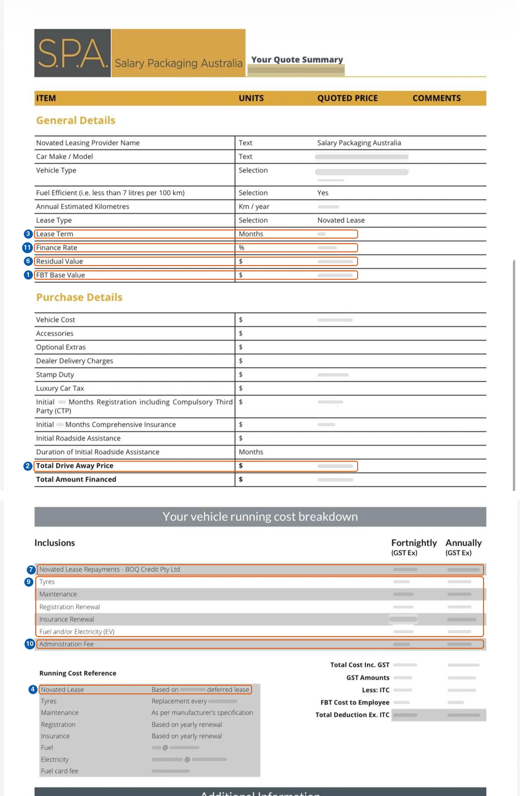

# How to read a Salary Packaging Australia (S.P.A.) novated lease quote

<!-- quote-review:begin -->
*Checked against 1 quote example; latest layout reviewed Nov 2026.*
<!-- quote-review:end -->

This numbered example shows a Salary Packaging Australia (S.P.A.) quote layout we reviewed. Match each marker to the table, then check the period and GST label on your own quote.

<!-- provider-traps:begin -->
## What catches people out on a Salary Packaging Australia (S.P.A.) quote

- **Drive-away price:** Use “Total Drive Away Price” including GST. Don’t use “Novated lease purchase price (excluding GST)”.
- **FBT base value:** If you see “Vehicle cost”, don't use it as the FBT base value: on this layout it means the drive-away price.
<!-- provider-traps:end -->

*Customer values and identifying details removed. Your quote may use a different layout.*

## Numbered field guide

<!-- provider-table:begin -->
| # | On the quote | In Guided |
|---|---|---|
| 1 | FBT Base Value | If you see “Vehicle cost”, don't use it as the FBT base value: on this layout it means the drive-away price. |
| 2 | Total Drive Away Price | Use “Total Drive Away Price” including GST. Don’t use “Novated lease purchase price (excluding GST)”. |
| 3 | Lease Term (Months) | Lease term |
| 4 | Running Cost Reference: "Novated Lease – Based on N-month deferred lease" | If you see “Based on 2-month deferred lease”, choose 2 months deferred. |
| 6 | Residual Value | Residual, "Including GST" (page 2 prints the same figure "inc GST") |
| 7 | Novated Lease Repayments – BOQ Credit Pty Ltd, Fortnightly (GST Ex) | Finance payment, per fortnight, **Excluding GST** |
| 9 | Tyres, Maintenance, Registration Renewal, Insurance Renewal, Fuel and/or Electricity | Running-cost boxes, per fortnight, ex GST ("GST Ex" heading) |
| 10 | Administration Fee | Lease management fees |
| 11 | Finance Rate | Compare with the effective rate Guided shows |
<!-- provider-table:end -->

On Queensland Government layouts, “Vehicle Cost” can equal the drive-away price. Check it against “Total Drive Away Price” before entering it.

The "Less: ITC" line under the totals is the employer's GST credit on running costs; with the
running costs already shown ex GST, choose "Excluding GST" for the running-cost heading.

Not shown on this sample: **5 documentation fee** (none shown on these pages) and **8 luxury vehicle adjustment**.

[Open Guided mode →](/calculator/) · [All provider quote guides →](/start-here/provider-quote-guides/)
