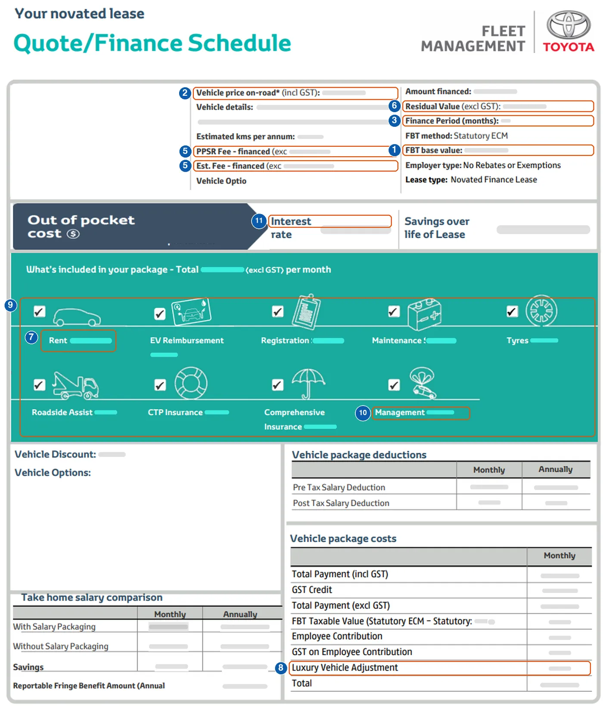

# How to read a Toyota Fleet Management novated lease quote

<!-- quote-review:begin -->
*Checked against 1 quote example; latest layout reviewed Oct 2026.*
<!-- quote-review:end -->

This Quote/Finance Schedule has an on-road vehicle price including GST and a residual excluding GST. The package section shows **Rent** under a monthly, excluding-GST heading.

<!-- provider-traps:begin -->
## What catches people out on a Toyota Fleet Management quote

Nothing on the Toyota Fleet Management quotes we checked looked easy to misread. The table below shows where each figure is.
<!-- provider-traps:end -->

*Customer values and identifying details removed. Your quote may use a different layout.*

<!-- provider-table:begin -->
| # | On this quote | In Guided mode |
| --- | --- | --- |
| 1 | FBT base value | FBT base value. |
| 2 | Vehicle price on-road (incl GST) | If you see “Vehicle price on-road* (incl GST)”, that's the drive-away price. |
| 3 | Finance Period (months) | Lease term. |
| 5 | PPSR Fee and Est. Fee, both financed | Add as one-off documentation fees, noting the printed GST basis. |
| 6 | Residual Value (excl GST) | If you see “Residual Value (excl GST)”, choose Excluding GST. |
| 7 | Rent, package inclusions | If you see “Rent” under a monthly “(excl GST)” heading, enter it per month, excluding GST. |
| 8 | Luxury Vehicle Adjustment | Enter it if the quote shows an amount for your car. |
| 9 | EV reimbursement, registration, maintenance, tyres and insurance | Running-cost budgets in the matching period. |
| 10 | Management | Lease management fee. |
| 11 | Interest rate | Compare with Guided's effective-rate result. |
<!-- provider-table:end -->

Do not use the package total or salary deduction as the finance payment.

<!-- provider-missing:begin -->
## If a figure isn't on your quote

- **Months deferred:** Can’t find months deferred on your Toyota Fleet Management quote? Choose “Not sure” (we’ll assume 2) unless told otherwise.
<!-- provider-missing:end -->

[Open Guided mode →](/calculator/) · [All provider guides →](/start-here/provider-quote-guides/)
