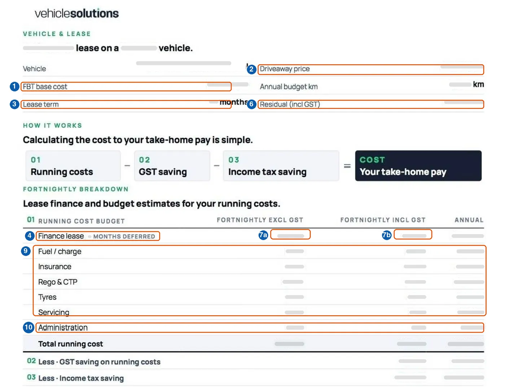

# How to read a Vehicle Solutions novated lease quote

<!-- quote-review:begin -->
*Checked against 1 quote example; latest layout reviewed Sep 2026.*
<!-- quote-review:end -->

This numbered example shows a Vehicle Solutions quote layout we reviewed. Match each marker to the table, then check the period and GST label on your own quote.

<!-- provider-traps:begin -->
## What catches people out on a Vehicle Solutions quote

Nothing on the Vehicle Solutions quotes we checked looked easy to misread. The table below shows where each figure is.
<!-- provider-traps:end -->

*Customer values and identifying details removed. Your quote may use a different layout.*

## Numbered field guide

<!-- provider-table:begin -->
| # | On the quote | In Guided |
|---|---|---|
| 1 | FBT base cost | FBT base value |
| 2 | Driveaway price | Use “Driveaway price” in “Vehicle & lease”, including GST. |
| 3 | Lease term | Lease term |
| 4 | Finance lease "N MONTHS DEFERRED" | Use the number before “MONTHS DEFERRED” on the Finance lease line. |
| 6 | Residual (incl GST) | If you see “Residual (incl GST)”, choose Including GST. |
| 7a | Finance lease, FORTNIGHTLY EXCL GST column | If EXCL GST and INCL GST finance-lease columns sit side by side, enter either fortnightly figure with its matching GST answer. |
| 7b | Finance lease, FORTNIGHTLY INCL GST column | Or this one, per fortnight, including GST. Either works with the matching GST answer |
| 9 | Fuel / charge, Insurance, Rego & CTP, Tyres, Servicing | Running-cost boxes; the quote shows ex GST, inc GST and annual columns, so pick the period and GST heading you copy from |
| 10 | Administration | Lease management fees |
<!-- provider-table:end -->

Not shown on this sample: **5 documentation fee**, **8 luxury vehicle adjustment**, **11 interest
rate** (not printed).

[Open Guided mode →](/calculator/) · [All provider quote guides →](/start-here/provider-quote-guides/)
